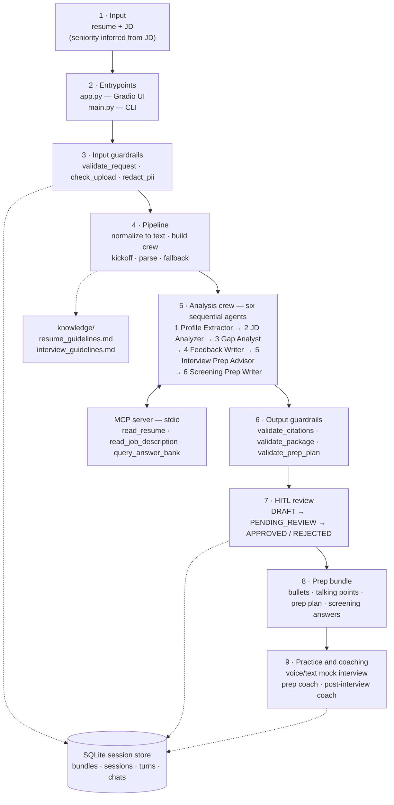
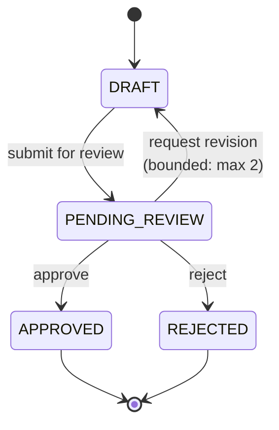
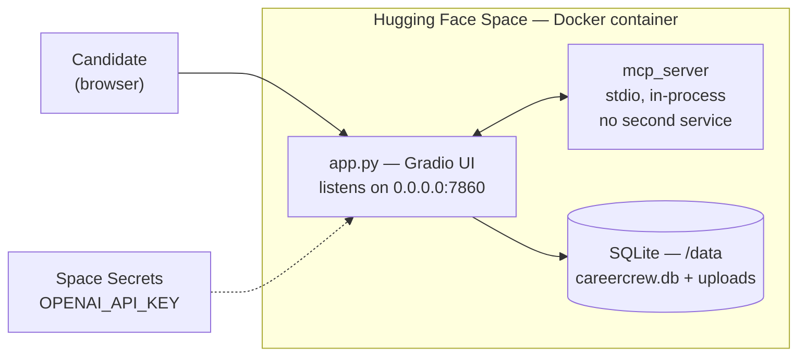

# CareerCrew architecture

> This file has one job: explain how the system is put together.
>
> - Product scope and users: `docs/engineering/product-overview.md`
> - Requirements and evidence: `docs/engineering/functional-nonfunctional-requirements.md`
> - Setup and run instructions: `docs/engineering/setup.md`
> - Tests and release gates: `docs/engineering/testing-and-release.md`
> - Agent and task details: `docs/engineering/agents-and-workflows.md`
> - Use cases and user stories: `docs/engineering/use-cases-and-user-stories.md`

## 1. System overview

A user provides a resume (file or pasted text) and a job description (file or
pasted text). Seniority is inferred from the JD, and the screening questions come
from the verified answer bank. Six agents run in a fixed
sequence and produce cited feedback plus a seniority-aware interview
preparation plan and copy-ready screening answers. On top of that, a voice
**mock interviewer** runs a practice interview with a live transcript and
per-question feedback, and two **coaching chats** answer follow-up questions.

Every claim in the output must trace to a resume fact or a verified
answer-bank entry; the system says "do not claim" rather than invent facts.
**Nothing is submitted anywhere** - CareerCrew prepares and practices; the
candidate applies.

## 2. Component legend

| Node | Component | Responsibility |
|---|---|---|
| `S2` | `app.py`, `main.py` | Gradio web interface and CLI entrypoints. |
| `S3` | `careercrew/guardrails.py` | Pre-LLM checks: exactly one resume/JD source, upload type and size, injection patterns, PII redaction. |
| `S4` | `careercrew/pipeline.py` | Normalizes inputs to text, kicks off the crew, parses/validates outputs, and runs deterministic fallbacks. |
| `S5` | `careercrew/crew.py` | Turns `config/*.yaml` into a running sequential crew with MCP tools and knowledge sources. |
| `1`–`6` | `config/agents.yaml`, `config/tasks.yaml` | The six sequential agents and their tasks (details in `docs/engineering/agents-and-workflows.md`). |
| `MCP` | `mcp_server/server.py` | Exposes the shared tool logic over stdio as three MCP tools. |
| `DT` | `careercrew/document_tools.py` | Single source of truth for tools: resume/JD reading, uploads-folder confinement, and the verified answer bank. |
| `S6` | `careercrew/guardrails.py` | Per-agent output checks: citations trace to real facts, screening answers come from the answer bank, prep-plan focus areas cite real gaps. |
| `S7` | `careercrew/review.py` | Human-in-the-loop state machine (see §3). |
| `S8` | `careercrew/models.py` | Approved prep bundle: bullets, talking points, prep plan, and copy-ready answers. Nothing is submitted. |
| `S9a` | `careercrew/interview.py`, `careercrew/audio.py` | Voice mock interviewer: question generation, `whisper-1` STT / `tts-1` TTS, live transcript, per-question evaluation, overall score. |
| `S9b` | `careercrew/coach.py` | `prep_coach_reply` (resume and preparation chat) and `post_coach_reply` (post-interview performance chat with transcript and scores in context). |
| `DB` | `careercrew/session_store.py` | SQLite persistence: bundles, interview sessions and turns, and both chat channels, so context survives restarts. |
| `K` | `knowledge/` | `resume_guidelines.md` (writing + honesty) and `interview_guidelines.md` (prep, interviewer, and coaching conduct). |

## 3. HITL review loop

`careercrew/review.py` enforces the transitions. A requested revision returns
to a fresh `DRAFT`; the revision count is bounded (`CAREERCREW_MAX_REVISIONS`,
default 2). In the UI the three transitions are the **Approve prep bundle**,
**Request changes**, and **Reject** buttons. Approval is reframed around the
prep bundle: nothing is ever submitted to an employer.

## 4. Key design decisions

1. **Sequential crew, not hierarchical.** The analysis pipeline is linear
   (extract → analyze → compare → write → plan → answer). There is no
   delegation decision to make, so a manager agent would add latency and cost
   for no benefit.
2. **MCP over stdio, in-process.** One tool implementation
   (`document_tools.py`) serves the agents, the deterministic fallback, and
   the tests. No second service to deploy or keep alive.
3. **SQLite for memory.** Standard library only, survives restarts, no
   infrastructure. The crew also uses `memory=True` for short-term memory
   within a session.
4. **Deterministic fallback.** The app works without `OPENAI_API_KEY`
   (real MCP answer-bank retrieval plus a gap-based prep plan); the UI banner
   says so.
5. **Evidence grounding.** Every factual claim traces to a supplied resume
   fact or a verified answer-bank entry. Unsupported claims go to
   `do_not_claim` instead of being invented.

## 5. Deployment

`Dockerfile` (python:3.12-slim): installs `requirements.txt`, copies the app,
runs as non-root `appuser` with a writable `/data` volume, healthchecks the
Gradio root, `CMD ["python", "app.py"]`. Secrets go in the Space settings, never
in the repo. The Space URL is the demo link for the final presentation.

## 6. Architecture verification checklist

Verified 2026-10-16 against `dev`; one item remains open.

- [x] Confirm the actual UI entry points and supported input methods.
- [x] Confirm the exact agent/task sequence and data contracts.
- [x] Confirm whether MCP tools and deterministic fallbacks are both implemented.
- [x] Confirm how output validation, retries, and package completeness are enforced.
- [x] Confirm whether human approval/revision/rejection exists in the UI or is only a proposed interaction.
- [x] Confirm which workflows use SQLite or other persistence and what is stored.
- [x] Confirm the actual mock-interview, voice/text, and coaching paths.
- [ ] Update the diagram to distinguish in-process modules from external services.

## 7. Reading order for learning the codebase

1. `config/agents.yaml` + `config/tasks.yaml` (what the crew is)
2. `careercrew/models.py` (the contracts between agents)
3. `careercrew/crew.py` (how YAML becomes a running crew with MCP + knowledge)
4. `careercrew/document_tools.py` (tools + guardrails + the answer bank)
5. `careercrew/pipeline.py` (orchestration, parsing, fallback, validation)
6. `careercrew/prep.py`, `careercrew/interview.py`, `careercrew/coach.py`
   (prep plan, mock interviewer, coaching chats)
7. `careercrew/audio.py` + `careercrew/llm.py` (audio and LLM helpers)
8. `careercrew/review.py` + `careercrew/session_store.py` (HITL + persistence)
9. `mcp_server/server.py` (the same tools over MCP)
10. `app.py`, then `main.py` (entrypoints)
