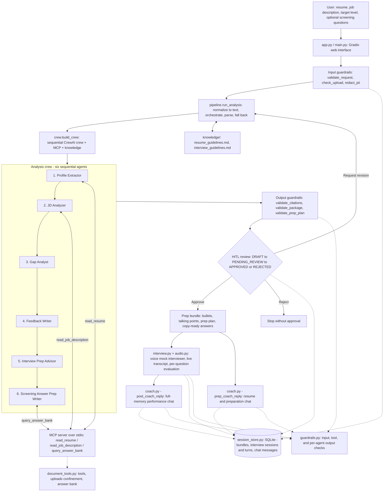

# CareerCrew architecture walkthrough

## The big picture

A user provides a resume (file or pasted text) and a job description (file or
pasted text), picks a target experience band, and optionally lists employer
screening questions. Six agents run in a fixed sequence and produce cited
feedback plus a seniority-aware interview preparation plan and copy-ready
screening answers. On top of that, a voice **virtual mock interviewer** runs a
practice interview with a live transcript and per-question feedback, and two
**full-memory coaching chats** answer follow-up questions.

Every claim in the output must trace to a resume fact or a verified answer-bank
entry; the system says "do not claim" rather than invent facts. **Nothing is
submitted anywhere** - CareerCrew prepares and practices; the candidate applies.

## Architecture diagram

### Legend

| Node | Component | Responsibility |
|---|---|---|
| `UI` | `app.py`, `main.py` | Gradio web interface (and CLI) entrypoints. |
| `IG` | `careercrew/guardrails.py` | Pre-LLM checks: exactly one resume/JD source, upload type and size, injection patterns, PII redaction. |
| `PL` | `careercrew/pipeline.py` | Normalizes inputs to text, kicks off the crew, parses/validates outputs, and runs deterministic fallbacks. |
| `CR` | `careercrew/crew.py` | Turns `config/*.yaml` into a running sequential crew with MCP tools and knowledge sources. |
| `CREW` | `config/agents.yaml`, `config/tasks.yaml` | The six sequential agents and their tasks. |
| `A1`–`A6` | crew agents | Profile Extractor → JD Analyzer → Gap Analyst → Feedback Writer → Interview Prep Advisor → Screening Answer Prep Writer. |
| `MCP` | `mcp_server/server.py` | Exposes the shared tool logic over stdio as three MCP tools. |
| `DT` | `careercrew/document_tools.py` | Single source of truth for tools: resume/JD reading, uploads-folder confinement, and the verified answer bank. |
| `OG` | `careercrew/guardrails.py` | Per-agent output checks: citations trace to real facts, screening answers come from the answer bank, prep-plan focus areas cite real gaps. |
| `HITL` | `careercrew/review.py` | Human-in-the-loop state machine (`DRAFT → PENDING_REVIEW → APPROVED / REJECTED`, bounded `REVISE`). |
| `BUNDLE` | `careercrew/models.py` | Approved prep bundle: bullets, talking points, prep plan, and copy-ready answers. Nothing is submitted. |
| `MI` | `careercrew/interview.py`, `careercrew/audio.py` | Voice mock interviewer: question generation, `whisper-1` STT / `tts-1` TTS, live transcript, per-question evaluation, overall score. |
| `C1` | `careercrew/coach.py` | `prep_coach_reply` - resume improvement and preparation chat. |
| `C2` | `careercrew/coach.py` | `post_coach_reply` - post-interview performance chat with the full transcript and scores in context. |
| `SS` | `careercrew/session_store.py` | SQLite persistence: bundles, interview sessions and turns, and both chat channels, so context survives restarts. |
| `K` | `knowledge/` | `resume_guidelines.md` (writing + honesty) and `interview_guidelines.md` (prep, interviewer, and coaching conduct). |
| `G` | `careercrew/guardrails.py` | Guardrail checks reused by the interviewer and coaches for answers, transcript turns, evaluations, and coaching replies. |

## Request lifecycle

1. `app.py` (or `main.py`) validates each upload (type, size), copies the resume
   and job description into `uploads/`, and redacts PII from pasted text. These
   are the input guardrails, applied before any LLM call.
2. `pipeline.run_analysis` normalizes the resume and JD to text (PDF/DOCX/TXT
   read, or pasted text), then builds the crew with `build_crew()` and calls
   `kickoff(inputs=...)` with `{resume_path}`/`{resume_text}`,
   `{jd_path}`/`{jd_text}`, `{screening_questions}`, and `{seniority}`.
3. Task 1, Profile Extractor, calls the MCP `read_resume` tool (or uses pasted
   text) and returns a `CandidateProfile`.
4. Task 2, JD Analyzer, calls the MCP `read_job_description` tool and returns
   `JobRequirements`.
5. Task 3, Gap Analyst, receives both typed outputs as context, scores coverage
   0-100, and labels each requirement covered, reframeable, or out_of_scope,
   returning a `GapReport`.
6. Task 4, Feedback Writer, drafts bullets plus talking points, each bullet
   carrying its `cited_fact`, returning a `FeedbackDraft`.
7. Task 5, Interview Prep Advisor, uses the profile, requirements, gaps, and the
   target band to return an `InterviewPrepPlan` (focus areas ranked by risk).
8. Task 6, Screening Answer Prep Writer, calls the MCP `query_answer_bank` tool
   per screening question and returns a `ScreeningPrep`. Unknown questions go to
   `do_not_claim`.
9. `validate_citations`, `validate_package`, and `validate_prep_plan` check the
   outputs, and the HITL buttons let the user approve, edit, or reject.

After the analysis, the mock interviewer and the two coaching chats run against
the stored context (see below).

## The six agents

- **Profile Extractor**: the only agent allowed to read the resume. Output is
  the single source of truth downstream. Its backstory forbids inferring
  employers, titles, or dates.
- **JD Analyzer**: turns prose into structure (skills, keywords, seniority,
  nice-to-haves), quoting source text per item so gaps stay traceable.
- **Gap Analyst**: the honesty core. Coverage score plus per-requirement
  verdicts. "Reframeable" means real experience can be reframed; "out of scope"
  means do not claim it.
- **Feedback Writer**: the only analysis agent that writes user-facing prose, and
  only from cited facts. Out-of-scope items go to `do_not_claim`.
- **Interview Prep Advisor**: decides where to spend preparation time, driven by
  the gap verdicts and the target seniority band (2-3, 5-10, or 10+ years).
- **Screening Answer Prep Writer**: answers screening questions **only** from the
  verified answer bank (MCP `query_answer_bank`). Never invents work
  authorization, notice-period, location, or salary facts, and never submits.

## Voice mock interviewer (practice only)

`careercrew/interview.py` holds the logic and `careercrew/audio.py` wraps the
OpenAI audio API:

- `generate_questions(...)` builds interviewer questions grounded in the JD,
  resume, gaps, and prep plan. A deterministic fallback runs without an LLM key.
- `evaluate_answer(...)` produces a per-question `AnswerEvaluation`
  (score, what the interviewer wanted, strengths, improvements, model outline).
- `append_turn(...)` keeps the live transcript; `overall_evaluation(...)` scores
  the finished session.

Audio degrades gracefully: with no key, questions are shown as text and answers
are typed. With a key, `whisper-1` transcribes the answer and `tts-1` speaks the
question.

## Full-memory coaching chats

`careercrew/coach.py` builds one bounded system context from everything the
pipeline produced - resume profile, JD requirements, gap report, prep plan, and
(for the post-interview coach) the full interview transcript, per-question
evaluations, and overall score - plus the persisted chat history. Two entry
points, `prep_coach_reply` and `post_coach_reply`, share the same context
builder. Both fall back to a deterministic, still-useful reply without a key.

## Why sequential, not hierarchical

The analysis pipeline is linear: extract, analyze JD, compare, write, plan prep,
prepare answers. There is no delegation decision to make, so a manager agent
would add latency and cost for no benefit.

## Input handling

Input is normalized to plain text before the crew runs, so agents never care
where it came from.

- Resume file: `.pdf` (pypdf), `.docx` (python-docx), `.txt` - read under
  uploads-folder confinement.
- Job description file: same three formats, same confinement.
- Pasted text: normalized through `read_resume_text` / `read_job_description`.
- URLs are **not** fetched: job boards block automated access, so a URL raises a
  clear `JobDescriptionError` telling the user to upload the file or paste text.

## Tools and MCP

`careercrew/document_tools.py` is the single source of truth. `mcp_server/server.py`
exposes it as three MCP tools (`read_resume_tool`, `read_job_description_tool`,
`query_answer_bank_tool`); `careercrew/mcp_client.py` provides both a real stdio
`MCPToolClient` (used by tests and the deterministic fallback) and a CrewAI
`MCPServerStdio` config the agents use natively. Tool guardrails (uploads-folder
confinement) live in `document_tools.py`, next to the code they protect.

## Guardrails, HITL, memory, knowledge

- **Input**: `validate_request` (exactly one resume source and one JD source, no
  injection patterns) + `redact_pii` + `check_upload`; `validate_interview_answer`
  for mock-interview answers and coach chat messages.
- **Output, per agent**: `validate_citations` (bullets cite real facts),
  `validate_package` (screening answers must be `source == "answer_bank"`),
  `validate_prep_plan` (focus areas cite real requirements, priorities valid,
  shares ~100%), `validate_evaluation` (bounded score, actionable feedback),
  `validate_transcript_turn`, and `validate_coaching_reply` (no invented facts,
  no PII leakage, safe refusals). Fails closed where it matters.
- **Tool**: uploads-folder confinement inside `document_tools.py`.
- **HITL**: `careercrew/review.py` enforces
  `DRAFT -> PENDING_REVIEW -> APPROVED / REJECTED`, with a bounded `REVISE`,
  reframed around the prep bundle (nothing is submitted).
- **Memory**: `memory=True` on the crew gives short-term memory within a session;
  `careercrew/session_store.py` persists packages, mock-interview sessions and
  turns, and both chat channels so context survives restarts.
- **Knowledge**: `knowledge/resume_guidelines.md` (writing + honesty) and
  `knowledge/interview_guidelines.md` (prep, interviewer, and coaching conduct).

## Deployment

Hugging Face Spaces running `app.py` (Docker SDK), secrets in Space settings.
The MCP server runs over stdio inside the container, so no second service is
needed. The Space URL is the demo link for the final presentation.

## Reading order for learning the codebase

1. `config/agents.yaml` + `config/tasks.yaml` (what the crew is)
2. `careercrew/models.py` (the contracts between agents)
3. `careercrew/crew.py` (how YAML becomes a running crew with MCP + knowledge)
4. `careercrew/document_tools.py` (tools + guardrails + the answer bank)
5. `careercrew/pipeline.py` (orchestration, parsing, fallback, validation)
6. `careercrew/prep.py`, `careercrew/interview.py`, `careercrew/coach.py`
   (prep plan, mock interviewer, coaching chats)
7. `careercrew/audio.py` + `careercrew/llm.py` (audio and LLM helpers)
8. `careercrew/review.py` + `careercrew/session_store.py` (HITL + persistence)
9. `mcp_server/server.py` (the same tools over MCP)
10. `app.py`, then `main.py` (entrypoints)
