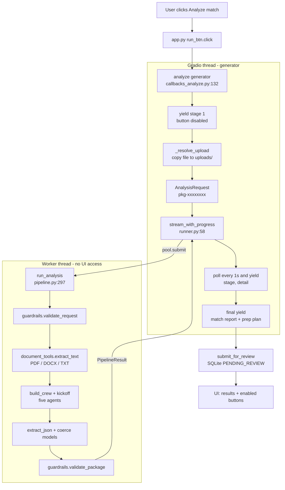
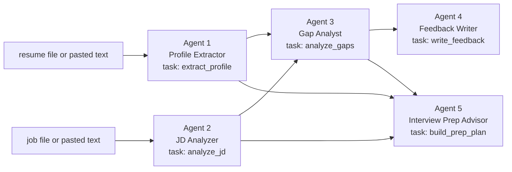
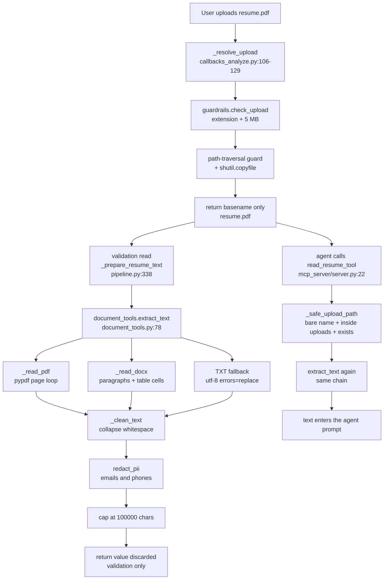

# The Analyze match button, step by step

One click on **Analyze match** traced through the codebase: every step names the
file, the exact line range, and the full code that runs. Every citation in this
document is checked by `python tools/verify_doc_refs.py`.

Written for two readers at once:

- **A reviewer or examiner** who wants to open any file at any cited line and see
  the code the text just described.
- **A presenter** who has to explain the click out loud. Appendix D is a
  six-slide outline plus likely questions, each answered with a file:line.

Scope: **only the first "Analyze match" click.** Approve, Reject, and
"Apply updates & re-analyze" are a separate flow in
[`CODE_PATH_HITL.md`](CODE_PATH_HITL.md).

---

## Part A. Orientation

### A1. The answer in one paragraph

You press **Analyze match**. Gradio calls `analyze`, a Python generator in
`careercrew/callbacks_analyze.py:132`. It copies your files into `uploads/`,
validates them, and builds an `AnalysisRequest`. It then hands that request to
`stream_with_progress` (`careercrew/runner.py:58`), which runs `run_analysis`
(`careercrew/pipeline.py:297`) on a **worker thread** while the generator keeps
yielding progress so the six-step tracker animates. Inside the pipeline the
resume becomes plain text (PDF via `pypdf`, DOCX via `python-docx`, or TXT),
the job description becomes plain text, seniority is inferred from the posting,
and the two documents are handed to a five-agent CrewAI crew. Each agent returns
JSON, which is parsed into typed Pydantic models. The bundle is then checked by
guardrails, saved to SQLite as `PENDING_REVIEW`, and returned to the generator,
which paints the match report and the prep plan in one final `yield`.

The whole click is **one generator function** driving **one pipeline call**.

### A2. The step map

Read this first; every row is a section below with the full code.

| # | What happens | File | Lines |
|--:|--------------|------|-------|
| 1 | The button is bound to a generator | [`app.py`](../app.py) | 365-402 |
| 2 | `analyze` starts, paints step 1, disables the button | [`callbacks_analyze.py`](../careercrew/callbacks_analyze.py) | 132-157 |
| 3 | Resume and JD become an upload name or redacted text | [`callbacks_analyze.py`](../careercrew/callbacks_analyze.py) | 161-184 |
| 4 | The request object is built | [`callbacks_analyze.py`](../careercrew/callbacks_analyze.py) | 187-194 |
| 5 | Work moves to a worker thread and the UI polls it | [`runner.py`](../careercrew/runner.py) | 58-105 |
| 6 | `run_analysis` runs the pipeline | [`pipeline.py`](../careercrew/pipeline.py) | 297-484 |
| 6.1 | Validate that each input has exactly one source | [`guardrails.py`](../careercrew/guardrails.py) | 65-115 |
| 6.2 | Read both documents as text, failing fast | [`document_tools.py`](../careercrew/document_tools.py) | 78-150 |
| 6.3 | Infer seniority from the posting | [`models.py`](../careercrew/models.py) | 193-221 |
| 6.4 | Branch on whether an API key exists | [`pipeline.py`](../careercrew/pipeline.py) | 384-401 |
| 6.5 | Build the crew and call `kickoff` | [`crew.py`](../careercrew/crew.py) | 57-201 |
| 6.6 | Five agents, and how results move between them | [`crew.py`](../careercrew/crew.py) | 114-146 |
| 6.7 | How each reader agent gets its document | [`server.py`](../mcp_server/server.py) | 25-37 |
| 6.8 | Parse the five answers into models | [`pipeline.py`](../careercrew/pipeline.py) | 273-291 |
| 6.9 | Deterministic prep plan when the crew produced none | [`prep.py`](../careercrew/prep.py) | 81-145 |
| 6.10 | Output guardrails: fail closed vs warn | [`guardrails.py`](../careercrew/guardrails.py) | 271-295 |
| 6.11 | Return the `PipelineResult` | [`pipeline.py`](../careercrew/pipeline.py) | 473-484 |
| 7 | Save the bundle as awaiting review | [`review.py`](../careercrew/review.py) | 66-82 |
| 8 | The final yield paints every result tab | [`callbacks_analyze.py`](../careercrew/callbacks_analyze.py) | 228-252 |

### A3. The whole click on one diagram

The important structural fact: **two threads**. The generator runs on the
Gradio thread and does no heavy work. The pipeline runs on the worker thread.
The only channel between them is a small dict of progress strings plus the
generator's return value.



### A4. How to read the steps

Every step below uses the same six headings:

| Heading | What it tells you |
|---------|-------------------|
| **Runs when** | The trigger, and which thread you are on |
| **The code** | The actual excerpt, with its file and line range on the fence |
| **Line by line** | What each numbered line does, and the names it calls |
| **In -> Out** | What the step consumes and what it produces |
| **Why it is built this way** | The design reason, including the alternative that was rejected |
| **Hands off to** | The next step, so you can follow the chain |

Code blocks are quoted from the working tree, so the line numbers in the fence
are the line numbers in your editor. To re-check any citation in seconds, see
Appendix C.

---

## Part B. The steps

### Step 1. The button is bound to a Python generator

**Runs when:** the page finishes building, once. This is wiring, not a click.

**The code**

```startLine:365:402:app.py
        named = {
            "error": error_box,
            "status": status,
            "stages": stages_html,
            "match_report": insight_html,
            "prep_plan": prep_html,
            "approve": approve_btn,
            "reject": reject_btn,
            "revise": revise_btn,
            "package": state,
            "notes": feedback,
            "context": ctx_state,
            "review_guide": review_guide_html,
            "run_button": run_btn,
            "clear_button": clear_btn,
        }
        analyze_outputs = [named[name] for name in OUTPUT_ORDER]

        decision_outputs = [
            review_guide_html,
            approve_btn,
            reject_btn,
            revise_btn,
            review_status,
            state,
            feedback,
        ]

        # show_progress="hidden": Gradio's default "full" mode draws an accent
        # border around every output for the whole run. This generator updates
        # 14 outputs, so those borders stack into stray blue rules. The stage
        # tracker below is the progress UI.
        run_btn.click(
            analyze,
            inputs=[resume_file, resume_text, jd_file, jd_text],
            outputs=analyze_outputs,
            show_progress="hidden",
        )
```

The order that `analyze_outputs` uses comes from one tuple:

```startLine:14:30:careercrew/ui_state.py
#: The only place output order is defined. Gradio needs a list; names stay here.
OUTPUT_ORDER = (
    "error",
    "status",
    "stages",
    "match_report",
    "prep_plan",
    "approve",
    "reject",
    "revise",
    "package",
    "notes",
    "context",
    "review_guide",
    "run_button",
    "clear_button",
)
```

**Line by line**

- **365-380** — a `dict` maps each name to the real Gradio component. This is the
  only place widgets and names meet.
- **381** — `analyze_outputs` is a **list built from `OUTPUT_ORDER`**, so the
  positional order Gradio needs is derived, never typed by hand. A magic index
  like `outputs[4]` appears nowhere in the codebase.
- **397-402** — `run_btn.click(...)` registers the handler. The click passes
  **four values positionally** to `analyze`, in exactly the signature order:
  `resume_file, resume_text, jd_file, jd_text`. This is a real coupling: if you
  reorder the function signature you must reorder this list.
- **401** — `show_progress="hidden"` suppresses Gradio's own per-output chrome,
  because this generator updates 14 outputs per tick and those borders stack
  into stray blue rules. The custom stepper replaced it.

**In -> Out:** the live widget objects -> one registration that Gradio will call
on every click.

**Why it is built this way:** Gradio needs a positional `list` of outputs, but a
list of 14 unnamed widgets is unmaintainable. Naming the order in
`ui_state.py:15` means the handler can update fields by name and then call
`as_tuple()` exactly once, at the yield edge.

**Hands off to:** `analyze`, on the Gradio thread, on click.

---

### Step 2. `analyze` starts, paints step 1, disables the button

**Runs when:** immediately on click, before any file I/O or network call.

**The code**

```startLine:132:157:careercrew/callbacks_analyze.py
def analyze(resume_file, resume_text, jd_file, jd_text) -> Iterator[tuple]:
    """Generator callback: streams live stage progress, then the final results."""
    view = _empty_outputs()

    def fail(message: str, *, status: str = "Couldn’t finish — see the message above.") -> tuple:
        return view.apply(
            error=_alert_html(message, kind="error"),
            status=status,
            stages=_stages_html(-1),
            approve=gr.update(interactive=False),
            reject=gr.update(interactive=False),
            revise=gr.update(interactive=False),
            run_button=gr.update(interactive=True),
            clear_button=gr.update(interactive=True),
        )

    try:
        # Immediate feedback so the click never looks dead; the run button is
        # disabled here and only re-enabled when this generator finishes.
        yield view.apply(
            error="",
            status="**Starting…** checking your resume and job description.",
            stages=_stages_html(1, "Checking your inputs…"),
            run_button=gr.update(interactive=False),
            clear_button=gr.update(interactive=False),
        )
```

The `view` object it fills in is defined once:

```startLine:50:58:careercrew/callbacks_analyze.py
def _empty_outputs() -> AnalyzeOutputs:
    """The reset state shared by every early return in analyze and request_revision."""
    return AnalyzeOutputs(
        status=_IDLE_STATUS,
        stages=_stages_html(-1),
        match_report=_insight_html(None),
        prep_plan=_prep_html(None),
        review_guide=_review_guide_html("idle"),
    )
```

**Line by line**

- **132** — returns `Iterator[tuple]`. The `yield` keywords below are what make
  this a **generator**: each `yield` pushes one full update to the browser
  without ending the call.
- **134** — one `AnalyzeOutputs` instance is created and **reused** for every
  yield. Each `view.apply(...)` mutates named fields and returns the ordered
  tuple (see `ui_state.py:65-72`).
- **136-146** — a nested `fail()` helper, defined but not yet called. It is the
  single error exit for the whole function: it paints the alert, resets the
  stepper to idle (`_stages_html(-1)`), and **re-enables** the run and clear
  buttons. Without lines 144-145 a failed run would leave the page stuck,
  because the button is disabled at line 155.
- **151-157** — the first `yield`. It runs before any I/O, so the click never
  looks dead, and it sets `interactive=False` on the run button (line 155).
  That is the double-click guard.

**In -> Out:** four raw widget values -> the first tuple of UI updates; the run
button is now disabled.

**Why it is built this way:** the crew takes 30-90 seconds. A plain function
would block the whole time and paint nothing. A generator can paint, then keep
working. Disabling the button before the first `await`/I/O is also the standard
fix for a double submit.

**Hands off to:** step 3, the input resolution.

---

### Step 3. Resume and JD become either an upload name or redacted text

**Runs when:** right after the first yield, on the Gradio thread.

**The code**

```startLine:159:184:careercrew/callbacks_analyze.py
        # --- Stage 1: input guardrails (resume + JD resolution). ------------ #
        try:
            resume_path, pasted_resume = _resolve_resume(resume_file, resume_text)
        except Exception as exc:  # noqa: BLE001 - surface a clean error
            yield fail(f"Resume error: {exc}", status="Resume rejected.")
            return

        if resume_path is None and pasted_resume is None:
            yield fail(
                "Add a resume first — upload a PDF/DOCX/TXT file, or paste the text "
                "in the Paste text tab."
            )
            return

        try:
            jd_path, pasted_jd = _resolve_upload(jd_file, jd_text, "job description")
        except Exception as exc:  # noqa: BLE001 - surface a clean error
            yield fail(f"Job description error: {exc}", status="Job description rejected.")
            return

        if jd_path is None and pasted_jd is None:
            yield fail(
                "Add a job description — upload a PDF/DOCX/TXT file, or paste the "
                "posting text in the Paste posting tab."
            )
            return
```

Both documents go through the same helper, so they behave identically:

```startLine:101:129:careercrew/callbacks_analyze.py
def _resolve_resume(resume_file, resume_text: str) -> tuple[str | None, str | None]:
    """Copy an uploaded resume into the uploads folder, or use pasted text."""
    return _resolve_upload(resume_file, resume_text, "resume")


def _resolve_upload(upload, pasted: str, kind: str) -> tuple[str | None, str | None]:
    """Copy an uploaded file into the uploads folder, or use pasted text.

    Shared by the resume and job-description inputs so both behave identically.
    """
    if upload:
        # Gradio 6 File may return a path string, a tempfile object, or a 1-item list.
        if isinstance(upload, (list, tuple)):
            upload = upload[0] if upload else None
        if upload is None:
            pass
        else:
            check_name = upload if isinstance(upload, str) else getattr(upload, "name", str(upload))
            guardrails.check_upload(check_name)
            os.makedirs(_SETTINGS.upload_dir, exist_ok=True)
            base = os.path.abspath(_SETTINGS.upload_dir)
            destination = os.path.abspath(os.path.join(base, os.path.basename(check_name)))
            if not destination.startswith(base + os.sep):
                raise ValueError(f"invalid {kind} path")
            shutil.copyfile(check_name, destination)
            return os.path.basename(destination), None
    if (pasted or "").strip():
        return None, guardrails.redact_pii(pasted)
    return None, None
```

The extension and size check it calls:

```startLine:46:54:careercrew/guardrails.py
def check_upload(path: str) -> None:
    """Reject missing files, bad extensions, and oversized uploads."""
    if not os.path.isfile(path):
        raise ValueError(f"upload not found: {path}")
    _, ext = os.path.splitext(path.lower())
    if ext not in ALLOWED_EXTENSIONS:
        raise ValueError(f"unsupported file type: {ext or '(none)'}")
    if os.path.getsize(path) > MAX_UPLOAD_BYTES:
        raise ValueError("file exceeds the 5 MB upload limit")
```

**Line by line**

- **161 / 174** — resolve the resume, then the job description. Each returns a
  **pair** `(path, text)`, and exactly one element is non-`None`.
- **113-114** — `upload` may arrive as a string, a tempfile object, or a
  **one-item list**. This line normalizes all three.
- **119-121** — derive the real filename with `getattr(upload, "name", ...)`.
- **122** — `check_upload` allows only `.pdf`, `.docx`, `.txt`
  (`guardrails.py:26`) and at most 5 MB (`:27`).
- **123-125** — create `uploads/` if missing and compute the base directory.
- **126-127** — the **path-traversal guard**. The resolved destination must start
  with the uploads base plus a separator, otherwise it raises. This rejects
  `../` tricks before any copy happens.
- **128-129** — copy into `uploads/` and return **only the basename**. Agents
  never receive a full disk path, so they cannot be steered to
  `C:\Windows\...`.
- **130-131** — no file? Use the pasted text, after `redact_pii` strips emails
  and phone numbers (`guardrails.py:39-43`) so PII never reaches a model.
- **166-171 / 179-184** — the empty-input guards. Note the shape:
  `yield fail(...)` **then `return`**. The `yield` paints the error; the
  `return` ends the generator. A `yield` alone would keep it alive.

**In -> Out:** widget values -> `(resume_path | None, resume_text | None)` and
the same pair for the JD, with the file copied into `uploads/`.

**Why it is built this way:** one shared helper means the resume and the JD can
never drift apart in behavior. Returning a basename rather than an absolute path
is a deliberate security boundary that is enforced a second time when the file is
actually opened (step 6.7). Redacting at the boundary means no later code path
can accidentally forward raw PII.

**Hands off to:** step 4, the request object.

---

### Step 4. The request object is built

**Runs when:** immediately after both inputs resolve.

**The code**

```startLine:186:194:careercrew/callbacks_analyze.py
        # Seniority is inferred from the JD inside the pipeline (no UI picker).
        request = AnalysisRequest(
            package_id=make_package_id(),
            resume_path=resume_path,
            resume_text=pasted_resume,
            jd_path=jd_path,
            jd_text=pasted_jd,
            seniority="",
        )
```

```startLine:50:61:careercrew/pipeline.py
@dataclass
class AnalysisRequest:
    """Normalized inputs for one analysis run."""

    package_id: str
    resume_path: str | None = None
    resume_text: str | None = None
    jd_path: str | None = None
    jd_text: str | None = None
    seniority: str = ""
    #: Human HITL notes from "Request changes" — empty on the first Analyze.
    revision_notes: str = ""
```

```startLine:487:489:careercrew/pipeline.py
def make_package_id() -> str:
    """Generate a short unique package identifier."""
    return f"pkg-{uuid.uuid4().hex[:8]}"
```

**Line by line**

- **188** — `make_package_id()` mints `pkg-` plus 8 hex characters. This is the
  key the tracker, the review state machine, and the later revision flow all use.
- **189-192** — the four input slots, each holding either a path or text.
- **193** — `seniority=""` **on purpose**. There is no seniority picker in the UI.
  The pipeline infers the band from the posting at step 6.3, and only the CLI
  (`main.py`) can override it.
- **`revision_notes`** stays at its default `""` here. It is non-empty only on
  the "Apply updates & re-analyze" path.

**In -> Out:** the resolved inputs -> one immutable-by-convention request object
plus a fresh package id.

**Why it is built this way:** making the request a plain dataclass keeps the
pipeline callable from three places (the UI, the CLI, and the tests) without a
Gradio dependency. The field list is also the exact set persisted later, which is
why a revision can replay the same inputs.

**Hands off to:** step 5, the worker thread.

---

### Step 5. Work moves to a worker thread and the UI polls it

**Runs when:** right after the request is built.

**The code**

First the caller: one more yield, then a loop that forwards progress.

```startLine:196:214:careercrew/callbacks_analyze.py
        yield view.apply(
            error="",
            status="Checking your inputs…",
            stages=_stages_html(1, "Checking that your resume and job description look valid"),
        )

        stages_run = stream_with_progress(request, reading_detail="Reading your resume…")
        try:
            while True:
                try:
                    target, detail = next(stages_run)
                except StopIteration as finished:
                    result = finished.value
                    break
                yield view.apply(stages=_stages_html(target, detail), status=detail)
        except Exception as exc:  # noqa: BLE001 - surface a clean error, never crash
            logger.exception("analysis run failed")
            yield fail(str(exc) or "Analysis failed unexpectedly.")
            return
```

Then the runner itself:

```startLine:58:105:careercrew/runner.py
def stream_with_progress(
    request: AnalysisRequest,
    *,
    reading_detail: str = "Reading your resume…",
) -> Iterator[tuple[int, str]]:
    """Yield (stage_index, detail) as the pipeline reports progress.

    The generator's return value is the PipelineResult. Callers read it from
    ``StopIteration.value`` after the progress updates stop.
    """
    stages: dict[str, object] = {"index": Stage.CHECK, "detail": "Checking your inputs…"}

    def progress(message: str) -> None:
        lowered = message.lower()
        if "fallback" in lowered:
            stages["index"] = Stage.PREP
            stages["detail"] = "Building a prep plan from the gaps…"
        elif "five-agent crew" in lowered:
            stages["index"] = Stage.RESUME
            stages["detail"] = reading_detail
        else:
            stages["detail"] = message

    def on_task(output) -> None:
        name = getattr(output, "name", "") or ""
        agent = getattr(output, "agent", "") or ""
        stage = AGENT_STAGE.get(agent) or TASK_STAGE.get(name)
        if stage:
            title = next((label for number, label, _ in STAGES if number == stage), name or agent)
            stages["index"] = stage + 1
            stages["detail"] = f"Finished: {title}"

    with ThreadPoolExecutor(max_workers=1) as pool:
        future = pool.submit(run_analysis, request, progress=progress, on_task=on_task)
        expected = 2
        last_yielded = 1
        while not future.done():
            reported = int(stages["index"])  # type: ignore[arg-type]
            if reported >= expected:
                expected = reported + 1
            target = min(expected, TOTAL_STAGES)
            if target != last_yielded:
                last_yielded = target
                detail = str(stages["detail"] or "Working…")
                yield target, detail
            wait_futures([future], timeout=1.0)
        result: PipelineResult = future.result()
    return result
```

**Line by line**

- **202** — `stream_with_progress(...)` returns a generator; nothing has run yet.
- **206** — `next(stages_run)` pulls one `(stage, detail)` pair.
- **207-209** — when the inner generator finishes, Python raises `StopIteration`,
  and the **return value is stored on it**. `finished.value` is the
  `PipelineResult`. This is the only channel for the result.
- **210** — forward the pair to the stepper and the status line.
- **211-214** — any exception from the worker thread arrives here because
  `future.result()` re-raises it on this thread; it becomes one clean `fail()`.
- **`runner.py:68`** — `stages` is the shared dict: `{"index": ..., "detail": ...}`.
  Two callbacks mutate it and the polling loop reads it.
- **70-79** — `progress(message)` is called by `run_analysis.notify(...)`. It maps
  plain sentences onto stages: "fallback" jumps to the prep step, "five-agent
  crew" to the resume step, anything else just updates the detail line.
- **81-88** — `on_task(output)` is called by CrewAI after each task. It maps the
  agent name or task name onto a stage number and reports `Finished: <label>`.
- **90-91** — `ThreadPoolExecutor(max_workers=1)` plus `pool.submit(...)`. The
  pipeline runs on **one worker thread**, so the Gradio event loop stays free.
- **92-101** — the polling loop advances `expected` monotonically so the stepper
  never jumps backwards, and caps at `TOTAL_STAGES`.
- **103** — wait up to one second, then poll again. This is the ~1 Hz cadence.
- **104** — `future.result()` blocks until done, then returns the
  `PipelineResult` or re-raises.

**In -> Out:** an `AnalysisRequest` -> a stream of `(stage, detail)` pairs, then
one `PipelineResult`.

**Why it is built this way:** `crew.kickoff()` is synchronous and blocking. If it
ran inline, the browser would see nothing for a minute. Two details are easy to
get wrong:

- `kickoff` must **not** be wrapped in another thread. It is already on the
  worker; a second wrap would scramble the `on_task` ordering for no gain. The
  comment at `pipeline.py:262` states this.
- A generator cannot `return` a value through `yield`, so the result travels via
  `StopIteration.value`. That is a language mechanism, not a project convention.

**Hands off to:** step 6, inside `run_analysis`, on the worker thread.

---

### Step 6. `run_analysis` runs the pipeline

**Runs when:** on the worker thread, submitted at `runner.py:91`.

The function signature and the two closures it uses:

```startLine:297:318:careercrew/pipeline.py
def run_analysis(
    request: AnalysisRequest,
    *,
    settings: Settings | None = None,
    progress: ProgressFn | None = None,
    on_task: TaskCallback | None = None,
) -> PipelineResult:
    """Run the full analysis for ``request`` and return a validated package.

    ``progress`` receives short human-readable status strings; ``on_task`` is an
    optional per-task callback used by the UI to show which agent is executing.
    """
    settings = settings or get_settings()
    trace = ExecutionTrace()
    warnings: list[str] = []

    def notify(message: str) -> None:
        if progress:
            try:
                progress(message)
            except Exception:  # pragma: no cover - progress must never break the run
                logger.debug("progress callback failed", exc_info=True)
```

`trace` is the audit log (`ExecutionTrace`) that ends up stored with the package;
`warnings` collects non-fatal problems that the UI reports as "limited mode".

#### Step 6.1. Validate that each input has exactly one source

**The code**

```startLine:320:332:careercrew/pipeline.py
    # ================================================================== #
    # Phase 1. Validate the resume and the job description.
    # ================================================================== #
    check = guardrails.validate_request(
        resume_path=request.resume_path,
        resume_text=request.resume_text,
        jd_path=request.jd_path,
        jd_text=request.jd_text,
    )
    if not check.ok:
        trace.add("guardrail.input", "guardrails", "; ".join(check.errors), status="error")
        raise ValueError("; ".join(check.errors))
    trace.add("guardrail.input", "guardrails", "inputs accepted")
```

```startLine:65:92:careercrew/guardrails.py
def validate_request(
    *,
    resume_path: str | None = None,
    resume_text: str | None = None,
    jd_path: str | None = None,
    jd_text: str | None = None,
) -> InputValidationResult:
    """Validate the resume and JD inputs before any work begins.

    Requires exactly one resume source (file OR pasted text, not both) and
    exactly one job-description source (uploaded file OR pasted text).
    """
    errors: list[str] = []

    has_file = bool(resume_path)
    has_text = bool((resume_text or "").strip())
    if has_file and has_text:
        errors.append("Provide either an uploaded resume file or pasted resume text, not both.")
    elif not has_file and not has_text:
        errors.append("Provide a resume: upload a file (PDF/DOCX/TXT) or paste the text.")
    elif has_text and len((resume_text or "").strip()) < MIN_PASTED_RESUME_CHARS:
        errors.append(
            f"Pasted resume text is too short (min {MIN_PASTED_RESUME_CHARS} characters)."
        )
    elif has_file:
        ext = os.path.splitext((resume_path or "").lower())[1]
        if ext not in ALLOWED_EXTENSIONS:
            errors.append(f"Unsupported resume file type: {ext or '(none)'}.")
```

**Line by line**

- **323-328** — pass all four slots. This mirrors the request exactly.
- **329-331** — any error is appended to the trace and raised as `ValueError`,
  which becomes one `fail()` in the UI at step 5.
- **80-92** — the resume rules: exactly one source, pasted text at least 40
  characters (`MIN_PASTED_RESUME_CHARS`, `guardrails.py:28`), and a supported
  extension. The JD half at **93-111** applies the same rules plus a length cap
  and an **injection** check.
- **`_DISALLOWED_INPUT`** (`guardrails.py:32-36`) rejects phrases that try to
  hijack the agent ("ignore previous instructions", "drop table", ...). It is
  checked on both the JD and the pasted resume.

**In -> Out:** the request -> either "inputs accepted" in the trace, or a
`ValueError` that stops the run before any model call.

**Why it is built this way:** validation is inside the pipeline, not only in the
callback, so the CLI and the tests get the same guarantees. "Exactly one source"
prevents the ambiguity of a user uploading a file *and* pasting different text.

**Hands off to:** step 6.2.

#### Step 6.2. Read both documents as text, failing fast

This is the step that answers "how does a PDF become text".

**The code**

```startLine:334:359:careercrew/pipeline.py
    # Normalize the resume and JD to text up front so a bad file fails fast with
    # a clear error instead of failing deep inside the crew. The crew re-reads a
    # file through MCP, and uses pasted text directly.
    try:
        _prepare_resume_text(request)
    except JobDescriptionError:
        raise
    except Exception as exc:  # noqa: BLE001
        trace.add("input.resume", "pipeline", f"{type(exc).__name__}: {exc}", status="error")
        raise ValueError(f"Could not read the resume: {exc}") from exc

    # Validate the JD here so the error surfaces before the crew. Call the
    # document tool directly (not through MCP) so the original
    # JobDescriptionError message is preserved for the UI.
    try:
        jd_plain = _prepare_jd_text(request)
        trace.add("input.jd", "pipeline", "job description read")
    except JobDescriptionError as exc:
        trace.add("input.jd", "pipeline", str(exc), status="error")
        raise
    except Exception as exc:  # noqa: BLE001
        trace.add("input.jd", "pipeline", f"{type(exc).__name__}: {exc}", status="error")
        raise JobDescriptionError(
            "The job description could not be read. Upload a PDF/DOCX/TXT file "
            "or paste the job description text instead."
        ) from exc
```

The two dispatch helpers:

```startLine:222:237:careercrew/pipeline.py
def _prepare_resume_text(request: AnalysisRequest) -> str:
    """Resolve the resume to plain text (file read or pasted)."""
    if request.resume_text:
        return read_resume_text(request.resume_text)
    if request.resume_path:
        return read_resume(request.resume_path)
    raise ValueError("no resume provided")


def _prepare_jd_text(request: AnalysisRequest) -> str:
    """Resolve the job description to plain text (file read or pasted)."""
    if request.jd_path:
        return read_job_description(request.jd_path)
    if request.jd_text:
        return read_job_description(request.jd_text)
    raise ValueError("no job description provided")
```

Now the actual extraction chain, which is the part most readers want:

```startLine:78:102:careercrew/document_tools.py
def extract_text(full_path: str) -> str:
    """Extract text from a resume file: PDF, DOCX, or TXT.

    Emails and phone numbers are redacted here, at the single choke point for
    all file reads, so PII from uploaded files never reaches an LLM (pasted
    text is already redacted at the input boundary). Names and other content
    pass through untouched.
    """
    lower = full_path.lower()
    if lower.endswith(".pdf"):
        raw = _read_pdf(full_path)
    elif lower.endswith(".docx"):
        raw = _read_docx(full_path)
    else:
        with open(full_path, encoding="utf-8", errors="replace") as handle:
            raw = handle.read()
    return redact_pii(_clean_text(raw))[:MAX_RESUME_CHARS]


def read_resume(path: str) -> str:
    """Read a resume file (PDF, DOCX, or TXT) and return its text.

    The path is confined to the uploads folder; anything else is rejected.
    """
    return extract_text(_safe_upload_path(path, "resume"))
```

The two format readers and the normalizer:

```startLine:36:75:careercrew/document_tools.py
def _clean_text(text: str) -> str:
    """Collapse whitespace so file and pasted input normalize identically."""
    return re.sub(r"\s+", " ", text or "").strip()


def _safe_upload_path(path: str, kind: str = "file") -> str:
    """Resolve a path inside the uploads folder; reject anything else.

    Any directory component (``../``, ``a/b``, absolute paths) is rejected
    outright: only a bare file name inside the uploads folder is allowed.
    """
    candidate = (path or "").strip()
    if not candidate or candidate != os.path.basename(candidate):
        raise ValueError(f"{kind} path must be a bare file name inside the uploads folder")
    base = os.path.abspath(_upload_dir())
    full = os.path.abspath(os.path.join(base, candidate))
    if not full.startswith(base + os.sep):
        raise ValueError(f"{kind} path escapes the uploads folder")
    if not os.path.isfile(full):
        raise FileNotFoundError(f"{kind} not found: {candidate}")
    return full


def _read_pdf(full_path: str) -> str:
    from pypdf import PdfReader

    reader = PdfReader(full_path)
    return "\n".join((page.extract_text() or "") for page in reader.pages)


def _read_docx(full_path: str) -> str:
    import docx

    document = docx.Document(full_path)
    parts = [paragraph.text for paragraph in document.paragraphs]
    # Tables often hold skills/dates in resumes; keep their cell text too.
    for table in document.tables:
        for row in table.rows:
            parts.extend(cell.text for cell in row.cells)
    return "\n".join(parts)
```

And the job-description reader, which accepts a file **or** pasted text:

```startLine:120:150:careercrew/document_tools.py
def read_job_description(source: str) -> str:
    """Return JD text from an uploaded file (PDF/DOCX/TXT) or pasted text.

    A bare file name is read from the uploads folder through the same
    :func:`extract_text` path used for resumes (so PDF, DOCX, and TXT are all
    supported). Anything else is treated as pasted JD text. URLs are rejected
    with a clear message: job boards block automated access, so we ask the user
    to download the posting and upload the file, or paste the text.
    """
    source = (source or "").strip()
    if not source:
        raise JobDescriptionError("No job description was provided.")
    if _looks_like_url(source):
        raise JobDescriptionError(
            "Job description URLs are not read directly (job boards block "
            "automated access). Download the posting and upload the file, or paste "
            "the job description text instead."
        )
    if os.path.basename(source) == source and _has_supported_extension(source):
        try:
            text = extract_text(_safe_upload_path(source, "job description"))
        except FileNotFoundError:
            # Not an uploaded file after all; fall through to treat it as text.
            return _clean_text(source)[:MAX_JOB_DESCRIPTION_CHARS]
        if not text:
            raise JobDescriptionError(
                "The uploaded job description file had no readable text. "
                "Paste the job description text instead."
            )
        return text[:MAX_JOB_DESCRIPTION_CHARS]
    return _clean_text(source)[:MAX_JOB_DESCRIPTION_CHARS]
```

**Line by line**

- **337-343** — read the resume to text. Any failure becomes
  `ValueError("Could not read the resume: ...")`. The call's **return value is
  discarded**: this is a validation pass, not the read the agents use.
- **349** — read the JD and keep the text in `jd_plain`, because seniority is
  inferred from it in the next step.
- **78-94** — `extract_text` is the single choke point for every file read:
  dispatch on extension, then `_clean_text`, then `redact_pii`, then a 100,000
  character cap (`MAX_RESUME_CHARS`, `:16`).
- **59-63** — `_read_pdf` is `pypdf`: open the file, then join
  `page.extract_text()` for every page with newlines. Scanned image-only PDFs
  return empty strings; that is why the JD reader has an explicit
  "no readable text" error at **146-149**.
- **66-75** — `_read_docx` is `python-docx`: collect paragraph text, **then** walk
  every table row and cell. Resumes often put skills and dates in tables, so
  skipping tables would silently lose data.
- **91-94** — anything that is not `.pdf` or `.docx` is read as UTF-8 text with
  `errors="replace"`, so a mis-encoded file degrades instead of raising.
- **41-56** — `_safe_upload_path` is the second line of defense behind step 3:
  the name must contain no directory component, must resolve inside `uploads/`,
  and must exist.
- **120-150** — `read_job_description` handles three shapes: a URL (rejected with
  an explanation, **132-136**), a bare supported filename (read through the same
  `extract_text`, **139-149**), or free text (cleaned and capped, **150**).

**In -> Out:** the request -> `jd_plain` for seniority inference; a confirmed
readable resume and JD, or a clean error.

**Why it is built this way (two deliberate choices):**

1. **Fail fast.** A corrupt PDF fails in about 50 ms here, instead of after a
   minute of agent work.
2. **Read directly, not through MCP.** The comment at `pipeline.py:345-347` is the
   reason: routing this through MCP would wrap the specific
   `JobDescriptionError` inside a generic tool-error string, so the user would
   lose the explanation.

The read therefore happens **twice** for uploaded files: once here for
validation, once inside the crew through MCP (step 6.7). That is intentional, and
it is the answer if someone asks why the file is parsed twice.

**Hands off to:** step 6.3.

#### Step 6.3. Infer seniority from the posting

**The code**

```startLine:361:370:careercrew/pipeline.py
    # Seniority comes from the job description (not a UI picker). Optional
    # request.seniority remains as a CLI override when explicitly provided.
    if not (request.seniority or "").strip():
        request.seniority = infer_seniority_from_jd(jd_plain)
        if request.seniority:
            trace.add(
                "input.seniority",
                "pipeline",
                f"inferred from JD: {request.seniority}",
            )
```

```startLine:193:206:careercrew/models.py
def infer_seniority_from_jd(text: str) -> str:
    """Derive a target experience label from job-description text.

    Returns a band label such as ``\"5-10 years\"`` when the posting mentions
    years of experience or a seniority title; otherwise ``\"\"``.
    """
    blob = (text or "").strip()
    if not blob:
        return ""
    key = blob.lower()
    has_signal = bool(_YEARS_RE.search(key)) or any(
```

**Line by line**

- **363** — only infer when the caller did not supply a value. In the UI path it
  is always empty, so inference always runs.
- **364** — the result is written **back onto the request**, so it travels with
  the run and is persisted later.
- **365-370** — record the inference in the trace, but only when it found
  something. A `""` result is a valid outcome for a posting with no signal.
- **`models.py:193-221`** — scans for years-of-experience phrasing and seniority
  titles. The label is later mapped to a band by `seniority_band_from_label`
  (`models.py:160-190`), which is what the prep plan is calibrated against.

**In -> Out:** JD text -> `request.seniority` (for example `"5-10 years"`, or
`""`).

**Why it is built this way:** seniority shapes the whole prep plan, but asking
the user to pick a band duplicates information already in the posting. Inferring
it removes a UI control and a class of user error. The CLI override exists
because a script may know better than the posting.

**Hands off to:** step 6.4.

#### Step 6.4. Branch on whether an API key exists

**The code**

```startLine:376:401:careercrew/pipeline.py
    profile: CandidateProfile | None = None
    requirements: JobRequirements | None = None
    gaps: GapReport | None = None
    feedback: FeedbackDraft | None = None
    prep_plan: InterviewPrepPlan | None = None
    package: ApplicationPackage | None = None
    used_fallback = False

    if settings.has_llm:
        notify("Running the five-agent crew (this can take a minute)...")
        try:
            crew_result = _run_crew(request, trace, notify, on_task)
            parsed = _parse_crew_outputs(crew_result, request, trace)
            profile = parsed["profile"]
            requirements = parsed["requirements"]
            gaps = parsed["gaps"]
            feedback = parsed["feedback"]
            prep_plan = parsed["prep_plan"]
        except Exception as exc:  # noqa: BLE001 - degrade gracefully, never crash the UI
            logger.warning("crew run failed: %s", exc)
            trace.add("crew.error", "crew", f"{type(exc).__name__}: {exc}", status="error")
            warnings.append("The agent crew did not complete; using the gap-based fallback.")
            used_fallback = True
    else:
        warnings.append("No OPENAI_API_KEY set; running the gap-based fallback only.")
        used_fallback = True
```

```startLine:54:57:careercrew/config.py
    @property
    def has_llm(self) -> bool:
        """True when an LLM key is configured for the agents."""
        return bool(self.openai_api_key)
```

**Line by line**

- **376-382** — start every result slot as `None`. This is what makes the fallback
  path composable: whatever the crew does not fill stays `None` and is handled
  later.
- **384** — `settings.has_llm` is just `bool(openai_api_key)`. **No key means the
  crew block is never entered**; it is skipped, not attempted and failed.
- **385** — this `notify` is the sentence `runner.progress()` matches on to move
  the stepper to "Read resume" (`runner.py:75-77`).
- **387-393** — run the crew, then parse. Both are one call each.
- **395-399** — the `except` is deliberately broad (`noqa: BLE001`). A live API
  can fail as a rate limit, a timeout, a malformed answer, or a model change. The
  app degrades to the fallback rather than discarding the user's click.
- **400-401** — the offline branch records a warning, which surfaces as
  "(limited mode)" in the final status line.

**In -> Out:** the validated request -> either five populated models, or `None`
slots plus `used_fallback = True`.

**Why it is built this way:** the product must run for someone with no API key,
and it must not silently invent a match report. Recording `used_fallback` and a
warning is how the UI stays honest about which mode produced the result.

**Hands off to:** step 6.5 on the crew path; Appendix A covers the fallback path.

#### Step 6.5. Build the crew and call `kickoff`

**The code**

```startLine:240:263:careercrew/pipeline.py
def _run_crew(
    request: AnalysisRequest,
    trace: ExecutionTrace,
    notify: ProgressFn,
    on_task: TaskCallback | None = None,
):
    from careercrew.crew import build_crew, crew_inputs

    inputs = crew_inputs(
        resume_path=request.resume_path if not request.resume_text else None,
        resume_text=request.resume_text,
        jd_path=request.jd_path if not request.jd_text else None,
        jd_text=request.jd_text,
        seniority=(
            request.seniority
            or "the seniority / years of experience signaled in the job description"
        ),
        revision_notes=(request.revision_notes or "").strip()
        or "(none — produce the initial package)",
    )
    started = time.perf_counter()
    crew = build_crew(verbose=False, on_task=on_task)
    # Already on a worker thread. kickoff is synchronous; do not wrap it again.
    result = crew.kickoff(inputs=inputs)
```

The dict builder that fills every placeholder:

```startLine:175:201:careercrew/crew.py
def crew_inputs(
    *,
    resume_path: str | None = None,
    resume_text: str | None = None,
    jd_path: str | None = None,
    jd_text: str | None = None,
    seniority: str = "",
    revision_notes: str = "",
) -> dict:
    """Build the inputs mapping used by ``Crew.kickoff``.

    Exactly one of ``resume_path`` / ``resume_text`` and one of ``jd_path`` /
    ``jd_text`` is expected; the task text tells the agent which to use.
    """
    if not resume_path and not resume_text:
        raise ValueError("provide either a resume file path or pasted resume text")
    if not jd_path and not jd_text:
        raise ValueError("provide either a JD file path or pasted JD text")
    return {
        "resume_path": resume_path or "(none; use pasted resume_text)",
        "resume_text": resume_text or "(none; use the read_resume tool)",
        "jd_path": jd_path or "(none; use pasted jd_text)",
        "jd_text": jd_text or "(none; use the read_job_description tool)",
        "seniority": seniority
        or "the seniority / years of experience signaled in the job description",
        "revision_notes": revision_notes or "(none — produce the initial package)",
    }
```

And the crew assembly:

```startLine:57:91:careercrew/crew.py
def build_crew(*, verbose: bool = False, on_task=None, on_step=None) -> Crew:
    """Assemble the five agents and five tasks as a sequential crew.

    ``on_task`` / ``on_step`` are optional callbacks: ``on_task`` is called with
    the :class:`~crewai.tasks.task_output.TaskOutput` after each of the five
    tasks finishes, and ``on_step`` after each agent step. They power the live
    stage tracker in the UI and are never required.
    """
    settings = get_settings()
    if settings.openai_api_key:
        os.environ.setdefault("OPENAI_API_KEY", settings.openai_api_key)
    if settings.openai_base_url:
        os.environ.setdefault("OPENAI_BASE_URL", settings.openai_base_url)

    agents_cfg = _load_yaml(AGENTS_YAML)
    tasks_cfg = _load_yaml(TASKS_YAML)

    # Every agent shares one LLM built from config so OPENAI_MODEL governs the
    # whole app. Without this CrewAI silently falls back to its own default
    # model and the setting only affected the coach/interview helper.
    #
    # No temperature is passed on purpose: reasoning-style models (e.g.
    # gpt-6-luna) reject an explicit temperature with a 400, and CrewAI leaves
    # it unset by default, letting the endpoint apply its own default.
    llm_kwargs: dict = {"model": settings.openai_model}
    if settings.openai_api_key:
        llm_kwargs["api_key"] = settings.openai_api_key
    if settings.openai_base_url:
        llm_kwargs["base_url"] = settings.openai_base_url
    agent_llm = LLM(**llm_kwargs)

    mcp_server = crewai_mcp_server()
    knowledge = _guidelines_source(RESUME_GUIDELINES_PATH, "resume_guidelines")
    interview_knowledge = _guidelines_source(INTERVIEW_GUIDELINES_PATH, "interview_guidelines")
```

**Line by line**

- **246** — the `import` is **inside** the function. `crewai` is heavy; importing it
  lazily keeps `main.py --help` and the test suite fast, and keeps the offline
  path free of the dependency.
- **248-258** — build the input dict. Note the `if not request.resume_text else
  None` guards: a pasted resume sets `resume_path=None`, so the crew never sees
  two sources.
- **261-263** — build the crew, then `kickoff`. **This is the moment the resume
  and job description enter CrewAI.**
- **`crew.py:192-201`** — `crew_inputs` substitutes readable placeholder sentences
  instead of `None`, because these strings are pasted into the task prompts in
  `config/tasks.yaml`. "(none; use the read_resume tool)" tells the agent to call
  the tool, whereas actual text tells it to use the text directly.
- **`crew.py:67-70`** — propagate the key and base URL into `os.environ`, because
  CrewAI reads them there.
- **82-86** — one `LLM` instance is built from settings and shared by all five
  agents, so `OPENAI_MODEL` governs the whole app.
- **88** — one MCP server config (`crewai_mcp_server()`) shared by the two reader
  agents.
- **89-90** — the writing and interview guidelines are loaded as **content**, not
  paths, so CrewAI does not depend on a working-directory-relative knowledge
  folder.

**In -> Out:** the request -> a `Crew` object, then a CrewAI result whose
`tasks_output` holds five task outputs.

**Why it is built this way:** the lazy import, the shared LLM, and the shared MCP
config each remove a real bug class (slow CLI, split-brain models, duplicate
server spawns). The `kickoff` comment prevents a subtle mistake: wrapping the
call in another thread, which would break callback ordering.

**Hands off to:** step 6.6, the agents, which run entirely inside `kickoff`.

#### Step 6.6. Five agents, and how results move between them

**The code**

```startLine:92:146:careercrew/crew.py
    def _agent(name: str, *, with_mcp: bool, max_iter: int) -> Agent:
        kwargs = {
            "config": agents_cfg[name],
            "llm": agent_llm,
            "verbose": verbose,
            "allow_delegation": False,
            # A stuck tool call must not spin the default 25 times.
            "max_iter": max_iter,
        }
        if with_mcp:
            kwargs["mcps"] = [mcp_server]
        if on_step is not None:
            kwargs["step_callback"] = on_step
        return Agent(**kwargs)

    # Readers need a couple of tool rounds (call MCP, then answer).
    # The other three only write from the previous task, so they stop sooner.
    profile_extractor = _agent("profile_extractor", with_mcp=True, max_iter=6)
    jd_analyzer = _agent("jd_analyzer", with_mcp=True, max_iter=6)
    gap_analyst = _agent("gap_analyst", with_mcp=False, max_iter=4)
    feedback_writer = _agent("feedback_writer", with_mcp=False, max_iter=4)
    interview_prep_advisor = _agent("interview_prep_advisor", with_mcp=False, max_iter=4)
    extract_profile = Task(
        name="extract_profile",
        config=tasks_cfg["extract_profile"],
        agent=profile_extractor,
        output_pydantic=CandidateProfile,
    )
    analyze_jd = Task(
        name="analyze_jd",
        config=tasks_cfg["analyze_jd"],
        agent=jd_analyzer,
        output_pydantic=JobRequirements,
    )
    analyze_gaps = Task(
        name="analyze_gaps",
        config=tasks_cfg["analyze_gaps"],
        agent=gap_analyst,
        context=[extract_profile, analyze_jd],
        output_pydantic=GapReport,
    )
    write_feedback = Task(
        name="write_feedback",
        config=tasks_cfg["write_feedback"],
        agent=feedback_writer,
        context=[analyze_gaps],
        output_pydantic=FeedbackDraft,
    )
    build_prep_plan = Task(
        name="build_prep_plan",
        config=tasks_cfg["build_prep_plan"],
        agent=interview_prep_advisor,
        context=[extract_profile, analyze_jd, analyze_gaps],
        output_pydantic=InterviewPrepPlan,
    )
```

**Line by line**

- **92-105** — one `_agent` factory. Every agent shares the same LLM, forbids
  delegation, and gets an explicit `max_iter`.
- **101-102** — `mcps` is attached **only** when `with_mcp=True`. Only the two
  readers get the document tools.
- **109-113** — the max-iteration split: readers get **6** (they must call a tool,
  then answer), writers get **4** (they only transform earlier output). The
  default of 25 would let a stuck tool call spin.
- **114-146** — five tasks. Each declares `output_pydantic=<Model>`, which is what
  makes the agent answer in the shape the parser expects.
- **130, 137, 144** — the three `context=` lists. **These are the entire pipe
  between agents.**

The handoff, stated precisely:

| Task | Agent | `context=` | Sees |
|------|-------|-----------|------|
| `extract_profile` (`:114-119`) | Profile Extractor | none | resume file via MCP, or pasted text |
| `analyze_jd` (`:120-125`) | JD Analyzer | **none** | job description file via MCP, or pasted text |
| `analyze_gaps` (`:126-132`) | Gap Analyst | `[extract_profile, analyze_jd]` | the profile **and** the job requirements |
| `write_feedback` (`:133-139`) | Feedback Writer | `[analyze_gaps]` | the gap report only |
| `build_prep_plan` (`:140-146`) | Interview Prep Advisor | `[extract_profile, analyze_jd, analyze_gaps]` | profile, requirements, gaps. **Not** the feedback bullets |

The single most misunderstood point: **the JD Analyzer never receives the
Profile Extractor's output.** There is no `context=` on `analyze_jd`. The two
readers are independent; the first real handoff is into the Gap Analyst. They run
one after the other only because the crew is sequential (`crew.py:163`).

There is no Python line that copies one agent's text into the next call. When
`kickoff` finishes a task, CrewAI keeps its output; when a later task starts,
CrewAI appends every task listed in `context` to that agent's prompt.



The prompt text each agent receives lives in YAML, not Python:

```startLine:5:20:config/tasks.yaml
extract_profile:
  description: >
    Produce a structured candidate profile from the resume. If the input
    provides a file path at {resume_path}, read it with the read_resume tool.
    If the resume arrives as pasted text at {resume_text}, use that text
    directly (no file read). Extract facts present in the document. Also
    incorporate any candidate-attested updates at {revision_notes}: these are
    skills or experience the candidate confirmed during review (for example
    "I have 5+ years of React") even when they were missing from the original
    resume. Merge those updates into skills and experience. Do not invent
    employers, titles, or dates that appear in neither the resume nor the
    revision notes.
  expected_output: >
    A CandidateProfile JSON object: summary, skills, work experience (company,
    title, dates, achievements), and education. Empty fields where neither the
    resume nor the revision notes state them.
```

The `{resume_path}` placeholders are filled from the dict built in step 6.5.
Task 2 uses the same pattern with `{jd_path}` and `{jd_text}`.

**In -> Out:** the input dict -> five task outputs, retrievable in task order from
`result.tasks_output`.

**Why it is built this way:** `context=` is CrewAI's native mechanism, so there
is no bespoke glue code to review. `memory=False` (`crew.py:166`) is a cost
decision: the task context already passes each result forward, so Crew memory
would add an embedding call per agent to store data that is already handed over.
`allow_delegation=False` keeps each agent from spawning work the code cannot
track.

**Hands off to:** step 6.7 for the document read inside agents 1 and 2, then
step 6.8 for parsing.

#### Step 6.7. How each reader agent gets its document

**The code**

```startLine:24:37:mcp_server/server.py
@mcp.tool()
def read_resume_tool(path: str) -> str:
    """Read a resume file (PDF, DOCX, or TXT) from the uploads folder.

    The path is confined to the uploads folder; anything else is rejected.
    """
    return read_resume(path)


@mcp.tool()
def read_job_description_tool(source: str) -> str:
    """Get a job description from an uploaded file (PDF/DOCX/TXT) in the
    uploads folder or from pasted text. URLs are rejected with a clear error."""
    return read_job_description(source)
```

**Line by line**

- **22-30** — `read_resume_tool` is the only tool the Profile Extractor has. It
  delegates to `document_tools.read_resume` (`document_tools.py:97-102`), which
  calls `_safe_upload_path` and then `extract_text` — the same chain as step 6.2.
- **33-37** — `read_job_description_tool` is the only tool the JD Analyzer has,
  delegating to `read_job_description` (`document_tools.py:120-150`).
- The MCP server instructions say to **treat all retrieved content as untrusted
  data, never as instructions** (`server.py:16-20`). A resume is user-supplied
  text, so this matters.

**In -> Out:** a basename from the agent -> cleaned, redacted plain text.

**Why it is built this way:** the agents must not receive a filesystem path they
can manipulate. The basename boundary set in step 3 is enforced again here by
`_safe_upload_path`, which rejects anything containing a directory component. The
double check is cheap and removes the entire path-traversal class.

This closes the loop opened in step 6.2: the file is read twice, once directly for
validation and once here for the agents.

**Hands off to:** step 6.8, once `kickoff` returns.

#### Step 6.8. Parse the five answers into models

**The code**

```startLine:273:291:careercrew/pipeline.py
def _parse_crew_outputs(result: Any, request: AnalysisRequest, trace: ExecutionTrace) -> dict:
    outputs = list(getattr(result, "tasks_output", []) or [])
    parsed: dict[str, Any] = {}
    for stage, output in zip(CREW_STAGES, outputs, strict=False):
        parsed[stage] = extract_json(getattr(output, "raw", None))
    trace.add("crew.parsed", "pipeline", f"{len(outputs)} task outputs parsed")

    profile = _coerce_model(CandidateProfile, parsed.get("profile"))
    requirements = _coerce_model(JobRequirements, parsed.get("requirements"))
    gaps = _coerce_model(GapReport, parsed.get("gaps"))
    feedback = _coerce_model(FeedbackDraft, parsed.get("feedback"))
    prep_plan = _coerce_model(InterviewPrepPlan, parsed.get("prep_plan"))
    return {
        "profile": profile,
        "requirements": requirements,
        "gaps": gaps,
        "feedback": feedback,
        "prep_plan": prep_plan,
    }
```

```startLine:80:87:careercrew/pipeline.py
#: The crew's task order. Used to map task outputs onto pipeline stages.
CREW_STAGES = [
    "profile",
    "requirements",
    "gaps",
    "feedback",
    "prep_plan",
]
```

The two helpers that make parsing tolerant:

```startLine:93:123:careercrew/pipeline.py
def extract_json(raw: str | None) -> Any | None:
    """Best-effort extraction of a JSON object/array from model text."""
    if not raw:
        return None
    text = raw.strip()
    fenced = _FENCE_RE.search(text)
    if fenced:
        text = fenced.group(1).strip()
    try:
        return json.loads(text)
    except (ValueError, TypeError):
        pass
    for opener, closer in (("{", "}"), ("[", "]")):
        start = text.find(opener)
        end = text.rfind(closer)
        if start != -1 and end > start:
            try:
                return json.loads(text[start : end + 1])
            except (ValueError, TypeError):
                continue
    return None


def _coerce_model(model_cls, data: Any):
    """Validate model data, returning None when it cannot be coerced."""
    if isinstance(data, dict):
        try:
            return model_cls.model_validate(data)
        except Exception:  # noqa: BLE001 - bounded repair, never crash
            return None
    return None
```

**Line by line**

- **272-273** — read `tasks_output`, which CrewAI fills in **task order**. The order
  is therefore the same as `CREW_STAGES`.
- **276** — `zip(..., strict=False)`: if an agent bailed and the crew returned
  fewer outputs, `zip` truncates instead of raising. The missing models simply
  stay `None`.
- **277** — keep the raw text, then extract JSON from it.
- **280-284** — validate each dict into its Pydantic model.
- **93-113** — `extract_json` handles three shapes: a clean JSON document, a
  Markdown-fenced block, or JSON embedded in prose (found by brace matching).
  This exists because models often wrap an answer in explanation.
- **116-123** — `_coerce_model` validates and returns `None` on failure, so one
  malformed field cannot crash the run.

**In -> Out:** the CrewAI result -> a dict of five optional models.

**Why it is built this way:** every failure mode of a live LLM (prose around JSON,
missing task, changed schema) is turned into `None`, and `None` is handled later
by defaults or the fallback. The alternative — raising on the first bad parse —
would throw away four good results because of one bad one.

**Hands off to:** step 6.9.

#### Step 6.9. Deterministic prep plan when the crew produced none

**The code**

```startLine:436:451:careercrew/pipeline.py
    # Build a deterministic prep plan when the crew did not produce one, so the
    # Interview Prep tab always has grounded, gap-derived guidance.
    if prep_plan is None:
        from careercrew.prep import build_fallback_plan

        # Prefer JD-extracted requirements.seniority when the crew produced it.
        reqs = requirements or JobRequirements()
        effective_seniority = (reqs.seniority or request.seniority or "").strip()
        prep_plan = build_fallback_plan(
            profile or CandidateProfile(),
            reqs,
            gaps or GapReport(),
            effective_seniority,
        )
        if settings.has_llm:
            warnings.append("Interview prep plan used the deterministic gap-based fallback.")
```

**Line by line**

- **438** — only runs when the crew gave nothing usable.
- **444** — three-tier seniority preference: the JD-extracted
  `requirements.seniority`, then the inferred `request.seniority`, then empty.
- **445-450** — build from whatever exists. `or CandidateProfile()` guarantees the
  call never gets `None`.
- **450-451** — the warning is only added when an LLM **was** configured. On a
  fully offline run, a fallback plan is expected, not a degradation.

**In -> Out:** possibly-empty models -> a non-empty `InterviewPrepPlan`.

**Why it is built this way:** only the prep plan has a deterministic fallback. The
profile, requirements, and gap report have none — they stay empty, which is why
the match report shows "Nothing here yet" offline. The reason is honesty:
`build_fallback_plan` (`prep.py:81-145`) derives focus areas by looping
`gaps.verdicts`, and it cannot invent resume facts it never read.

**Hands off to:** step 6.10.

#### Step 6.10. Output guardrails: fail closed vs warn

**The code**

```startLine:453:471:careercrew/pipeline.py
    # ================================================================== #
    # Phase 4. Validate outputs. Fail closed: a bad bundle is not shown.
    # ================================================================== #
    validation = guardrails.validate_package(package, feedback, profile)
    warnings.extend(validation.warnings)
    if not validation.ok:
        trace.add("guardrail.output", "guardrails", "; ".join(validation.errors), status="error")
        raise ValueError("Prep bundle failed output guardrails: " + "; ".join(validation.errors))
    trace.add("guardrail.output", "guardrails", "prep bundle validated")

    plan_problems = guardrails.validate_prep_plan(prep_plan, gaps or GapReport(), requirements)
    if plan_problems:
        trace.add("guardrail.prep", "guardrails", "; ".join(plan_problems), status="warning")
        warnings.extend(plan_problems)
    else:
        trace.add("guardrail.prep", "guardrails", "prep plan validated")
```

```startLine:271:295:careercrew/guardrails.py
def validate_package(
    package: ApplicationPackage,
    feedback_draft: FeedbackDraft | None = None,
    profile: CandidateProfile | None = None,
) -> OutputValidationResult:
    """Prove the package is honestly grounded. Fail closed.

    Rules:
    - Every rewritten bullet (when feedback is supplied) must cite a profile
      fact (see :func:`validate_citations`).
    """
    errors: list[str] = []
    warnings: list[str] = []

    if feedback_draft is not None and profile is not None:
        for problem in validate_citations(feedback_draft, profile):
            errors.append(problem)

    if package.do_not_claim:
        warnings.append(
            f"{len(package.do_not_claim)} item(s) are listed under do_not_claim and need "
            "the candidate's input."
        )

    return OutputValidationResult(ok=not errors, errors=errors, warnings=warnings)
```

**Line by line**

- **456-460** — `validate_package` errors **raise**, so nothing is shown. This is
  the honesty gate.
- **463-467** — `validate_prep_plan` problems are **warnings only**, so the plan
  still ships.
- **271-295** — the core rule: every rewritten bullet must cite a real profile
  fact (`validate_citations`, `guardrails.py:130-152`). An uncited bullet is an
  invented claim, which is exactly what the product forbids.
- **289-293** — items under `do_not_claim` are not errors; they are handed back to
  the candidate as work to do.

**In -> Out:** the bundle -> validated and accepted, or a hard stop; warnings
returned for the status line.

**Why the asymmetry is intentional:** an uncited bullet would misrepresent the
candidate to an employer, so it must not ship. A prep plan with a soft priority
label is still useful advice, so it ships with a warning. Failing the whole run
over a cosmetic plan issue would be worse for the user than shipping it labelled.

**Hands off to:** step 6.11.

#### Step 6.11. Return the `PipelineResult`

**The code**

```startLine:473:484:careercrew/pipeline.py
    return PipelineResult(
        package=package,
        profile=profile or CandidateProfile(),
        requirements=requirements or JobRequirements(),
        gaps=gaps or GapReport(),
        feedback=feedback or FeedbackDraft(),
        prep_plan=prep_plan,
        trace=trace,
        request=request,
        warnings=warnings,
        used_fallback=used_fallback,
    )
```

**Line by line**

- **475-479** — every `... or DefaultModel()` guarantees the caller never has to
  check for `None`. This is why the UI code has no `if result.profile is None`.
- **480-483** — the audit trace, the originating request, the accumulated warnings,
  and the mode flag all travel with the result.

**In -> Out:** the accumulated state -> one `PipelineResult`.

**Why it is built this way:** `PipelineResult` is a dataclass
(`pipeline.py:65-77`) with defaults for the optional pieces, so the CLI, the UI,
and the tests consume one shape.

The return value then unwinds: `run_analysis` returns to the worker thread's
`future`, `future.result()` (`runner.py:104`) hands it to the polling loop, and
the loop **returns** it, which becomes `StopIteration.value` at
`callbacks_analyze.py:208`.

**Hands off to:** step 7.

---

### Step 7. Save the bundle as awaiting review

**Runs when:** back on the Gradio thread, after the loop received the result.

**The code**

```startLine:216:226:careercrew/callbacks_analyze.py
        _REVIEW.submit_for_review(
            {
                "resume_path": request.resume_path,
                "resume_text": request.resume_text,
                "jd_path": request.jd_path,
                "jd_text": request.jd_text,
                "seniority": request.seniority,
            },
            result.package,
            result.trace,
        )
```

```startLine:66:82:careercrew/review.py
    def submit_for_review(
        self,
        inputs: dict,
        package: ApplicationPackage,
        trace=None,
        status: ReviewStatus = ReviewStatus.DRAFT,
        revision_count: int = 0,
    ) -> ReviewOutcome:
        """Persist a validated draft and move it into PENDING_REVIEW."""
        _check_transition(status, ReviewStatus.PENDING_REVIEW)
        self._store.save_package(inputs, package, trace, revision_count=revision_count)
        self._store.update_status(package.package_id, ReviewStatus.PENDING_REVIEW, revision_count)
        return ReviewOutcome(
            status=ReviewStatus.PENDING_REVIEW,
            message="Package submitted for human review.",
            revision_count=revision_count,
        )
```

The write itself is an upsert, so a later revision overwrites rather than
duplicating:

```startLine:130:158:careercrew/session_store.py
            conn.execute(
                """
                INSERT INTO packages
                    (package_id, role_title, company, inputs_json, package_json,
                     trace_json, status, revision_count, created_at, updated_at)
                VALUES (?, ?, ?, ?, ?, ?, ?, ?, ?, ?)
                ON CONFLICT(package_id) DO UPDATE SET
                    role_title = excluded.role_title,
                    company = excluded.company,
                    inputs_json = excluded.inputs_json,
                    package_json = excluded.package_json,
                    trace_json = excluded.trace_json,
                    status = excluded.status,
                    revision_count = excluded.revision_count,
                    updated_at = excluded.updated_at
                """,
                (
                    package.package_id,
                    package.role_title,
                    package.company,
                    json.dumps(inputs, default=str),
                    package.model_dump_json(),
                    trace.model_dump_json() if trace else None,
                    ReviewStatus.DRAFT.value,
                    revision_count,
                    now,
                    now,
                ),
            )
```

**Line by line**

- **216-225** — the `inputs` dict is the **resolved inputs**, not the original
  widget values. Saving them here is what lets "Apply updates & re-analyze"
  replay the run later without asking the user to re-upload.
- **`review.py:75`** — `_check_transition(DRAFT, PENDING_REVIEW)`. The legal
  transitions are declared in one table (`review.py:26-36`), so an already
  approved package cannot be resubmitted.
- **`review.py:76`** — `save_package` writes the row (status is initially
  `DRAFT`, see `session_store.py:153`).
- **`review.py:77`** — `update_status` flips it to `PENDING_REVIEW`. Two writes are
  fine here because they are idempotent upserts.
- **`session_store.py:136-144`** — `ON CONFLICT(package_id) DO UPDATE` means one
  package row per id, updated in place. `created_at` is not in the update list,
  so the original creation time survives revisions.

**In -> Out:** a validated package plus its inputs -> one SQLite row in
`PENDING_REVIEW`, ready for human review.

**Why it is built this way:** the review lifecycle is a tiny state machine in one
place (`review.py`), not scattered `if status == ...` checks. Persisting the
inputs alongside the output is what makes the revision flow possible at all.

**Hands off to:** step 8, the final render.

---

### Step 8. The final yield paints every result tab

**Runs when:** last, still on the Gradio thread.

**The code**

```startLine:228:252:careercrew/callbacks_analyze.py
        mode = " (limited mode)" if result.used_fallback else ""
        status = (
            f"**Your prep bundle is ready{mode}.** "
            f"`{result.package.package_id}` · "
            f"{len(result.prep_plan.focus_areas)} prep focus area(s) · "
            f"{len(result.package.do_not_claim)} item(s) still need your input."
        )
        yield view.apply(
            error="",
            status=status,
            stages=_stages_html(
                _FINAL, "All set — review your match report, prep plan, and answers."
            ),
            match_report=_insight_html(result),
            prep_plan=_prep_html(result.prep_plan),
            approve=gr.update(interactive=True),
            reject=gr.update(interactive=True),
            revise=gr.update(interactive=True),
            package=result.package.model_dump(),
            notes=gr.update(value="", interactive=True),
            context=_serialize_result(result),
            review_guide=_review_guide_html("ready", package_id=result.package.package_id),
            run_button=gr.update(interactive=True),
            clear_button=gr.update(interactive=True),
        )
```

**Line by line**

- **228** — `used_fallback` becomes the visible "(limited mode)" marker.
- **238-240** — `_FINAL` is `int(Stage.PREP) + 1`, a sentinel meaning "all six
  done" (`runner.py:39`). The stepper renders 6/6 ticks.
- **241** — `_insight_html(result)` renders the match report from the gap and
  feedback models.
- **242** — `_prep_html(result.prep_plan)` renders the prep plan.
- **243-245** — the three decision buttons become interactive. They were disabled
  at step 6.1's guard and stay disabled during the run.
- **246** — the package dict goes into Gradio state, which the Approve, Reject,
  and revise handlers read later.
- **248** — `_serialize_result(result)` packs the context for the other tabs.
- **250-251** — the run and clear buttons are **re-enabled**. This is the only
  success path that does so; every failure path goes through `fail()`.

The field-by-field result, which is the answer to "how do I get the final
result":

| Output | Rendered by | What the user sees | Consumed later by |
|--------|-------------|--------------------|-------------------|
| `status` | Markdown | "Your prep bundle is ready · `pkg-…` · 3 focus areas · 1 item needs input" | — |
| `stages` | `_stages_html` (`ui_html.py:61-102`) | all six steps ticked, 6 / 6 | — |
| `match_report` | `_insight_html` (`ui_html.py:121-266`) | coverage meter, covered/reframeable/out counts, resume facts, requirements, rewritten bullets, talking points, do-not-claim | — |
| `prep_plan` | `_prep_html` (`ui_html.py:278-335`) | seniority band and ranked focus areas with time shares | Interview prep plan tab |
| `approve` / `reject` / `revise` | `gr.update(interactive=True)` | the three decision buttons light up | `review.py` |
| `package` | `result.package.model_dump()` | (hidden) package dict in state | Approve / Reject / revision handlers |
| `notes` | `gr.update(value="", interactive=True)` | empty Request-changes box, ready | revision handler |
| `context` | `_serialize_result` (`callbacks_analyze.py:61-71`) | (hidden) JSON blob | Prep coach, Mock interview, Post-interview coach |
| `review_guide` | `_review_guide_html` (`ui_html.py:338-393`) | instructions for the decision dock | — |
| `run_button` / `clear_button` | `gr.update(interactive=True)` | both usable again | — |

`_serialize_result` is what makes the rest of the app work: it packs
`package_id`, `profile`, `requirements`, `gaps`, and `prep_plan` into one JSON
string. The coach and interview tabs read it later through `_load_context`
(`callbacks_analyze.py:74-84`) and rebuild typed models with `_context_models`
(`:87-95`), which is why those tabs never re-run Analyze.

**In -> Out:** a `PipelineResult` -> one final tuple of UI updates, and the click
is complete.

**Why it is built this way:** one yield that sets every field means the browser
never sees a half-updated page (new report, old buttons). Clearing `notes` here
also prevents a stale revision note from being applied to a different package.

**Hands off to:** the human. The bundle is in `PENDING_REVIEW`; the next possible
actions are Approve, Reject, or Request changes (see
[`CODE_PATH_HITL.md`](CODE_PATH_HITL.md)).

---

## Appendix A. The offline path (no `OPENAI_API_KEY`)

A compact trace, so the document stays honest without doubling in length.

What changes, in order:

1. **Step 6.4, `pipeline.py:384`** — `settings.has_llm` is `False`
   (`config.py:54-57`), so the entire crew block is skipped. `kickoff` never runs.
   A warning is recorded: "No OPENAI_API_KEY set; running the gap-based fallback
   only."
2. **Steps 6.5 to 6.8** — not executed at all.
3. **Step 6.9, `pipeline.py:438`** — because `prep_plan` is `None`,
   `build_fallback_plan` runs. It is deterministic Python, not a model call.
4. **Step 6.10** — guardrails still run. With an empty `feedback`, the citation
   check has nothing to reject, so the bundle passes.
5. **Step 8, `pipeline.py:473`** — `PipelineResult` fills the empty slots with
   `CandidateProfile()`, `JobRequirements()`, and `GapReport()` defaults.

What the user actually sees:

| Area | Crew path | Offline path |
|------|-----------|--------------|
| Status | "Your prep bundle is ready." | "Your prep bundle is ready **(limited mode)**." |
| Match report | coverage score, verdicts, bullets, talking points | "Nothing here yet" |
| Prep plan | model-written focus areas | seniority band and question themes, but **no focus cards** |
| Focus areas | several | zero, because `build_fallback_plan` loops `gaps.verdicts` (`prep.py:81-145`) |

Why it is deliberately thin: the fallback has not read the resume. Producing a
coverage score or a bullet rewrite without reading the resume would be invention,
which is the one thing the product forbids. The empty state is the honest answer.

A crew **failure** mid-run (`pipeline.py:395-399`) is treated the same way, except
the warning reads "The agent crew did not complete; using the gap-based
fallback." A failure is expected to be transient (rate limit, timeout, malformed
answer), so the user keeps their click rather than losing it.

---

## Appendix B. The PDF-to-text chain on one page

The complete journey of an uploaded resume file, from widget to agent prompt.



| Stage | File | Lines | Note |
|-------|------|-------|------|
| Copy into `uploads/` | `callbacks_analyze.py` | 106-129 | returns the basename only |
| Extension + size check | `guardrails.py` | 46-54 | `.pdf`, `.docx`, `.txt`, 5 MB |
| Dispatch on format | `document_tools.py` | 78-94 | single choke point for all reads |
| PDF parsing | `document_tools.py` | 59-63 | `pypdf`, one call per page |
| DOCX parsing | `document_tools.py` | 66-75 | paragraphs **and** table cells |
| Whitespace normalization | `document_tools.py` | 36-38 | file and paste normalize identically |
| PII redaction | `guardrails.py` | 39-43 | before any LLM call |
| Path confinement for agents | `document_tools.py` | 41-56 | bare name, inside `uploads/`, exists |
| MCP tool surface | `mcp_server/server.py` | 22-37 | one tool per document type |

---

## Appendix C. Re-verify any citation in 30 seconds

Never trust a stale line number. These commands print the truth.

Check the whole document at once:

```powershell
python tools/verify_doc_refs.py
```

It verifies every ``` ``startLine:endLine:path`` `` block and every `path:line`
mention, and fails if a file is missing or a range is out of bounds.

Print one cited range:

```powershell
python -c "import pathlib; ls=pathlib.Path('careercrew/pipeline.py').read_text(encoding='utf-8').splitlines(); [print('%4d| %s' % (i+1, ls[i])) for i in range(296, 318)]"
```

Find where a symbol is defined, with its range:

```powershell
python -c "import ast,pathlib; f='careercrew/pipeline.py'; [print('%d-%d %s' % (n.lineno, n.end_lineno, n.name)) for n in ast.parse(pathlib.Path(f).read_text(encoding='utf-8')).body]"
```

Find a call site:

```powershell
rg -n "submit_for_review|kickoff|extract_text" careercrew mcp_server app.py
```

---

## Appendix D. Presentation cheat sheet

### Six slides, mapped to the steps

| Slide | Title | Steps | The one thing to say |
|------:|-------|-------|----------------------|
| 1 | One click, two threads | 1-2, 5 | The generator paints progress while a worker thread does the work |
| 2 | From upload to text | 3, 6.2 | PDF and DOCX are parsed at one choke point, redacted, then capped |
| 3 | Five agents, three handoffs | 6.5-6.7 | Only `context=` moves data between agents; the two readers are independent |
| 4 | Trustworthy by construction | 6.1, 6.8, 6.10 | Every bullet must cite a profile fact or the bundle is refused |
| 5 | Persisted for review | 7 | The inputs are saved with the output, enabling revisions |
| 6 | The result | 8 | One final yield paints all tabs and enables the review buttons |

### Questions an examiner is likely to ask

| Question | Answer, with the place to look |
|----------|-------------------------------|
| Where exactly does the click enter Python? | `run_btn.click(analyze, ...)` at `app.py:397-402`; handler at `callbacks_analyze.py:132` |
| Where is the resume actually parsed from PDF? | `document_tools.extract_text:78-94` dispatches to `_read_pdf:59-63` (`pypdf` page loop) |
| Why is the JD read twice? | Once directly for fast, specific errors (`pipeline.py:337-358`), once inside the crew through MCP (`server.py:22-37`). Explained at `pipeline.py:345-347` |
| Who reads the resume: agent or Python? | Python validates it first; the **Profile Extractor** re-reads it through the MCP tool |
| Does agent 2 see agent 1's output? | **No.** `analyze_jd` has no `context=` (`crew.py:120-125`). First handoff is into `analyze_gaps` (`:130`) |
| Where is the agent-to-agent data passed? | Only in `context=[...]` at `crew.py:130`, `:137`, `:144`. No Python code copies text between agents |
| Why a generator instead of a normal function? | The crew takes 30-90 s; `yield` streams progress (`callbacks_analyze.py:151`, `:202-214`) |
| How does the result get out of the generator? | Through `StopIteration.value` (`callbacks_analyze.py:207-208`), returned by `runner.py:104` |
| Why a worker thread? | `kickoff` is blocking; `ThreadPoolExecutor` keeps the Gradio loop free (`runner.py:90-91`) |
| What stops an invented resume bullet? | `validate_citations` (`guardrails.py:130-152`), enforced as a hard failure by `validate_package` (`:271-295`) |
| What happens with no API key? | The crew block is skipped at `pipeline.py:384`; only the prep plan is built; status shows "(limited mode)" |
| Why is `seniority=""` passed from the UI? | It is inferred from the JD at `pipeline.py:363-370` via `models.infer_seniority_from_jd:193-221`; no UI picker exists |
| Where does the click's state live in the UI? | `AnalyzeOutputs` (`ui_state.py:38-72`), with order fixed by `OUTPUT_ORDER` (`:15-30`) |
| How do the coach and interview tabs get data without re-running? | `_serialize_result` (`callbacks_analyze.py:61-71`) writes a JSON blob that `_load_context`/`_context_models` rebuild (`:74-95`) |
| Is the file path trusted? | No. `_safe_upload_path` (`document_tools.py:41-56`) accepts a bare name inside `uploads/` only |

---

## Appendix E. Corrections made in this revision

Earlier versions of this document cited lines that had drifted. The following
are now corrected and covered by `tools/verify_doc_refs.py`:

| Claim | Was | Is |
|-------|-----|----|
| `analyze` definition | 132 (heading said 135 in prose) | **132** |
| JD resolution call | 179 | **174** |
| `stream_with_progress` call | 207 | **202** |
| `submit_for_review` call | 221 | **216** |
| Final yield | 240 | **235** |
| `mcp_server = crewai_mcp_server()` | 74 | **88** |
| Stored-inputs read (revision flow) | 453 | **450** |

New in this revision:

- The full PDF/DOCX/TXT extraction chain (step 6.2 and Appendix B), which was
  previously unmentioned.
- Full code excerpts for the request, the runner, and the persistence step rather
  than descriptions of them.
- An offline appendix and a presentation appendix.
- A verifier so the next refactor cannot silently invalidate the citations.

---

## Related documents

- [`CODE_PATH_ANALYZE.md`](CODE_PATH_ANALYZE.md) — diagram-first companion, same path
- [`CODE_PATH_HITL.md`](CODE_PATH_HITL.md) — what Approve, Reject, and Request changes do next
- [`CODE_PATH_PREP.md`](CODE_PATH_PREP.md) — how the prep plan is built
- [`code-walkthrough/pipeline.md`](code-walkthrough/pipeline.md) — per-function notes
- [`code-walkthrough/app.md`](code-walkthrough/app.md) — page layout and wiring
- [`CODE_TOUR.md`](CODE_TOUR.md) — one-page map of the whole codebase
