# CareerCrew architecture — diagrams and quick explanations

> A one-page-per-diagram tour of how CareerCrew is built. Every diagram is
> followed by a short "what to notice" paragraph so the picture is usable
> without reading the code first.
>
> Deeper material:
> - `ARCHITECTURE.md` — the prose architecture with the design decisions
> - `docs/ANALYZE_BUTTON_WALKTHROUGH.md` — one continuous trace with full code
> - `docs/code-walkthrough/INDEX.md` — per-file reference pages

All line numbers in this document were checked against the working tree with
`python tools/verify_doc_refs.py docs/ARCHITECTURE_DIAGRAMS.md`.

---

## 1. System context — who talks to what

CareerCrew is one Python process plus one external API. There is no second
service to deploy: the MCP server runs as a stdio child process of the same
app, and SQLite is a file on disk.

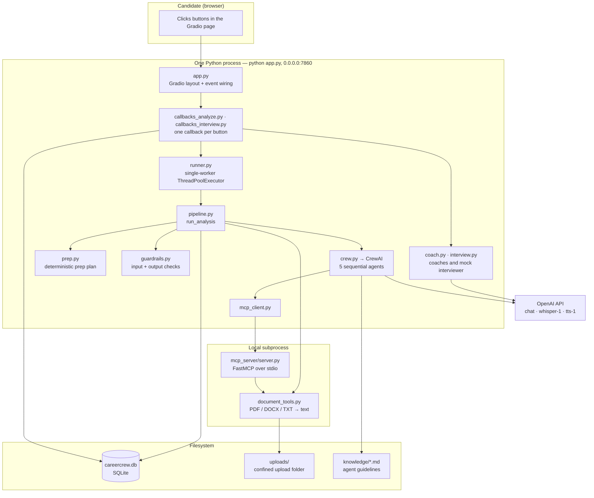

**What to notice**

- **One process, one port.** `app.py` serves everything; the MCP server is a
  stdio child, not an HTTP service (`careercrew/mcp_client.py:53-66`).
- **Two paths reach the same document code.** The agents go through MCP
  (`mcp_server/server.py:25-37`); the pre-flight check in the pipeline calls
  `document_tools.py` directly so the original error message survives
  (`careercrew/pipeline.py:231-237`). Both end in the same reader, so there is
  no second implementation to keep in sync.
- **Everything that costs a model call is inside `OPENAI`**, which is why the
  app still runs with no key (§7).

---

## 2. Layered view — which module owns which decision

The layers are strict: a lower layer never imports a higher one. The import
graph confirms it, so this is an acyclic design, not just a drawing.

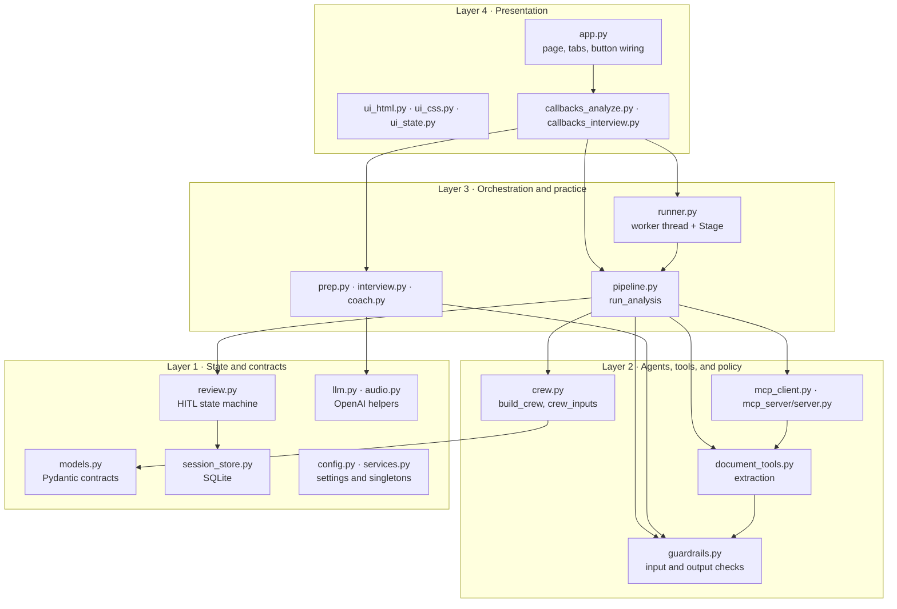

**What to notice**

- **Only callbacks know about Gradio.** `pipeline.py`, `crew.py`, and
  `session_store.py` never import `gradio`, so the CLI (`main.py`) reuses the
  same pipeline with no UI present.
- **`guardrails.py` is a leaf that only depends on `models.py`.** That is what
  lets it be called from five different places without a cycle (§6).
- **`services.py` is 12 lines of wiring** (`careercrew/services.py`): it opens
  one `SessionStore` and one `PackageReviewService` at import time, so the UI
  never constructs a second database handle.

---

## 3. The analysis run — request to validated bundle

This is the diagram to show first. It is the whole "Analyze match" press in one
picture. Exact code for each step is in `docs/ANALYZE_BUTTON_WALKTHROUGH.md`.

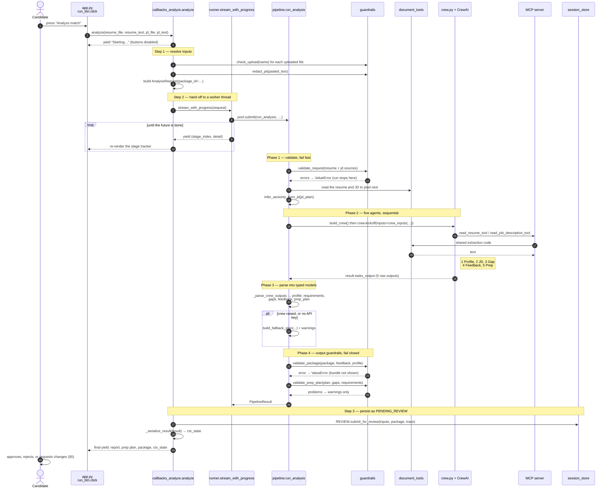

**What to notice**

- **The thread hop is the part people miss.** `analyze` is a generator that
  runs on the Gradio event thread; the actual work runs on a single-worker
  pool so the page can still stream progress (`careercrew/runner.py:58-105`).
- **Fail closed vs warn.** A `validate_request` or `validate_package` failure
  raises and shows nothing; a `validate_prep_plan` failure only adds a warning
  (`careercrew/pipeline.py:394-398`, `careercrew/pipeline.py:455-465`).
- **Fallback is a real branch, not an error page.** The same function ends with
  a usable `PipelineResult` whether the crew ran or not
  (`careercrew/prep.py:81-145`, merge at `careercrew/pipeline.py:418-434`).
- **`ctx_state` is what makes tabs 2-4 possible.** `_serialize_result` stores
  the models as JSON so the coaches and mock interviewer can reload them
  without re-running the crew (`careercrew/callbacks_analyze.py:61-71`).

---

## 4. Agent pipeline and the handoff mechanism

The five agents are sequential and share no memory. Each task declares the
earlier tasks it needs in `context=`, and CrewAI injects those outputs into the
prompt. That is the entire handoff mechanism.

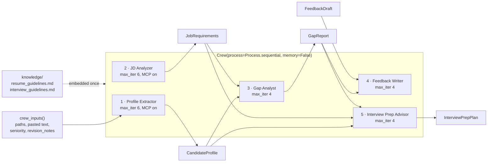

Task wiring, quoted from the code:

```126:146:careercrew/crew.py
    analyze_gaps = Task(
        name="analyze_gaps",
        config=tasks_cfg["analyze_gaps"],
        agent=gap_analyst,
        context=[extract_profile, analyze_jd],
        output_pydantic=GapReport,
    )
    write_feedback = Task(
        name="write_feedback",
        config=tasks_cfg["write_feedback"],
        agent=feedback_writer,
        context=[analyze_gaps],
        output_pydantic=FeedbackDraft,
    )
    build_prep_plan = Task(
        name="build_prep_plan",
        config=tasks_cfg["build_prep_plan"],
        agent=interview_prep_advisor,
        context=[extract_profile, analyze_jd, analyze_gaps],
        output_pydantic=InterviewPrepPlan,
    )
```

**What to notice**

- **`context=` is the arrow you are looking for.** `analyze_gaps` receives the
  profile and the requirements because both tasks are listed;
  `write_feedback` receives only the gaps.
- **`output_pydantic=` gives every handoff a typed shape.** Models live in
  `careercrew/models.py` (`CandidateProfile`, `JobRequirements`, `GapReport`,
  `FeedbackDraft`, `InterviewPrepPlan`).
- **Only the two readers get MCP.** They are the ones that must read a file
  (`max_iter=6`); the other three write from the previous task and stop at 4.
- **`memory=False` is deliberate.** Because `context=` already passes the
  outputs, CrewAI memory would only add an extra model call per agent.

---

## 5. HITL review — the state machine and the approval gate

Analysis never auto-approves. The bundle is persisted as `PENDING_REVIEW`, and
the practice tabs refuse to run until a human approves it.

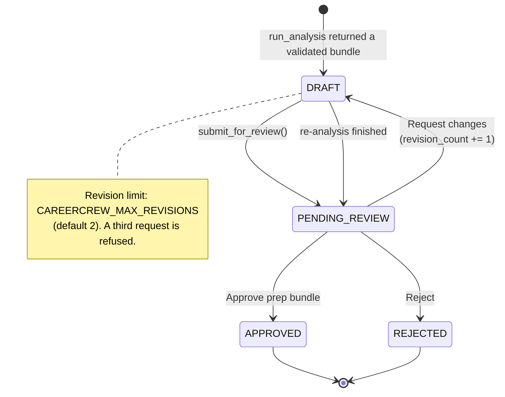

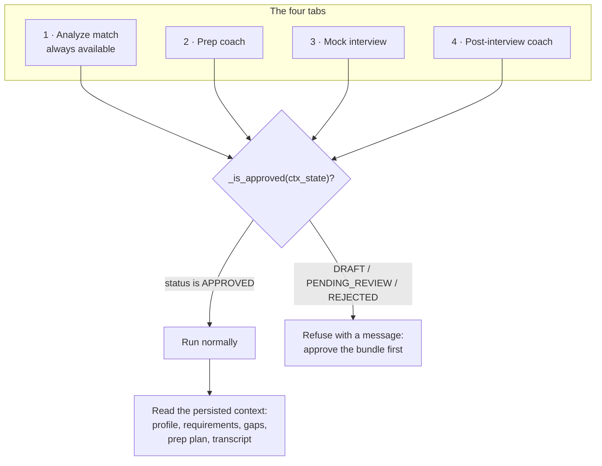

The transition table is code, not convention:

```27:36:careercrew/review.py
_ALLOWED: dict[ReviewStatus, set[ReviewStatus]] = {
    ReviewStatus.DRAFT: {ReviewStatus.PENDING_REVIEW},
    ReviewStatus.PENDING_REVIEW: {
        ReviewStatus.APPROVED,
        ReviewStatus.REJECTED,
        ReviewStatus.DRAFT,  # a requested revision returns to a fresh draft
    },
    ReviewStatus.APPROVED: set(),
    ReviewStatus.REJECTED: set(),
}
```

**What to notice**

- **The analysis results stay readable while pending.** Only the three practice
  tabs are gated; the match report and prep plan are visible, because the
  candidate needs them in order to decide.
- **Revision is bounded and requires feedback.** `apply_decision` raises if the
  notes are empty or the count would exceed the limit
  (`careercrew/review.py:118-127`).
- **The gate reads the database, not the browser.** `_is_approved` reads the
  persisted `packages.status`, so refreshing the page or opening a second tab
  cannot bypass the review (`careercrew/callbacks_interview.py:30-44`).

---

## 6. Guardrails — every check, where it runs, and what it costs

Guardrails are plain functions returning a list of problem strings. There are
two severities: **fail closed** (raise, show nothing) and **warn** (continue,
show a banner).

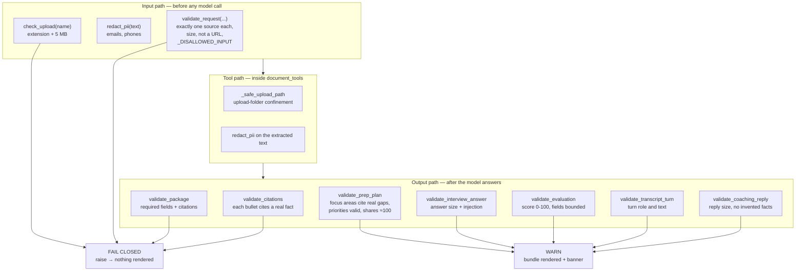

| Check | File and lines | Severity | Why that severity |
|---|---|---|---|
| `check_upload` | `careercrew/guardrails.py:46-54` | fail closed | Accepting an unreadable type wastes a full run. |
| `redact_pii` | `careercrew/guardrails.py:39-43` | transform | Removes emails and phones before any model sees the text. |
| `validate_request` | `careercrew/guardrails.py:65-115` | fail closed | Two sources or a URL means the run is ambiguous. |
| `_safe_upload_path` | `careercrew/document_tools.py:41-56` | fail closed | Blocks `../` escapes out of `uploads/`. |
| `validate_citations` | `careercrew/guardrails.py:130-152` | fail closed via `validate_package` | An uncited bullet is an invented claim. |
| `validate_package` | `careercrew/guardrails.py:271-295` | fail closed | The last gate before the bundle is displayed. |
| `validate_prep_plan` | `careercrew/guardrails.py:155-193` | warn | Advice can be imperfect without being dishonest. |
| `validate_interview_answer` | `careercrew/guardrails.py:196-211` | warn | Re-asks for a real answer. |
| `validate_evaluation` | `careercrew/guardrails.py:214-231` | warn | Keeps a bounded score. |
| `validate_transcript_turn` | `careercrew/guardrails.py:234-244` | warn | Keeps the transcript well-formed. |
| `validate_coaching_reply` | `careercrew/guardrails.py:247-268` | warn | Replaces a bad reply rather than crashing the chat. |

**What to notice**

- **The severity choice is the design.** Anything that fabricates evidence
  fails closed; anything that only degrades quality warns and renders.
- **`validate_citations` is enforced through `validate_package`**, which is why
  a citation problem produces a hard failure in the pipeline.
- **Guardrails never call a model.** They are deterministic functions of the
  strings and models passed in, so they are fully unit tested offline.

---

## 7. Two execution modes

The same entry points run with or without a key. The difference is which
branches exist, and the UI says which one you got.

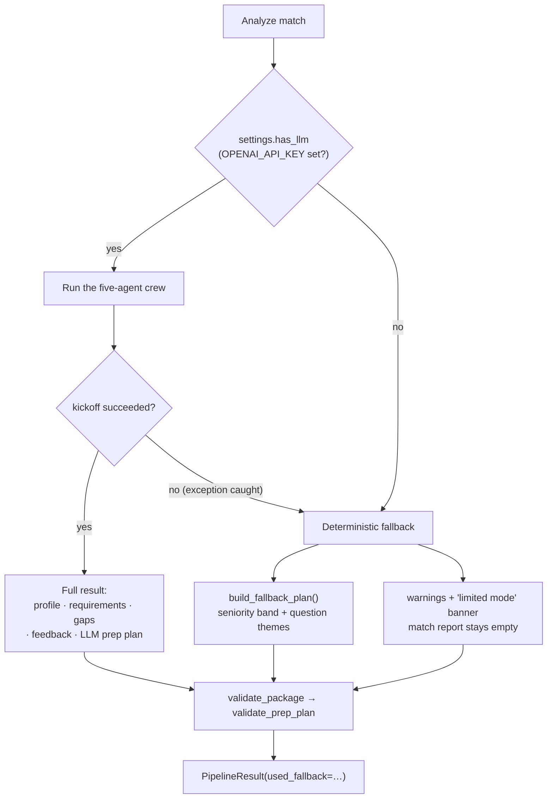

**What to notice**

- **A crew exception is caught, not raised.** The user still gets a bundle, plus
  a warning (`careercrew/pipeline.py:395-399`).
- **The offline path has no gaps to plan from**, so the prep plan carries only
  the seniority band and question themes. That is why the match report is
  empty — there was no analysis, and the app does not pretend otherwise.
- **`used_fallback` travels in the result**, so the callback can label the run
  instead of silently presenting fallback output as agent output.

---

## 8. Persistence model

Five tables. `packages` is the center of gravity; everything else points at it.

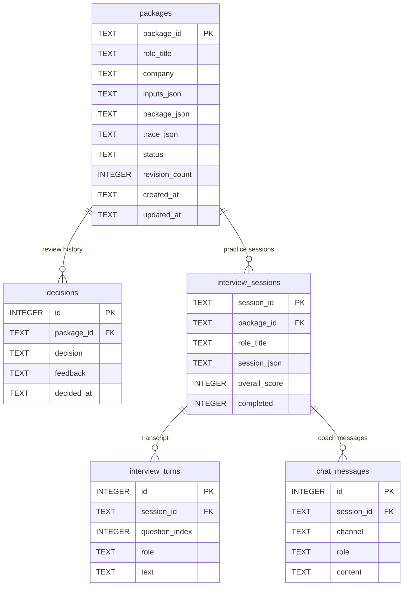

**What to notice**

- **The status column is the approval gate.** Tables 2-4 exist to make a
  practice session and its coaching history survive a page refresh.
- **The schema lives in one string.** `SCHEMA` is executed with
  `CREATE TABLE IF NOT EXISTS`, so there is no migration step to run
  (`careercrew/session_store.py:21-73`).
- **`chat_messages` is append-only.** Chat history is written for auditability;
  the live conversation is held in the Gradio component.

---

## 9. Progress reporting — how a stage lights up

The tracker has six steps. A CrewAI task callback maps an agent name onto a
step number, and the runner converts that into a yielded tuple.

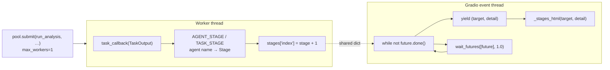

The step names, quoted:

```30:38:careercrew/runner.py
STAGES: list[tuple[int, str, str]] = [
    (Stage.CHECK, "Check inputs", "Make sure your resume and job posting look valid"),
    (Stage.RESUME, "Read resume", "Pull out skills, roles, and achievements from your resume"),
    (Stage.ROLE, "Understand role", "Extract what the job actually requires"),
    (Stage.MATCH, "Score match", "Mark each requirement as covered, reframeable, or out of scope"),
    (Stage.REWRITES, "Draft rewrites", "Suggest stronger bullets backed by facts from your resume"),
    (Stage.PREP, "Prep plan", "Plan where to spend your interview preparation time"),
]
```

**What to notice**

- **One worker, deliberately.** `max_workers=1` serializes runs so two clicks
  cannot interleave crew state.
- **The worker writes, the event thread reads.** A plain dict is the mailbox;
  the poll loop wakes every second.
- **The number and the enum are the same thing**, so the UI never passes a bare
  `6` to mean "prep plan" (`careercrew/runner.py:18-26`).

---

## 10. Request-changes loop — what a revision actually re-runs

"Request changes" is not an edit. It returns the package to `DRAFT`, folds the
candidate's notes into the experience, and runs the whole pipeline again.

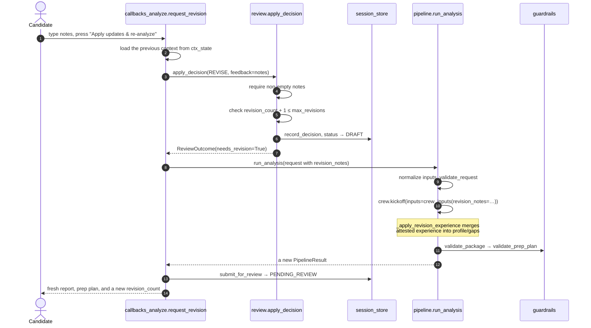

**What to notice**

- **The previous bundle is reused, not discarded.** The callback reloads
  `ctx_state` first, so the notes are applied to the analysis already on screen.
- **The revision limit is enforced before any work starts.** A third request is
  refused with a message rather than burning a full run
  (`careercrew/review.py:118-127`).
- **The candidate's own words are treated as evidence.** This is the one place
  where a human assertion enters the profile — flagged in the warnings
  (`careercrew/pipeline.py:418-434`).

---

## 11. Where to go next

| Question | Document |
|---|---|
| What does pressing Analyze do, line by line? | `docs/ANALYZE_BUTTON_WALKTHROUGH.md` |
| What is the responsibility of one specific module? | `docs/code-walkthrough/INDEX.md` |
| Why was it built this way? | `ARCHITECTURE.md` §4 |
| What are the requirements and their evidence? | `docs/engineering/functional-nonfunctional-requirements.md` |
| How do I run and test it? | `docs/engineering/setup.md`, `docs/engineering/testing-and-release.md` |
