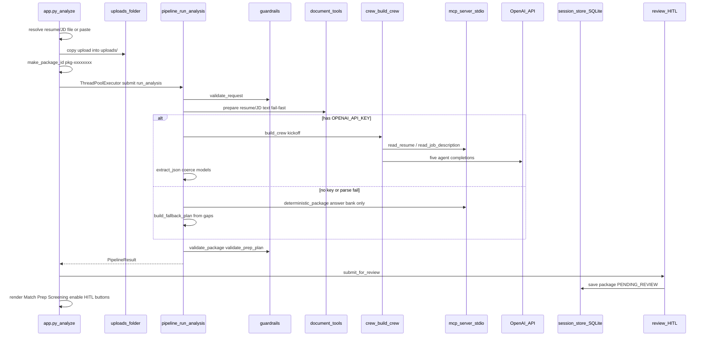

# Code path: Analyze button

Live talk aid. Open the cited file/function while explaining. Nothing here
changes product behavior — it only documents it.

**Related:** [CODE_PATH_PREP.md](CODE_PATH_PREP.md) (Interview Prep Advisor detail) ·
[CODE_PATH_HITL.md](CODE_PATH_HITL.md) · [SPEAKER_CHEATSHEET.md](SPEAKER_CHEATSHEET.md)

---

## 1. Trigger

| Item | Detail |
|------|--------|
| UI control | Gradio button **Analyze match** (`run_btn`) in `app.py` `build_app()` |
| Handler | Generator `analyze(...)` in [`app.py`](../app.py) |
| Why a generator | Yields progress to the stage stepper before the long crew run finishes |

Wiring (conceptually): `run_btn.click(analyze, inputs=[...], outputs=[...])`.

---

## 2. End-to-end sequence



---

## 3. Step table (open these while talking)

| # | What happens | File / symbol | I/O / API | Why |
|---|--------------|--------------|-----------|-----|
| 1 | Click Analyze → `analyze()` starts | `app.py` `analyze` | UI event | Entry point for the whole analysis |
| 2 | Immediate yield: stage 1 “Checking…” | `analyze` / `_stages_html` | Gradio stream | Click never looks dead |
| 3 | Resolve resume | `_resolve_resume` | **Write** copy into `uploads/` if file; else pasted text | Agents only see confined uploads or paste |
| 4 | Resolve JD | `_resolve_upload(..., "job description")` | Same as resume | URLs are not fetched |
| 5 | Parse screening lines + seniority | `analyze` body | In-memory list + band label | Inputs for agent 6 and prep advisor |
| 6 | Create request id | `pipeline.make_package_id` → `pkg-{8 hex}` | New id | Tracker / History key |
| 7 | Run pipeline off UI thread | `ThreadPoolExecutor` + `run_analysis` | Worker thread | Gradio stays responsive; UI polls stages |
| 8 | Input guardrails | `guardrails.validate_request` | Fail → `ValueError` | Exactly one resume source + one JD source; injection/size checks |
| 9 | Fail-fast file/text read | `_prepare_resume_text` / `_prepare_jd_text` → `document_tools` | **Read** PDF/DOCX/TXT under uploads confinement | Bad files fail before the expensive crew |
| 10a | If `settings.has_llm` | `pipeline._run_crew` → `crew.build_crew` → `crew.kickoff` | CrewAI sequential + OpenAI HTTPS | Full six-agent path |
| 10b | MCP tools during crew | `mcp_client` + `mcp_server/server.py` | stdio subprocess to FastMCP | Real MCP (course requirement) |
| 10c | Parse task JSON → models | `extract_json`, `_coerce_model`, `_parse_package` | In-memory | Typed contracts for tabs/guardrails |
| 11 | Fallback if no key / crew fail / no package | `deterministic_package` + `prep.build_fallback_plan` | MCP answer bank; gap math | Demo works offline; never invent screening answers |
| 12 | Output guardrails | `validate_package`, `validate_prep_plan` | Fail closed on package; prep → warnings | Honesty story |
| 13 | Return `PipelineResult` | `pipeline.run_analysis` | In-memory | Bundle for UI |
| 14 | HITL submit | `review.submit_for_review` → `SessionStore.save_package` | **Write** SQLite `packages`; status `PENDING_REVIEW` | History + approve buttons |
| 15 | Render tabs + enable HITL | `_insight_html`, `_prep_html`, `_package_html`; `ctx_state` | UI | Match / Prep plan / Screening; coaches/interview use `ctx_state` |

---

## 4. Five agents (sequential crew)

Config: [`config/agents.yaml`](../config/agents.yaml), [`config/tasks.yaml`](../config/tasks.yaml).  
Wiring: [`careercrew/crew.py`](../careercrew/crew.py) `build_crew()`.

| Order | Agent key | Task name | Typed output | MCP? | Knowledge |
|------:|-----------|-----------|--------------|------|-----------|
| 1 | `profile_extractor` | `extract_profile` | `CandidateProfile` | Yes (`read_resume`) | `resume_guidelines.md` |
| 2 | `jd_analyzer` | `analyze_jd` | `JobRequirements` | Yes (`read_job_description`) | resume guidelines |
| 3 | `gap_analyst` | `analyze_gaps` | `GapReport` | No | resume guidelines |
| 4 | `feedback_writer` | `write_feedback` | `FeedbackDraft` | No | resume guidelines |
| 5 | `interview_prep_advisor` | `build_prep_plan` | `InterviewPrepPlan` | No | + `interview_guidelines.md` |

**Context edges** (why order matters):

- Gap receives profile + JD tasks  
- Feedback receives gaps  
- Prep plan receives profile + JD + gaps  
- Screening receives feedback + JD  

**Process:** `Process.sequential`. Each task receives the previous task output. Crew memory is off so Analyze does not pay an extra model call per agent.

**Kickoff inputs** (`crew_inputs`): `resume_path`, `resume_text`, `jd_path`, `jd_text`, `screening_questions`, `seniority`.

---

## 5. MCP map

| MCP tool (server) | Shared implementation | Used by |
|-------------------|----------------------|---------|
| `read_resume_tool` | `document_tools.read_resume` | Profile Extractor |
| `read_job_description_tool` | `document_tools.read_job_description` | JD Analyzer (+ pipeline fail-fast) |
| `query_answer_bank_tool` | `document_tools.query_answer_bank` | Screening Prep Writer + deterministic fallback |

Server: [`mcp_server/server.py`](../mcp_server/server.py).  
Client / CrewAI config: [`careercrew/mcp_client.py`](../careercrew/mcp_client.py) (`MCPToolClient`, `crewai_mcp_server`).  
Answer bank file: [`data/answer_bank.yaml`](../data/answer_bank.yaml) (`verified: true` required to return).

**Tool guardrail:** paths confined to the uploads folder inside `document_tools` (no arbitrary disk reads).

---

## 6. Fallback decision tree

```
has OPENAI_API_KEY?
  ├─ yes → kickoff six-agent crew
  │         ├─ parse OK → use typed models
  │         └─ crew error / package None → deterministic_package (MCP)
  └─ no  → skip crew; deterministic_package (MCP)
           warning: "No OPENAI_API_KEY…"

prep_plan is None?
  └─ yes → prep.build_fallback_plan(profile, requirements, gaps, seniority)

validate_package fails?
  └─ raise ValueError (fail closed; UI shows error)

validate_prep_plan problems?
  └─ warnings only (plan still shown)
```

`deterministic_package` ([`pipeline.py`](../careercrew/pipeline.py)): for each screening question, **real** `mcp.query_answer_bank`; if not found → `do_not_claim`. Never invents work-auth / salary facts.

---

## 7. What Analyze writes / returns

| Artifact | Where | Contents |
|----------|-------|----------|
| Upload copies | `uploads/` | Resume/JD files (if uploaded) |
| `PipelineResult` | Memory → Gradio state | profile, requirements, gaps, feedback, prep_plan, package, trace, warnings |
| SQLite `packages` | `careercrew.db` | `package_id`, inputs JSON, package JSON, trace JSON, status=`pending_review`, revision_count |
| Match report tab | `_insight_html` | Coverage, verdicts, rewrites, talking points, do-not-claim |
| Interview prep plan tab | `_prep_html` | Seniority + focus areas (see [CODE_PATH_PREP.md](CODE_PATH_PREP.md)) |
| Screening answers tab | `_package_html` | Copy-ready Q&A + needs-your-input |
| Advanced tab | `_trace_markdown` | `ExecutionTrace` events |
| `ctx_state` | Gradio State | Serialized result for mock interview + coaches |

**Not done by Analyze:** mock interview audio, coach chats, approve/reject (those are later paths).

---

## 8. Models produced (contracts)

Defined in [`careercrew/models.py`](../careercrew/models.py):

- `CandidateProfile`, `JobRequirements`, `GapReport` / `GapVerdict`
- `FeedbackDraft` / `RewrittenBullet`
- `InterviewPrepPlan` / `PrepFocus` / `SeniorityAssessment`
- `ScreeningPrep` / `ScreeningAnswer` (alias `ApplicationPackage` still exists for older imports)
- `ExecutionTrace` / `TraceEvent`

---

## 9. UI stage mapping

`STAGES` / `_AGENT_STAGE` / `_TASK_STAGE` in `app.py` map CrewAI task/agent names onto the 7-step progress stepper. `on_task` advances the stepper after each of the six tasks; fallback jumps the UI toward the screening stage.
