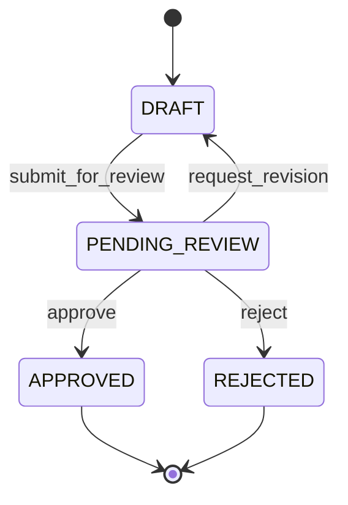

# Code path: Human-in-the-loop (approve / revise / reject)

After Analyze, the prep bundle is stored as **`PENDING_REVIEW`**. The dock
**Your decision** lets a human approve, request changes, or reject. Nothing is
submitted to an employer.

**Upstream:** [CODE_PATH_ANALYZE.md](CODE_PATH_ANALYZE.md) step 14.

---

## 1. State machine

Implemented in [`careercrew/review.py`](../careercrew/review.py).

| From | Allowed to | Trigger |
|------|------------|---------|
| `DRAFT` | `PENDING_REVIEW` | `PackageReviewService.submit_for_review` (end of Analyze) |
| `PENDING_REVIEW` | `APPROVED` | UI **Approve prep bundle** |
| `PENDING_REVIEW` | `REJECTED` | UI **Reject** |
| `PENDING_REVIEW` | `DRAFT` | UI **Request changes** (requires notes; revision count++) |
| `APPROVED` / `REJECTED` | — | Terminal |

Revision limit: `CAREERCREW_MAX_REVISIONS` (default **2**) via `Settings.max_revisions`. Exceeding → `ReviewError`.

Enums: `ReviewStatus`, `ReviewAction` in [`models.py`](../careercrew/models.py).

---

## 2. Submit for review (automatic after Analyze)

| Step | Code | Persistence |
|------|------|-------------|
| 1 | `app.analyze` calls `_REVIEW.submit_for_review(inputs, result.package, result.trace)` | |
| 2 | `save_package(inputs, package, trace, revision_count)` | **INSERT/UPSERT** SQLite `packages` |
| 3 | `update_status(..., PENDING_REVIEW)` | Status column |
| 4 | Enable Approve / Reject / Revise buttons | Gradio `interactive=True` |

**SQLite `packages` columns written:** `package_id`, `role_title`, `company`, `inputs_json`, `package_json`, `trace_json`, `status`, `revision_count`, timestamps.

Store: [`careercrew/session_store.py`](../careercrew/session_store.py).

---

## 3. UI handlers

| Button | Handler in `app.py` | Service call |
|--------|---------------------|--------------|
| Approve prep bundle | `approve(state, feedback)` | `apply_decision(..., APPROVE)` |
| Request changes | `request_revision(state, feedback)` | Candidate adds missing experience (e.g. React years). Notes are **merged into the resume**, then Analyze re-runs so gaps / prep / rewrites update. |
| Reject | `reject(state, feedback)` | `apply_decision(..., REJECT)` |
| Refresh history | `refresh_btn` → `_tracker_rows()` | `list_packages` read-only |

Shared pattern:

1. `_load_package(state)` → `ScreeningPrep`  
2. `_current_status(package)` → read SQLite status + revision_count  
3. `ReviewDecision(package_id, decision, reviewer_feedback)`  
4. `_REVIEW.apply_decision(...)`  
5. Refresh `package_md` HTML + History table  

On success, approve message includes the prep-bundle id (`pkg-…`).

---

## 4. Decisions table

Each approve/reject/revise also **INSERT**s into SQLite `decisions`:

| Column | Meaning |
|--------|---------|
| `package_id` | FK to packages |
| `decision` | `approve` / `reject` / `revise` |
| `feedback` | Notes from the textbox |
| `decided_at` | UTC ISO timestamp |

---

## 5. History tab

| Piece | Detail |
|-------|--------|
| Renderer | `_tracker_rows()` → Gradio Dataframe |
| Source | `_STORE.list_packages(limit=50)` |
| Columns | Package (id), Role, Company, Status, Revisions, Updated |

**This is where you find `pkg-ec169491`:** History tab, Package column. Content of that bundle is the **Screening answers** tab (and Match / Prep plan from the same Analyze run in Gradio state).

---

## 6. Talking points

- HITL is real persistence, not a fake button  
- Approve does **not** call any employer API  
- Revise without notes is rejected by the service  
- **Request changes** means “I have experience that wasn’t on my resume” → merge into resume → re-analyze → refresh Match / Prep / Screening  
- After terminal APPROVED/REJECTED, further decisions fail until a new Analyze  
