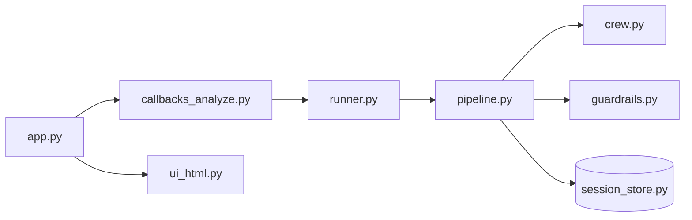

# Code tour

One page for the live code talk. The longer function-by-function notes stay in `docs/code-walkthrough/`. Words used on this page are defined in `GLOSSARY.md`.

## File map

| Open this | One sentence |
|-----------|----------------|
| `app.py` | Builds the page and wires each button to a callback. |
| `careercrew/ui_html.py` | Turns data into HTML. No buttons, no database. |
| `careercrew/ui_css.py` | Styling only. Skip it during the code talk. |
| `careercrew/ui_state.py` | The Analyze outputs, named, instead of `outputs[5]`. |
| `careercrew/callbacks_analyze.py` | Analyze, Approve, Reject, and Request changes. |
| `careercrew/callbacks_interview.py` | Mock interview and the two coach chats. |
| `careercrew/runner.py` | Runs the pipeline on a background thread and reports the `Stage`. |
| `careercrew/pipeline.py` | The four phases: check inputs, run the crew, parse, check outputs. |
| `careercrew/crew.py` | Builds the five agents from the YAML files. |
| `config/agents.yaml` | Role, goal, and backstory for each agent. |
| `config/tasks.yaml` | What each agent must produce. |
| `careercrew/models.py` | The typed objects passed between steps. |
| `careercrew/guardrails.py` | The checks that reject invented claims. |
| `careercrew/document_tools.py` | Reads a resume or job file into text. |
| `mcp_server/server.py` | The two tools agents are allowed to call. |
| `careercrew/mcp_client.py` | How the crew and the tests call that server. |
| `careercrew/review.py` | Approve, reject, or request changes. |
| `careercrew/session_store.py` | SQLite so a refresh does not lose the bundle. |
| `careercrew/prep.py` | The prep plan, including the offline fallback. |
| `careercrew/interview.py` | Questions and scores for the practice interview. |
| `careercrew/audio.py` | Speech in and speech out. Empty when there is no key. |
| `careercrew/coach.py` | The prep chat and the post-interview chat. |
| `careercrew/services.py` | The one settings object, database, and review service. |
| `main.py` | The same pipeline, from the command line. |

## What happens when you press Analyze match

1. `app.py` calls `analyze` with the resume and the job description.
2. `analyze` checks that both are present, then asks `stream_with_progress` to run.
3. `runner.py` starts `run_analysis` on a worker thread and yields the current `Stage`.
4. `pipeline.py` validates the files, runs the five-agent crew, and validates the citations.
5. The callback fills an `AnalyzeOutputs` object by name and yields it as a list only at the edge, because Gradio needs an ordered list.
6. The prep bundle is saved and waits for Approve, Reject, or Request changes.

## The five agents

1. Profile Extractor — resume to a structured profile.
2. Job Description Analyzer — posting to required skills.
3. Gap Analyst — covered, reframeable, or out of scope.
4. Feedback Writer — bullet rewrites that cite a resume fact.
5. Interview Prep Advisor — where to spend prep time.

There is no sixth agent. Screening answers and the answer bank were removed because the page no longer collects or shows them, so `ApplicationPackage` is just the reviewable bundle (role, company, summary, do-not-claim list).
