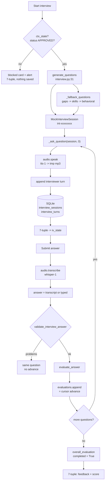

# The Mock interview button, step by step

One press of **Start interview**, then one press of **Submit answer** traced through
the codebase: every step names the file, the exact line range, and the code that
runs. Every citation in this document is checked by
`python tools/verify_doc_refs.py docs/MOCK_INTERVIEW_WALKTHROUGH.md`.

Written for two readers at once:

- **A reviewer or examiner** who wants to open any file at any cited line and see
  the code the text just described.
- **A presenter** who has to explain the tab out loud. Appendix D is a
  five-slide outline plus likely questions, each answered with a file:line.

Scope: **the voice/text practice interview only.** Approval is covered by
[`CODE_PATH_HITL.md`](CODE_PATH_HITL.md); the chats that read this session are in
[`PREP_COACH_WALKTHROUGH.md`](PREP_COACH_WALKTHROUGH.md) and
[`POST_INTERVIEW_COACH_WALKTHROUGH.md`](POST_INTERVIEW_COACH_WALKTHROUGH.md).

---

## Part A. Orientation

### A1. The answer in one paragraph

You press **Start interview**. Gradio calls `interview_start`
(`careercrew/callbacks_interview.py:144`), a plain function (not a generator). It
reads the Analyze context out of `ctx_state`, refuses to run unless the stored
package is `APPROVED`, and asks `interview.generate_questions`
(`careercrew/interview.py:31`) for N questions. That helper tries the LLM once and
falls back to a deterministic question bank built from the gap report
(`careercrew/interview.py:101`). A `MockInterviewSession` is created and
`_ask_question` (`careercrew/callbacks_interview.py:195`) speaks the first question
with `tts-1`, appends an interviewer turn, saves the session to SQLite, and returns
a **7-tuple** of UI updates. Every press of **Submit answer** calls
`interview_submit` (`:215`), which transcribes the recording with `whisper-1`
(or takes the typed text), guardrails the answer, scores it with
`interview.evaluate_answer`, **appends the evaluation** — which is how the cursor
advances — and either asks the next question or scores the whole session.

The whole tab is **one cursor, one session object, one 7-tuple contract**.

### A2. The step map

Read this first; every row is a section below with the full code.

| # | What happens | File | Lines |
|--:|--------------|------|-------|
| 1 | Two buttons are bound to two handlers | [`app.py`](../app.py) | 440-467 |
| 2 | The tab's components and their fixed order | [`app.py`](../app.py) | 270-330 |
| 3 | The approval gate reads SQLite | [`callbacks_interview.py`](../careercrew/callbacks_interview.py) | 30-44 |
| 4 | `interview_start` runs three gates, then builds the session | [`callbacks_interview.py`](../careercrew/callbacks_interview.py) | 144-192 |
| 5 | Questions: LLM first, deterministic bank second | [`interview.py`](../careercrew/interview.py) | 31-55 |
| 5.1 | The deterministic question bank | [`interview.py`](../careercrew/interview.py) | 101-164 |
| 6 | `_ask_question` speaks, appends, saves, renders | [`callbacks_interview.py`](../careercrew/callbacks_interview.py) | 195-212 |
| 6.1 | TTS: `tts-1` -> temp mp3 or `None` | [`audio.py`](../careercrew/audio.py) | 65-93 |
| 6.2 | The interviewer card and its three states | [`callbacks_interview.py`](../careercrew/callbacks_interview.py) | 56-84 |
| 7 | `interview_submit` — the four early exits | [`callbacks_interview.py`](../careercrew/callbacks_interview.py) | 215-250 |
| 8 | Answer in: STT first, typed text second, then guardrails | [`callbacks_interview.py`](../careercrew/callbacks_interview.py) | 252-267 |
| 9 | Scoring the answer | [`callbacks_interview.py`](../careercrew/callbacks_interview.py) | 269-279 |
| 9.1 | `evaluate_answer`: LLM, then the heuristic scorer | [`interview.py`](../careercrew/interview.py) | 167-184 |
| 9.2 | The heuristic scorer, in full | [`interview.py`](../careercrew/interview.py) | 225-294 |
| 10 | Advancing the cursor and asking the next question | [`callbacks_interview.py`](../careercrew/callbacks_interview.py) | 280-305 |
| 11 | The last answer: overall score and completion | [`callbacks_interview.py`](../careercrew/callbacks_interview.py) | 306-321 |
| 12 | Persistence: one row per session, rebuilt turn rows | [`session_store.py`](../careercrew/session_store.py) | 211-251 |
| 13 | The three renderers the tab uses | [`callbacks_interview.py`](../careercrew/callbacks_interview.py) | 87-130 |

### A3. The whole tab on one diagram

The important structural fact: **the cursor is not stored.** The current question
index is `len(session.evaluations)`, so a rejected answer cannot skip a question and
a double submit cannot evaluate the same question twice.



### A4. How to read the steps

Every step below uses the same six headings:

| Heading | What it tells you |
|---------|-------------------|
| **Runs when** | The trigger, and what state it depends on |
| **The code** | The actual excerpt, with its file and line range on the fence |
| **Line by line** | What each line does, and the names it calls |
| **In -> Out** | What the step consumes and what it produces |
| **Why it is built this way** | The design reason, including the alternative that was rejected |
| **Hands off to** | The next step, so you can follow the chain |

Code blocks are quoted from the working tree, so the line numbers in the fence are
the line numbers in your editor. To re-check any citation in seconds, see
Appendix C.

---

## Part B. The steps

### Step 1. Two buttons are bound to two handlers

**Runs when:** the page finishes building, once. This is wiring, not a click.

**The code**

```startLine:440:467:app.py
        iv_start_btn.click(
            interview_start,
            inputs=[ctx_state, iv_questions],
            outputs=[
                iv_error,
                iv_question_html,
                iv_audio,
                iv_chatbot,
                iv_feedback_html,
                iv_overall_html,
                iv_state,
            ],
            show_progress="hidden",
        )
        iv_submit_btn.click(
            interview_submit,
            inputs=[ctx_state, iv_state, iv_answer_text, iv_answer_audio],
            outputs=[
                iv_error,
                iv_question_html,
                iv_audio,
                iv_chatbot,
                iv_feedback_html,
                iv_overall_html,
                iv_state,
            ],
            show_progress="hidden",
        )
```

**Line by line**

- **440-451** — `Start interview` passes **two** inputs: the Analyze context and the
  question-count slider. It writes **seven** outputs.
- **454-467** — `Submit answer` passes **four** inputs: context, the live session,
  the typed text, and the recorded-file path. It writes the **same seven** outputs,
  in the same order.
- **451, 467** — `show_progress="hidden"` suppresses Gradio's per-output spinner.
  These handlers return 7 outputs, so the default mode would stack seven progress
  strips.

Two facts are load-bearing. First, **`ctx_state` and `iv_state` are different
Gradio `gr.State`s**: the first holds the Analyze JSON blob, the second holds the
interview JSON. Second, **the order of `outputs` is the tuple contract** — every
return statement in both handlers must produce these seven values positionally.

**In -> Out:** live widget objects -> two registrations Gradio will call on click.

**Why it is built this way:** `iv_state` is the session. Keeping it in a
`gr.State` instead of a Python global means two browser tabs cannot corrupt each
other's interview, and a reload simply starts with `None`.

**Hands off to:** `interview_start`, step 4, through the gate in step 3.

---

### Step 2. The tab's components

**Runs when:** page build time.

**The code**

```startLine:270:330:app.py
            with gr.Tab("3 · Mock interview"):
                gr.HTML(
                    "<div class='cc-panel-head'><h3>Voice mock interview</h3>"
                    "<p class='cc-hint'>Requires a finished Analyze first. The interviewer asks "
                    "questions from your resume and the role. Answer by voice or type. "
                    "Practice only — nothing is submitted.</p></div>"
                )
                with gr.Row():
                    iv_start_btn = gr.Button(
                        "Start interview",
                        variant="primary",
                        elem_classes=["cc-run"],
                        scale=0,
                        min_width=168,
                    )
                    iv_questions = gr.Slider(
                        minimum=3,
                        maximum=10,
                        value=_SETTINGS.interview_question_count,
                        step=1,
                        label="Number of questions",
                        scale=1,
                    )
                iv_error = gr.HTML("")
                iv_question_html = gr.HTML(_question_html(None, done=True))
                iv_audio = gr.Audio(
                    label="Interviewer (listen)",
                    autoplay=True,
                    interactive=False,
                    elem_id="cc-iv-audio",
                )
                with gr.Row(equal_height=True):
                    with gr.Column(scale=1):
                        gr.HTML("<div class='cc-section-title'>Your answer</div>")
                        iv_answer_audio = gr.Audio(
                            sources=["microphone"],
                            type="filepath",
                            label="Record your answer",
                        )
                        iv_answer_text = gr.Textbox(
                            label="Or type your answer",
                            placeholder="Type your answer if you prefer not to record…",
                            lines=4,
                            elem_classes=["cc-field"],
                        )
                        iv_submit_btn = gr.Button(
                            "Submit answer",
                            variant="primary",
                            elem_classes=["cc-run"],
                            scale=0,
                            min_width=168,
                        )
                    with gr.Column(scale=1):
                        gr.HTML("<div class='cc-section-title'>Live transcript</div>")
                        iv_chatbot = gr.Chatbot(
                            label="Interview transcript",
                            height=360,
                            elem_id="cc-iv-transcript",
                        )
                iv_feedback_html = gr.HTML("")
                iv_overall_html = gr.HTML("")
```

**Line by line**

- **285-291** — the slider: 3 to 10, defaulting to
  `_SETTINGS.interview_question_count` (5 unless
  `CAREERCREW_INTERVIEW_QUESTIONS` says otherwise).
- **295-300** — the interviewer's player. `interactive=False` means the user cannot
  upload into it; `autoplay=True` plays the question the moment it arrives.
- **304-308** — the answer recorder. `sources=["microphone"]` is Gradio asking the
  browser for `getUserMedia`; `type="filepath"` means Python receives a **path to a
  temp file**, not bytes or a numpy array. There is no custom JavaScript capture
  code anywhere in this repo.
- **309-314** — the text alternative. Both inputs are always present, so the tab
  works with no microphone and no API key.
- **316-322** — the submit button. It is **not** disabled while a request is in
  flight, which is a known rough edge (see Appendix E).
- **325-329** — the transcript. `Chatbot` takes a list of `{"role", "content"}`
  dicts, which `_turns_to_messages` produces.
- **329-330** — two empty HTML blocks: the per-answer feedback card and the overall
  scorecard. They stay empty mid-interview.

**In -> Out:** nothing; this step only constructs components.

**Why it is built this way:** the answer area pairs a recorder with a textbox
rather than toggling between them. Voice is an enhancement, never a requirement,
so a browser that denies the microphone or a deployment with no audio key still has
a complete interview tab.

**Hands off to:** step 1, the wiring.

---

### Step 3. The approval gate reads SQLite

**Runs when:** at the top of `interview_start`, `interview_submit`, and both chat
handlers.

**The code**

```startLine:30:44:careercrew/callbacks_interview.py
def _is_approved(ctx_state) -> bool:
    """True when the analyzed package has been approved by a human.

    The mock interview and both coaching chats are gated on approval: they consume
    the reviewed bundle, so they must not run on an unreviewed draft. Returns
    ``False`` when there is no context or no stored package.
    """
    context = _load_context(ctx_state)
    if not context:
        return False
    package_id = context.get("package_id") or ""
    if not package_id:
        return False
    stored = _STORE.get_package(package_id)
    return bool(stored) and stored.get("status") == ReviewStatus.APPROVED.value
```

**Line by line**

- **38** — `_load_context` parses the Analyze JSON. `None` means Analyze never ran in
  this browser session.
- **41-43** — no `package_id` in the blob means there is nothing to approve.
- **44** — the **only** source of truth is the `packages` row in SQLite. The status
  is not cached in Gradio state.

**In -> Out:** the context blob -> `True`/`False`.

**Why it is built this way:** the gate deliberately reads persisted state rather
than a UI flag. That is what makes it survive a reload, and what lets it re-check on
**every submit** — so revoking approval mid-interview takes effect on the next
answer instead of at the next page load.

**Hands off to:** step 4 (or the blocked card).

---

### Step 4. `interview_start` runs three gates, then builds the session

**Runs when:** the user presses **Start interview**.

**The code**

```startLine:144:192:careercrew/callbacks_interview.py
def interview_start(ctx_state, count: int) -> tuple:
    """Begin a mock interview: generate questions and ask the first one."""
    context = _load_context(ctx_state)
    if not context:
        return (
            _alert_html("Analyze a match first — the interview uses your resume and the role."),
            _question_html(None, blocked=True),
            None,
            [],
            "",
            "",
            None,
        )
    if not _is_approved(ctx_state):
        return (
            _alert_html(_APPROVAL_REQUIRED),
            _question_html(None, blocked=True),
            None,
            [],
            "",
            "",
            None,
        )
    models = _context_models(context)
    questions = interview.generate_questions(
        models["profile"],
        models["requirements"],
        models["gaps"],
        models["prep_plan"],
        int(count or _SETTINGS.interview_question_count),
        llm=llm.callable_or_none(),
    )
    if not questions:
        return (
            _alert_html("No interview questions could be generated. Try analyzing again."),
            _question_html(None, done=True),
            None,
            [],
            "",
            "",
            None,
        )

    session = MockInterviewSession(
        session_id=interview.make_session_id(),
        role_title=(models["requirements"].seniority or "the role"),
        questions=questions,
    )
    return _ask_question(session, 0)
```

**Line by line**

- **146-156** — gate 1: no Analyze context. The 7-tuple is `(alert, blocked card,
  None, [], "", "", None)`; the last slot is `iv_state`, and `None` means **no
  session exists yet**.
- **157-166** — gate 2: the bundle is not approved. Same shape, different alert.
- **167** — `_context_models` rebuilds typed Pydantic models from the JSON blob, so
  nothing here re-runs the crew.
- **168-175** — gate 3 is a soft one: ask for questions. `llm.callable_or_none()`
  returns `None` when no API key is set, which sends `generate_questions` straight
  to its deterministic bank.
- **176-185** — if even the fallback produced nothing, show the "complete" card
  rather than a blank interviewer panel.
- **187-191** — the session. `make_session_id()` yields `int-` plus 8 hex chars;
  `role_title` falls back to the literal `"the role"` when the JD had no seniority.
- **192** — the first question is asked by the same helper that asks all the
  others.

**In -> Out:** `(ctx_state, slider_value)` -> the 7-tuple for question 0.

**Why it is built this way:** the three early returns are ordered cheapest-first,
and every one of them returns the **full** 7-tuple. A short tuple would make Gradio
throw a "handler did not return enough outputs" error instead of showing the gate
message.

**Hands off to:** step 5 for the questions, then step 6 to ask them.

---

### Step 5. Questions: LLM first, deterministic bank second

**Runs when:** inside `interview_start`, and never again for that session.

**The code**

```startLine:31:55:careercrew/interview.py
def generate_questions(
    profile,
    requirements,
    gaps,
    plan: InterviewPrepPlan | None = None,
    count: int = 5,
    *,
    llm=None,
) -> list[InterviewQuestion]:
    """Produce interviewer questions.

    Uses the LLM when available, otherwise derives questions deterministically
    from the highest-priority gaps, the requirements, and the prep-plan themes.
    Questions never assert facts absent from the provided context.
    """
    questions: list[InterviewQuestion] = []
    if llm is not None:
        try:
            raw = llm(_build_question_prompt(profile, requirements, gaps, plan, count))
            questions = _parse_questions(raw, count)
        except Exception as exc:  # noqa: BLE001 - fall back, never crash
            logger.warning("question generation failed: %s", exc)
    if not questions:
        questions = _fallback_questions(profile, requirements, gaps, plan, count)
    return questions
```

**Line by line**

- **47** — `llm` is `None` without a key, so the whole `try` block is skipped.
- **49-50** — one prompt, one parse. `_build_question_prompt` (`:58`) embeds the four
  models as JSON and asks for a `{"questions": [...]}` object.
- **51-52** — a network error, a timeout, or malformed JSON all land here and are
  logged, never raised.
- **53-54** — the fallback also covers the case where the parse *succeeded* but
  returned an empty list.

**In -> Out:** four typed models plus a count -> a list of `InterviewQuestion`.

**Why it is built this way:** the guard is `if not questions`, not `if llm is None`.
That single condition makes the fallback cover three distinct failures — no key,
exception, and empty parse — with no duplicated logic.

**Hands off to:** step 5.1 for the bank, then the caller in step 4.

---

### Step 5.1. The deterministic question bank

**Runs when:** the LLM is absent, failed, or returned nothing.

**The code**

```startLine:101:164:careercrew/interview.py
def _fallback_questions(profile, requirements, gaps, plan, count: int) -> list[InterviewQuestion]:
    out: list[InterviewQuestion] = []

    def add(text: str, intent: str, competency: str, source: str) -> None:
        if len(out) < count:
            out.append(
                InterviewQuestion(
                    index=len(out),
                    text=text,
                    intent=intent,
                    target_competency=competency,
                    source=source,
                )
            )

    for verdict in gaps.verdicts:
        if (verdict.verdict or "").lower().startswith("out"):
            add(
                f"The role asks for {verdict.requirement}, which isn't on your resume yet. "
                f"How would you get up to speed, and what related experience can you draw on?",
                "How you handle a genuine gap honestly and how you learn.",
                verdict.requirement,
                verdict.requirement,
            )
    for verdict in gaps.verdicts:
        if (verdict.verdict or "").lower().startswith("reframe"):
            add(
                f"Tell me about a time your work touched on {verdict.requirement}. "
                "What did you do and what was the result?",
                "Whether related experience transfers clearly to the requirement.",
                verdict.requirement,
                verdict.requirement,
            )
    for skill in list(requirements.required_skills)[:4]:
        add(
            f"Walk me through a project where you used {skill}. What was your specific "
            "contribution and the measurable outcome?",
            "Depth and ownership in a core required skill.",
            skill,
            skill,
        )
    for skill in list(profile.skills)[:3]:
        add(
            f"You list {skill} on your resume — describe the most complex problem you "
            "solved with it and the trade-offs you weighed.",
            "Evidence depth behind a claimed skill.",
            skill,
            skill,
        )
    add(
        "Tell me about a time you disagreed with a teammate or stakeholder. How did you "
        "resolve it, and what was the outcome?",
        "Collaboration and conflict handling.",
        "collaboration",
        "general",
    )
    add(
        "Describe a project that failed or missed its goal. What did you learn, and what "
        "would you do differently?",
        "Self-awareness and learning from failure.",
        "reflection",
        "general",
    )
    return out[:count]
```

**Line by line**

- **104-114** — `add` is the whole budget mechanism. Once `len(out)` hits `count`,
  every later call is silently dropped, so the priority order below **is** the
  ranking.
- **116-124** — out-of-scope gaps first. The most uncomfortable question is the most
  valuable one.
- **125-133** — then reframeable gaps.
- **134-141** — then the JD's four most important required skills.
- **142-149** — then the candidate's own claimed skills, asking for evidence depth.
- **150-162** — two general behavioral questions fill any remaining slots, so the
  list is never empty.
- **164** — `out[:count]` is belt-and-braces; `add` already enforced it.

**In -> Out:** the models -> 3 to 10 `InterviewQuestion`s, each with an `index`.

**Why it is built this way:** every question names a `target_competency` taken
verbatim from the analysis, which is what later lets the heuristic scorer say
"you never mentioned React". Generic questions from thin air would break that link.

**Hands off to:** step 6.

---

### Step 6. `_ask_question` speaks, appends, saves, renders

**Runs when:** once per question — from `interview_start` for index 0, and from
`interview_submit` for every later index.

**The code**

```startLine:195:212:careercrew/callbacks_interview.py
def _ask_question(session: MockInterviewSession, index: int, *, error: str = "") -> tuple:
    """Append the interviewer's question turn, synthesize audio, and render."""
    question = session.questions[index]
    audio_path = audio.speak(question.text) or ""
    question.audio_ref = audio_path
    interview.append_turn(
        session, InterviewTurnRole.INTERVIEWER, question.text, question_index=index
    )
    _STORE.save_interview(session)
    return (
        _alert_html(error) if error else _audio_status(),
        _question_html(question),
        audio_path or None,
        _turns_to_messages(session),
        "",
        "",
        session.model_dump_json(),
    )
```

**Line by line**

- **198** — TTS. `or ""` normalises `None` to the empty string so the model holds a
  `str`, not `Optional[str]`.
- **200-202** — the interviewer's line is recorded in the transcript. Note the turn
  is appended **after** the audio is produced, so a failed synthesis still leaves a
  readable question.
- **203** — persisted immediately. The database therefore always contains at least
  the question the user is looking at.
- **205** — slot `[0]` is either an error alert or the text-only-mode banner.
- **207** — slot `[2]` is the mp3 path, or `None` so the player stays blank.
- **208-209** — slots `[4]` and `[5]` are cleared. That is what removes the previous
  answer's feedback card when a new question arrives.
- **211** — slot `[6]`, `iv_state`, is the whole session serialized.

**In -> Out:** a session plus a question index -> the 7-tuple for that question.

**Why it is built this way:** one helper for "ask question N" is what makes the
submit handler's middle path a single call. The alternative — inline rendering in
both places — would be two copies of the TTS, append, save, and render sequence that
could drift apart.

**Hands off to:** step 6.1 for the voice, step 6.2 for the card.

---

### Step 6.1. TTS: `tts-1` -> temp mp3 or `None`

**Runs when:** `_ask_question` runs and an API key is configured.

**The code**

```startLine:65:93:careercrew/audio.py
def speak(text: str) -> str | None:
    """Synthesize the interviewer's question with ``tts-1``.

    Returns a path to an mp3 file, or ``None`` when audio is unavailable or
    synthesis fails. Never raises.
    """
    text = (text or "").strip()
    if not text or not audio_available():
        return None
    settings = get_settings()
    try:
        response = _client().audio.speech.create(
            model=settings.tts_model,
            voice=settings.tts_voice,
            input=text,
        )
        handle, path = tempfile.mkstemp(prefix="careercrew_q", suffix=".mp3")
        os.close(handle)
        # The SDK provides .write_to_file / .stream_to_file depending on version.
        if hasattr(response, "write_to_file"):
            response.write_to_file(path)
        else:  # pragma: no cover - older SDK shape
            with open(path, "wb") as out:
                for chunk in response.iter_bytes():
                    out.write(chunk)
        return path
    except Exception as exc:  # noqa: BLE001 - degrade to text, never crash
        logger.warning("speech synthesis failed: %s", exc)
        return None
```

**Line by line**

- **71-73** — empty text, or no key, means `None`. `audio_available()` is just
  `bool(settings.openai_api_key)` (`careercrew/config.py:60-62`), so there is no
  separate audio key.
- **76-80** — the call. Model default `tts-1`, voice default `alloy`, both
  overridable by `CAREERCREW_TTS_MODEL` / `CAREERCREW_TTS_VOICE`.
- **81-82** — a pre-created temp file. `mkstemp` returns an open descriptor, so the
  `os.close` at line 82 is required before the SDK reopens the path for writing.
- **84-89** — the SDK-shape branch: newer releases expose `write_to_file`, others are
  streamed chunk by chunk.
- **91-93** — any failure degrades to `None`, which the caller renders as text-only.

**In -> Out:** question text -> an absolute mp3 path, or `None`.

**Why it is built this way:** `speak` never raises. The interview is the product; the
voice is a delivery detail. A quota error at this point must not cost the user their
session.

**Hands off to:** back to step 6.

---

### Step 6.2. The interviewer card and its three states

**Runs when:** every render.

**The code**

```startLine:56:84:careercrew/callbacks_interview.py
def _question_html(
    question: InterviewQuestion | None, *, done: bool = False, blocked: bool = False
) -> str:
    if blocked:
        return (
            "<div class='cc-card'><h3>Interview not started</h3>"
            "<div class='cc-empty'><strong>This bundle is still waiting for review</strong>"
            "Approve the prep bundle in <strong>1 · Analyze match</strong> to unlock the "
            "mock interview.</div></div>"
        )
    if done or question is None:
        return (
            "<div class='cc-card'><h3>Interview complete</h3>"
            "<div class='cc-empty'><strong>You finished the mock interview</strong>"
            "Review your score and the per-question feedback below, then ask the "
            "post-interview coach anything you like.</div></div>"
        )
    return (
        "<div class='cc-card'><h3>Interviewer</h3>"
        "<p class='cc-hint'>Question "
        f"{question.index + 1} of the mock interview</p>"
        f"<p style='font-size:16px;line-height:1.55;color:var(--cc-ink);margin:6px 0'>{_esc(question.text)}</p>"
        "<div class='cc-cite'>"
        "<span class='cc-cite-label'>Looking for</span>"
        "<span class='cc-cite-fact'>"
        f"{_esc(question.intent or question.target_competency or 'a grounded, specific answer')}"
        "</span></div>"
        "</div>"
    )
```

**Line by line**

- **59-65** — `blocked=True` is the approval/no-context state.
- **66-72** — `done=True`, or a `None` question, is the finished state. The tab
  starts in this state so it never looks broken before the first click.
- **73-84** — the live card. "Question N" comes from `question.index + 1`, so it is
  one-based.
- **81-82** — the "Looking for" chip falls back through `intent`, then
  `target_competency`, then a generic phrase. Every value is `_esc`aped.

**In -> Out:** a question (or a state flag) -> an HTML string.

**Why it is built this way:** three states, one function, one `question_html`
component. If the card were built in the callback, every early return would need its
own copy.

**Hands off to:** step 7, the answer submission.

---

### Step 7. `interview_submit` — the four early exits

**Runs when:** the user presses **Submit answer**.

**The code**

```startLine:215:252:careercrew/callbacks_interview.py
def interview_submit(ctx_state, iv_state, answer_text, answer_audio) -> tuple:
    """Evaluate the candidate's answer, then move to the next question."""
    context = _load_context(ctx_state)
    session = _load_interview(iv_state)
    if context is None or session is None:
        return (
            _alert_html("Start the interview first."),
            _question_html(None, done=True),
            None,
            [],
            "",
            "",
            iv_state,
        )
    if not _is_approved(ctx_state):
        return (
            _alert_html(_APPROVAL_REQUIRED),
            _question_html(None, blocked=True),
            None,
            _turns_to_messages(session),
            "",
            "",
            iv_state,
        )

    index = sum(1 for e in session.evaluations)
    if index >= len(session.questions):
        return (
            "",
            _question_html(None, done=True),
            None,
            _turns_to_messages(session),
            "",
            _overall_html(session),
            session.model_dump_json(),
        )

    question = session.questions[index]
```

**Line by line**

- **217-218** — the session is rehydrated from `iv_state` by
  `_load_interview` (`:324`), which returns `None` on invalid JSON.
- **219-228** — no context or no session: tell the user to start. `iv_state` is
  handed back **unchanged**, so nothing is lost.
- **229-238** — the approval gate again, on every single answer. Note it still
  renders the existing transcript.
- **240** — **the cursor.** `len(session.evaluations)` is the index of the next
  question. There is no counter field anywhere in the model.
- **241-250** — completion guard: if the cursor is past the end, show the overall
  score instead of crashing on `questions[index]`. This makes a late double-click
  harmless.
- **252** — only now is the current question read.

**In -> Out:** four widget values -> either an early 7-tuple or the question being
answered.

**Why it is built this way:** deriving the cursor from `evaluations` makes the
session **idempotent under duplicate submits**. If the same answer were evaluated
twice it would advance twice, so the guard at 240-241 is the safety net, and the
`evaluations.append` at step 10 is the single place the cursor moves.

**Hands off to:** step 8.

---

### Step 8. Answer in: STT first, typed text second, then guardrails

**Runs when:** the session and gate checks pass.

**The code**

```startLine:252:268:careercrew/callbacks_interview.py
    question = session.questions[index]

    # Prefer the transcript of the recorded audio; fall back to typed text.
    transcript = audio.transcribe(answer_audio) if answer_audio else ""
    answer = transcript.strip() or (answer_text or "").strip()

    problems = guardrails.validate_interview_answer(answer)
    if problems:
        return (
            _alert_html("Please answer the question: " + "; ".join(problems)),
            _question_html(question),
            None,
            _turns_to_messages(session),
            _evaluation_html(session.evaluations[-1] if session.evaluations else None),
            "",
            session.model_dump_json(),
        )
```

**Line by line**

- **255** — `transcribe` is called only when a recording exists. It returns `""` for
  a missing path, no key, or any API error (see `careercrew/audio.py:38-59`).
- **256** — the precedence is explicit: **recording, then typed text**. An empty
  transcript (silence, or a failed call) falls through to whatever was typed.
- **258** — one guardrail call covers empty, over 6000 characters, and
  instruction-injection patterns (`careercrew/guardrails.py:196-211`).
- **260-267** — the rejection tuple. Two details matter: the **same** question is
  re-rendered (no advance, because nothing was appended to `evaluations`), and the
  previous answer's feedback is re-shown rather than cleared.

**In -> Out:** the recorder path and the textbox -> one validated answer string, or
an error tuple.

**Why it is built this way:** the guard runs on the **merged** answer, not on each
input separately. That way the rule is "the text we will send to the evaluator must
be acceptable", which is the property that actually matters.

**Hands off to:** step 9.

---

### Step 9. Scoring the answer

**Runs when:** the answer passed the guardrail.

**The code**

```startLine:270:279:careercrew/callbacks_interview.py
    models = _context_models(context)
    context_bundle = {
        "role": models["requirements"].model_dump(),
        "gaps": models["gaps"].model_dump(),
        "prep_plan": models["prep_plan"].model_dump(),
    }
    evaluation = interview.evaluate_answer(
        question, answer, context_bundle, llm=llm.callable_or_none()
    )
    eval_problems = guardrails.validate_evaluation(evaluation)
```

**Line by line**

- **270-275** — a **narrowed** context. The evaluator gets the role, the gaps, and
  the prep plan, but deliberately **not** the whole candidate profile. Fewer tokens,
  and no chance of the scorer inventing a fact it half-read.
- **276-278** — one call, which internally handles LLM and fallback.
- **279** — output guardrail. Note what happens next: the result is **carried
  forward**, not acted on here. It surfaces only on the final answer (step 11).

**In -> Out:** question, answer, context -> an `AnswerEvaluation` in 0-100.

**Why it is built this way:** `eval_problems` being deferred is a small wart. A
mid-interview warning is arguably worth showing immediately; today only the last one
is displayed. See Appendix E.

**Hands off to:** step 9.1, then step 9.2.

---

### Step 9.1. `evaluate_answer`: LLM, then the heuristic scorer

**Runs when:** step 9 calls it.

**The code**

```startLine:167:184:careercrew/interview.py
def evaluate_answer(
    question: InterviewQuestion,
    answer: str,
    context: dict | None = None,
    *,
    llm=None,
) -> AnswerEvaluation:
    """Critique one answer: what the interviewer wanted, plus what to improve."""
    context = context or {}
    if llm is not None:
        try:
            raw = llm(_build_eval_prompt(question, answer, context))
            parsed = _parse_evaluation(raw, question, answer)
            if parsed is not None:
                return parsed
        except Exception as exc:  # noqa: BLE001 - fall back, never crash
            logger.warning("answer evaluation failed: %s", exc)
    return _fallback_evaluation(question, answer, context)
```

**Line by line**

- **178-181** — unlike `generate_questions`, this checks the **parsed object**, not
  an empty list. A reply that parses to `None` falls through.
- **182-183** — logged, never raised.

**In -> Out:** the same inputs as step 9 -> `AnswerEvaluation`.

**Why it is built this way:** one `return` on the happy path, one on the fallback, so
there is no path that produces no evaluation at all. The UI always has a score.

**Hands off to:** step 9.2 when the LLM is unavailable.

---

### Step 9.2. The heuristic scorer, in full

**Runs when:** no API key, or the LLM call/parse failed.

**The code**

```startLine:225:294:careercrew/interview.py
def _fallback_evaluation(
    question: InterviewQuestion, answer: str, context: dict
) -> AnswerEvaluation:
    """Heuristic, deterministic evaluation used without an LLM key.

    It rewards concrete structure and specifics (numbers, "I" ownership, outcome
    words) and always returns at least one improvement, so the feedback stays
    actionable.
    """
    text = (answer or "").strip()
    words = text.split()
    length = len(words)
    lower = text.lower()

    score = 55
    strengths: list[str] = []
    improvements: list[str] = []

    if length >= 60:
        score += 12
        strengths.append("Gave a developed answer with enough detail to follow.")
    elif length >= 25:
        score += 5
        strengths.append("Covered the question at a high level.")
    else:
        improvements.append("Expand the answer with a concrete example and a clear outcome.")

    if re.search(r"\d", text):
        score += 10
        strengths.append("Included specifics or metrics, which makes the answer credible.")
    else:
        improvements.append("Add a number or measurable result to make the impact concrete.")

    if re.search(r"\b(i|my|we)\b", lower) and re.search(
        r"\b(result|impact|led|built|shipped|improved|reduced|increased)\b", lower
    ):
        score += 12
        strengths.append("Used action-and-result framing rather than just describing duties.")
    else:
        improvements.append(
            "Use an action-result structure (situation, what YOU did, the outcome)."
        )

    if question.target_competency and question.target_competency.lower() not in lower:
        improvements.append(f"Connect the answer explicitly to {question.target_competency}.")

    if not strengths:
        strengths.append("Engaged with the question directly.")
    if not improvements:
        improvements.append("Tighten the ending with a one-sentence takeaway.")

    score = max(0, min(100, score))
    outline = [
        "Open with a one-line summary of the situation.",
        "Explain your specific role and the actions you took.",
        "Quantify the result and name what you learned.",
    ]
    return AnswerEvaluation(
        question_index=question.index,
        question=question.text,
        answer=text,
        score=score,
        what_interviewer_wanted=(
            question.intent
            or f"Evidence of real experience with {question.target_competency or 'the requirement'}."
        ),
        strengths=strengths,
        improvements=improvements,
        model_answer_outline=outline,
    )
```

**Line by line**

- **239** — the floor is **55**, so an empty-ish answer still scores above zero. The
  three bonuses are +12, +10, +12, giving a realistic ceiling of 89 and a floor of
  55 before clamping.
- **243-250** — length: 60+ words earns the full bonus, 25-59 earns half, shorter gets
  an instruction instead.
- **252-256** — any digit earns +10. This is a crude proxy for "quantified result",
  and it is why "I shipped 3 features" beats a better story with no numbers.
- **258-266** — the strongest signal: first person **and** an outcome verb.
- **268-269** — the only check that uses the analysis: it names the competency the
  question targeted and asks the candidate to connect to it explicitly.
- **271-274** — both lists are guaranteed non-empty, which is what
  `validate_evaluation` requires.
- **286-289** — `what_interviewer_wanted` prefers the question's own `intent`.

**In -> Out:** question, answer, context -> `AnswerEvaluation`.

**Why it is built this way:** the scorer is deliberately legible. An examiner can
compute the score by hand from the answer text, which is the honest thing to offer
when no model is scoring. It is also why the same answer always scores the same on
every deployment.

**Hands off to:** step 10.

---

### Step 10. Advancing the cursor and asking the next question

**Runs when:** an evaluation exists and questions remain.

**The code**

```startLine:280:305:careercrew/callbacks_interview.py
    session.evaluations.append(evaluation)
    interview.append_turn(
        session,
        InterviewTurnRole.CANDIDATE,
        answer,
        question_index=index,
        audio_ref=str(answer_audio or ""),
    )

    next_index = index + 1
    if next_index < len(session.questions):
        session.overall_score = round(
            sum(e.score for e in session.evaluations) / len(session.evaluations)
        )
        _STORE.save_interview(session)
        question_out = _ask_question(session, next_index)
        # Splice the evaluation feedback into the returned tuple.
        return (
            question_out[0],
            question_out[1],
            question_out[2],
            question_out[3],
            _evaluation_html(evaluation),
            "",
            question_out[6],
        )
```

**Line by line**

- **280** — **the cursor advances here and only here.** Everything after this line
  sees a session that has moved on.
- **281-287** — the candidate's turn, with `question_index=index` so the transcript
  can be paired with the evaluation.
- **289** — the next index. A local variable, not stored.
- **290-292** — the running average, recomputed from scratch each time. Cheap, and
  impossible to drift.
- **293** — saved **before** the next question is asked, so a crash inside
  `_ask_question` still leaves a consistent session.
- **294** — TTS, append, save for question N+1.
- **297-304** — the splice. **This is the subtle part:** `_ask_question` returns an
  empty slot `[4]` because it has no feedback to show. Here that slot is overwritten
  with `_evaluation_html(evaluation)` so the user sees feedback for the answer they
  *just gave* alongside the *next* question. Slot `[5]` stays empty until the end.

**In -> Out:** the evaluated session -> the 7-tuple for question N+1, with N's
feedback in slot `[4]`.

**Why it is built this way:** the splice exists because two different things are
being painted at once. Passing the evaluation into `_ask_question` would have
coupled the "ask" helper to the "score" concern for the sake of one field.

**Hands off to:** step 11 on the final answer, or back to step 7 for the next submit.

---

### Step 11. The last answer: overall score and completion

**Runs when:** `next_index >= len(session.questions)`.

**The code**

```startLine:307:321:careercrew/callbacks_interview.py
    # Final answer: finish the session and score it.
    score, summary = interview.overall_evaluation(session, llm=llm.callable_or_none())
    session.overall_score = score
    session.overall_summary = summary
    session.completed = True
    _STORE.save_interview(session)
    return (
        _alert_html("; ".join(eval_problems)) if eval_problems else _audio_status(),
        _question_html(None, done=True),
        None,
        _turns_to_messages(session),
        _evaluation_html(evaluation),
        _overall_html(session),
        session.model_dump_json(),
    )
```

**Line by line**

- **308** — `overall_evaluation` (`careercrew/interview.py:319-334`) returns the plain
  mean of all scores, plus an LLM-written 3-5 sentence summary or a deterministic
  one.
- **311** — `completed = True` is what makes `_overall_html` render at all.
- **314** — the only place `eval_problems` from step 9 is shown. If the evaluator
  produced something out of bounds, the user learns about it here.
- **315** — the card flips to "Interview complete".
- **316** — audio cleared.
- **318-319** — the final answer's feedback **and** the overall score are shown
  together, which is the only moment both are visible at once.

The overall scorer:

```startLine:319:334:careercrew/interview.py
def overall_evaluation(session: MockInterviewSession, *, llm=None) -> tuple[int, str]:
    """Return (overall_score, summary) for a finished session."""
    scores = [e.score for e in session.evaluations]
    base = round(sum(scores) / len(scores)) if scores else 0
    all_improvements: list[str] = []
    for evaluation in session.evaluations:
        all_improvements.extend(evaluation.improvements)

    if llm is not None:
        try:
            raw = llm(_build_overall_prompt(session, base))
            summary = _parse_overall(raw) or _fallback_summary(session, base)
            return base, summary
        except Exception:  # noqa: BLE001
            pass
    return base, _fallback_summary(session, base)
```

Note that the **score is always the plain mean**, even with an LLM. The model only
writes the prose. That keeps the number reproducible.

**In -> Out:** the completed session -> the final 7-tuple.

**Why it is built this way:** completion is derived from the question list, not from
a "finished" button. The user cannot end early, and cannot overrun.

**Hands off to:** the Post-interview coach, which reads this same session in
[`POST_INTERVIEW_COACH_WALKTHROUGH.md`](POST_INTERVIEW_COACH_WALKTHROUGH.md).

---

### Step 12. Persistence: one row per session, rebuilt turn rows

**Runs when:** after every interviewer turn and every answer.

**The code**

```startLine:211:251:careercrew/session_store.py
    def save_interview(self, session, package_id: str | None = None) -> None:
        """Insert or update a mock interview session (with its transcript turns)."""
        now = _now()
        with self._connect() as conn:
            conn.execute(
                """
                INSERT INTO interview_sessions
                    (session_id, package_id, role_title, session_json,
                     overall_score, completed, created_at, updated_at)
                VALUES (?, ?, ?, ?, ?, ?, ?, ?)
                ON CONFLICT(session_id) DO UPDATE SET
                    session_json = excluded.session_json,
                    overall_score = excluded.overall_score,
                    completed = excluded.completed,
                    updated_at = excluded.updated_at
                """,
                (
                    session.session_id,
                    package_id,
                    session.role_title,
                    session.model_dump_json(),
                    int(session.overall_score),
                    1 if session.completed else 0,
                    now,
                    now,
                ),
            )
            # Rebuild the turn rows so re-saving never duplicates them.
            conn.execute("DELETE FROM interview_turns WHERE session_id = ?", (session.session_id,))
            for turn in session.turns:
                conn.execute(
                    "INSERT INTO interview_turns (session_id, question_index, role, text, created_at) "
                    "VALUES (?, ?, ?, ?, ?)",
                    (
                        session.session_id,
                        turn.question_index,
                        turn.role.value,
                        turn.text,
                        turn.created_at.isoformat(),
                    ),
                )
```

**Line by line**

- **217-225** — upsert on `session_id`. `created_at` is written only on insert;
  `updated_at` is refreshed on every save.
- **231** — the **whole session** goes into `session_json`. The other columns are
  denormalised copies for querying, not the source of truth.
- **238-239** — delete then re-insert the turns. The session object is the source of
  truth; the table is a mirror, so rebuilding is always correct and never doubles a
  row.
- **241-250** — one row per turn with `question_index`, so a query can reconstruct
  the transcript in order.

The two tables:

```startLine:44:63:careercrew/session_store.py
CREATE TABLE IF NOT EXISTS interview_sessions (
    session_id      TEXT PRIMARY KEY,
    package_id      TEXT,
    role_title      TEXT NOT NULL DEFAULT '',
    session_json    TEXT NOT NULL,
    overall_score   INTEGER NOT NULL DEFAULT 0,
    completed       INTEGER NOT NULL DEFAULT 0,
    created_at      TEXT NOT NULL,
    updated_at      TEXT NOT NULL
);

CREATE TABLE IF NOT EXISTS interview_turns (
    id              INTEGER PRIMARY KEY AUTOINCREMENT,
    session_id      TEXT NOT NULL,
    question_index  INTEGER NOT NULL DEFAULT 0,
    role            TEXT NOT NULL,
    text            TEXT NOT NULL DEFAULT '',
    created_at      TEXT NOT NULL,
    FOREIGN KEY (session_id) REFERENCES interview_sessions(session_id)
);
```

Note `package_id` is **nullable and never supplied** by the callbacks — every call
is `_STORE.save_interview(session)` with one argument. Linking a session to a
package would need a one-word change at each call site.

**In -> Out:** the in-memory session -> two tables.

**Why it is built this way:** one upsert per save means crash-consistency is trivial.
`latest_interview` (`careercrew/session_store.py:253-263`) reads
`ORDER BY updated_at DESC LIMIT 1`, which is what lets the post-interview coach
recover a session after a page refresh destroyed `iv_state`.

**Hands off to:** step 13 for rendering, and the coach tabs for reading.

---

### Step 13. The three renderers the tab uses

**Runs when:** every render.

The transcript, interviewer turns mapped to `assistant`:

```startLine:47:53:careercrew/callbacks_interview.py
def _turns_to_messages(session: MockInterviewSession) -> list[dict]:
    """Convert the transcript to Gradio chatbot messages (interviewer = assistant)."""
    messages: list[dict] = []
    for turn in session.turns:
        role = "assistant" if turn.role is InterviewTurnRole.INTERVIEWER else "user"
        messages.append({"role": role, "content": turn.text})
    return messages
```

The per-answer card:

```startLine:87:116:careercrew/callbacks_interview.py
def _evaluation_html(evaluation: AnswerEvaluation | None) -> str:
    if evaluation is None:
        return ""
    strengths = "".join(f"<li>{_esc(s)}</li>" for s in evaluation.strengths)
    improvements = "".join(f"<li>{_esc(i)}</li>" for i in evaluation.improvements)
    outline = "".join(f"<li>{_esc(o)}</li>" for o in evaluation.model_answer_outline)
    return (
        "<div class='cc-card'><h3>Feedback on your answer</h3>"
        "<div class='cc-stats'>"
        f"<span class='cc-chip'>score · {int(evaluation.score)}/100</span>"
        "</div>"
        "<div class='cc-section-title'>What the interviewer was looking for</div>"
        f"<p style='color:var(--cc-ink-2);font-size:13.5px;line-height:1.55'>{_esc(evaluation.what_interviewer_wanted)}</p>"
        + (
            f"<div class='cc-section-title'>What worked</div><ul class='cc-list'>{strengths}</ul>"
            if strengths
            else ""
        )
        + (
            f"<div class='cc-section-title'>What to improve</div><div class='cc-note'><ul class='cc-list'>{improvements}</ul></div>"
            if improvements
            else ""
        )
        + (
            f"<div class='cc-section-title'>A stronger answer would</div><ul class='cc-list'>{outline}</ul>"
            if outline
            else ""
        )
        + "</div>"
    )
```

The overall scorecard:

```startLine:119:130:careercrew/callbacks_interview.py
def _overall_html(session: MockInterviewSession) -> str:
    if not session.completed:
        return ""
    return (
        "<div class='cc-card'><h3>Overall performance</h3>"
        "<div class='cc-meter'><div class='cc-meter-top'>"
        f"<div class='cc-score'>{int(session.overall_score)}<small>/100</small></div>"
        "<div class='cc-meter-label'>Average across your answers</div></div>"
        f"<div class='cc-bar'><span style='width:{int(session.overall_score)}%'></span></div></div>"
        f"<p style='color:var(--cc-ink-2);font-size:14px;line-height:1.6'>{_esc(session.overall_summary)}</p>"
        "</div>"
    )
```

**Line by line**

- **50-51** — the interviewer is `assistant`. That is what makes the transcript read
  like a conversation rather than a log.
- **90-92** — every list is escaped **per item**, not per list, so a candidate's own
  angle brackets cannot break the markup.
- **101, 106, 111** — each section is omitted when empty, so the card never shows a
  heading with nothing under it.
- **120-121** — the scorecard is hidden until `completed`.

**In -> Out:** session or evaluation -> HTML strings.

**Why it is built this way:** all three are pure functions of the models. They can be
unit-tested without Gradio, and the callbacks stay about orchestration.

**Hands off to:** the browser.

---

## Appendix A. The offline path (no `OPENAI_API_KEY`)

A compact trace, so the document stays honest without doubling in length.

1. `llm.callable_or_none()` (`careercrew/llm.py:98`) returns `None`, so
   `generate_questions` skips straight to `_fallback_questions`.
2. `audio.speak` and `audio.transcribe` both see `audio_available() == False` and
   return `None` / `""` without a network call.
3. `_ask_question` therefore renders `_audio_status()`, the "Text-only practice
   mode" banner, in slot `[0]`.
4. `evaluate_answer` returns `_fallback_evaluation`, the heuristic scorer.
5. `overall_evaluation` returns the mean plus `_fallback_summary`.

| Area | With key | Without key |
|------|----------|-------------|
| Questions | LLM, grounded in the four models | deterministic bank, gaps first |
| Interviewer voice | `tts-1`, autoplaying mp3 | text card only, banner explains |
| Answer capture | `whisper-1` transcript or typing | typing only |
| Per-answer score | model critique | heuristic: length + digits + action-result |
| Overall score | plain mean either way | plain mean |
| Summary | model prose | deterministic sentence |

Nothing in the tab is unreachable offline. Voice is the only missing capability.

---

## Appendix B. The cursor on one page

The single most important invariant in this tab. The current question is never
stored:

```
cursor = len(session.evaluations)
```

| Event | What changes | Cursor |
|-------|--------------|--------|
| Start interview | `evaluations = []` | 0 |
| Ask question | `turns` grows | unchanged |
| Submit rejected answer | nothing | unchanged |
| Submit accepted answer | `evaluations` grows by 1, `turns` grows by 1 | +1 |
| Final answer | `completed = True` | equal to `len(questions)` |

Consequences worth stating out loud:

- A guardrail rejection cannot skip a question, because nothing was appended.
- A duplicate submit of the last answer hits the completion guard (`:241`) and
  re-renders the overall card instead of raising `IndexError`.
- The count in "Question N of the mock interview" always matches the stored
  evaluations, so the UI cannot disagree with the database.

---

## Appendix C. Re-verify any citation in 30 seconds

Check this whole document at once:

```powershell
python tools/verify_doc_refs.py docs/MOCK_INTERVIEW_WALKTHROUGH.md
```

It verifies every ``` ``startLine:endLine:path`` `` block and every `path:line`
mention, and fails if a file is missing, a range is out of bounds, or the quoted
body does not match the source.

Print one cited range:

```powershell
python -c "import pathlib; ls=pathlib.Path('careercrew/callbacks_interview.py').read_text(encoding='utf-8').splitlines(); [print('%4d| %s' % (i+1, ls[i])) for i in range(143, 193)]"
```

Find a call site:

```powershell
rg -n "_is_approved|save_interview|latest_interview|_ask_question" careercrew app.py
```

---

## Appendix D. Presentation cheat sheet

### Five slides, mapped to the steps

| Slide | Title | Steps | The one thing to say |
|------:|-------|-------|----------------------|
| 1 | Gated practice, not a bot demo | 1-3 | Nothing runs until a human approves the bundle, and the gate re-checks on every answer |
| 2 | Questions from the gaps | 4-5.1 | The fallback bank is ordered by real priority, so the hardest question comes first |
| 3 | One cursor, no counter | 7, 10 | The index is `len(evaluations)`; that is why a rejected answer cannot skip a question |
| 4 | Voice is optional | 2, 6.1, 8 | Browser captures the mic, Whisper transcribes, but typed text is always accepted |
| 5 | Scored and persisted | 11-12 | The score is the plain mean; the session survives a refresh in SQLite |

### Questions an examiner is likely to ask

| Question | Answer, with the place to look |
|----------|-------------------------------|
| Where does the click enter Python? | `iv_start_btn.click(...)` at `app.py:440-451`; handler at `careercrew/callbacks_interview.py:144` |
| Why is `interview_start` not a generator? | It has nothing to stream — one question generation call, then one render. `analyze` needs a generator because the crew takes 30-90 s |
| Where is the "must be approved" rule? | `_is_approved` (`careercrew/callbacks_interview.py:30-44`), called at `:157`, `:229`, `:337`, `:368` |
| Does the gate use UI state or the database? | The database: `_STORE.get_package(package_id)["status"]` (`:44`) |
| Who generates the questions? | `interview.generate_questions` (`careercrew/interview.py:31-55`); fallback bank at `:101-164` |
| Where are the questions stored? | Inside `MockInterviewSession.questions`, serialized to `session_json` (`careercrew/session_store.py:231`) |
| Where does the mic get opened? | The browser, via `gr.Audio(sources=["microphone"])` at `app.py:304-308`. No custom JS in this repo |
| What model does STT/TTS use? | `whisper-1` and `tts-1` with voice `alloy`, from `careercrew/config.py:72-74` |
| Where is the current question tracked? | Nowhere — it is `len(session.evaluations)` at `careercrew/callbacks_interview.py:240` |
| What if the answer is empty or injected? | `validate_interview_answer` (`careercrew/guardrails.py:196-211`); the handler returns at `:260` without advancing |
| How is an answer scored without an API key? | `_fallback_evaluation` (`careercrew/interview.py:225-294`): base 55, +12 length, +10 digits, +12 action-result |
| Is the overall score model-generated? | No. It is the plain mean (`careercrew/interview.py:321-322`); the model only writes the summary |
| How does the post-interview coach find this session after a refresh? | `_STORE.latest_interview()` (`careercrew/session_store.py:253-263`), used at `careercrew/callbacks_interview.py:370` |
| Why are turns deleted before insert? | The session object is the source of truth; rebuilding avoids duplicate rows (`careercrew/session_store.py:238-239`) |
| Is anything submitted to an employer? | No. Practice only; the tab copy says so at `app.py:273-276` |

---

## Appendix E. Rough edges worth knowing

Honest notes, so the document is not a sales brochure.

| Observation | Where | Effect |
|-------------|-------|--------|
| `audio.cleanup()` is defined but never called | `careercrew/audio.py:99` | One temp `.mp3` per question accumulates in the OS temp folder |
| `eval_problems` is computed but deferred | `careercrew/callbacks_interview.py:279` | A mid-interview guardrail warning is dropped; only the last is shown at `:314` |
| `package_id` is never passed to `save_interview` | `careercrew/session_store.py:212` | The column stays `NULL`, so sessions are not linked to bundles |
| Submit is not disabled while running | `app.py:316-322` | A very fast double-click can race; the completion guard at `:241` is the backstop |
| Typed text is ignored when a recording exists | `careercrew/callbacks_interview.py:255-256` | Recording wins by design, but a user who records silence relies on Whisper returning `""` |

---

## Related documents

- [`ANALYZE_BUTTON_WALKTHROUGH.md`](ANALYZE_BUTTON_WALKTHROUGH.md) — the same
  treatment for the Analyze click
- [`REVISION_BUTTON_WALKTHROUGH.md`](REVISION_BUTTON_WALKTHROUGH.md) — the
  "Apply updates & re-analyze" click
- [`PREP_COACH_WALKTHROUGH.md`](PREP_COACH_WALKTHROUGH.md) — the preparation chat
- [`POST_INTERVIEW_COACH_WALKTHROUGH.md`](POST_INTERVIEW_COACH_WALKTHROUGH.md) — the
  chat that reads this session
- [`CODE_PATH_MOCK_INTERVIEW.md`](CODE_PATH_MOCK_INTERVIEW.md) — diagram-first
  companion, same path
- [`CODE_PATH_HITL.md`](CODE_PATH_HITL.md) — how approval and revision work
- [`code-walkthrough/interview.md`](code-walkthrough/interview.md) — per-function
  notes
