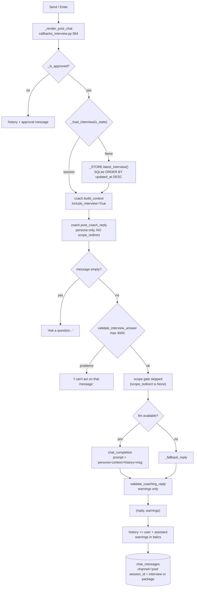

# The Post-interview coach ("Send"), step by step

One press of **Send** in Tab 4 traced through the codebase: every step names the
file, the exact line range, and the code that runs. Every citation in this document
is checked by
`python tools/verify_doc_refs.py docs/POST_INTERVIEW_COACH_WALKTHROUGH.md`.

Written for two readers at once:

- **A reviewer or examiner** who wants to open any file at any cited line and see
  the code the text just described.
- **A presenter** who has to explain the tab out loud. Appendix D is a
  five-slide outline plus likely questions, each answered with a file:line.

Scope: **the post-interview chat only.** Read
[`PREP_COACH_WALKTHROUGH.md`](PREP_COACH_WALKTHROUGH.md) first — this tab is the same
handler and the same reply pipeline with **two** differences, and knowing the shared
part makes the differences obvious.

---

## Part A. Orientation

### A1. The answer in one paragraph

You press **Send** (or Enter). Gradio calls `_render_post_chat`
(`careercrew/callbacks_interview.py:364`), which takes **four** inputs instead of
three — the extra one is `iv_state`, the mock interview. It gates on approval, loads
the interview session from `iv_state` **or falls back to the most recent session in
SQLite**, and calls `coach.build_context` with `include_interview=True` so the
transcript, every per-question evaluation, and the overall score all enter the prompt.
The reply comes from `coach.post_coach_reply` (`careercrew/coach.py:592`), which is
`coach._reply` **without a `scope_redirect`** — that single omission is why this
channel answers broader questions than the prep coach. Both messages are appended to
the visible thread and written to `chat_messages` with `channel="post"`.

The whole tab is **one function, one wider context, two return values**.

### A2. The step map

| # | What happens | File | Lines |
|--:|--------------|------|-------|
| 1 | Enter and Send both bind four inputs | [`app.py`](../app.py) | 482-493 |
| 2 | The tab's two components | [`app.py`](../app.py) | 335-358 |
| 3 | The approval gate, shared with the other tabs | [`callbacks_interview.py`](../careercrew/callbacks_interview.py) | 30-44 |
| 4 | `_render_post_chat` — the whole turn | [`callbacks_interview.py`](../careercrew/callbacks_interview.py) | 364-399 |
| 5 | How the session is found | [`callbacks_interview.py`](../careercrew/callbacks_interview.py) | 324-331 |
| 5.1 | The SQLite fallback when `iv_state` is empty | [`session_store.py`](../careercrew/session_store.py) | 253-263 |
| 6 | `build_context` with the interview folded in | [`coach.py`](../careercrew/coach.py) | 67-82 |
| 7 | `post_coach_reply` — no scope gate | [`coach.py`](../careercrew/coach.py) | 592-612 |
| 8 | `_reply`, as it runs for this channel | [`coach.py`](../careercrew/coach.py) | 615-663 |
| 9 | The output guardrail | [`guardrails.py`](../careercrew/guardrails.py) | 247-267 |
| 10 | Persistence under `channel="post"` | [`session_store.py`](../careercrew/session_store.py) | 266-273 |

### A3. The whole turn on one diagram

The important structural fact: **this channel is the permissive one, and the
permissiveness is not written anywhere in the handler.** It comes from an argument
that is *absent* — `scope_redirect` is simply not passed.



### A4. How to read the steps

Every step below uses the same six headings:

| Heading | What it tells you |
|---------|-------------------|
| **Runs when** | The trigger, and what state it depends on |
| **The code** | The actual excerpt, with its file and line range on the fence |
| **Line by line** | What each line does, and the names it calls |
| **In -> Out** | What the step consumes and what it produces |
| **Why it is built this way** | The design reason, including the alternative that was rejected |
| **Hands off to** | The next step, so you can follow the chain |

Code blocks are quoted from the working tree, so the line numbers in the fence are
the line numbers in your editor. To re-check any citation in seconds, see
Appendix C.

---

## Part B. The steps

### Step 1. Enter and Send both bind four inputs

**Runs when:** page build time.

**The code**

```startLine:482:493:app.py
        post_msg.submit(
            _render_post_chat,
            inputs=[post_chat, post_msg, ctx_state, iv_state],
            outputs=[post_chat, post_msg],
            show_progress="hidden",
        )
        post_send_btn.click(
            _render_post_chat,
            inputs=[post_chat, post_msg, ctx_state, iv_state],
            outputs=[post_chat, post_msg],
            show_progress="hidden",
        )
```

**Line by line**

- **482, 488** — two triggers, one handler.
- **484, 490** — **four inputs.** Compare with the prep coach's three
  (`app.py:470-481`): the fourth is `iv_state`.
- **485, 491** — still only two outputs. The handler cannot repaint anything outside
  this tab.

`ctx_state` and `iv_state` are separate `gr.State`s declared together:

```startLine:89:91:app.py
        state = gr.State(None)
        ctx_state = gr.State(None)
        iv_state = gr.State(None)
```

**In -> Out:** live widgets -> two registrations.

**Why it is built this way:** `iv_state` is passed as an input rather than read from
a module global so that two browser sessions cannot see each other's interviews.

**Hands off to:** `_render_post_chat`, step 4.

---

### Step 2. The tab's two components

**Runs when:** page build time.

**The code**

```startLine:335:358:app.py
            with gr.Tab("4 · Post-interview coach"):
                gr.HTML(
                    "<div class='cc-panel-head'><h3>Post-interview coach</h3>"
                    "<p class='cc-hint'>After your mock interview, ask about performance. "
                    "Remembers resume, JD, gaps, prep plan, and interview transcript.</p></div>"
                )
                post_chat = gr.Chatbot(label="Chat", height=380, show_label=False)
                with gr.Row(equal_height=True):
                    post_msg = gr.Textbox(
                        label="Your question",
                        placeholder="What should I improve before the real interview?",
                        lines=2,
                        scale=4,
                        elem_classes=["cc-field"],
                    )
                    post_send_btn = gr.Button(
                        "Send",
                        variant="primary",
                        elem_classes=["cc-run"],
                        scale=0,
                        min_width=100,
                    )
```

**Line by line**

- **343** — `gr.Chatbot` at 380 px, list-of-dicts format.
- **338-340** — the hint promises a *wider* memory than the prep coach: resume, JD,
  gaps, prep plan, **and transcript**. That promise is kept in `build_context`.
- **345-349** — the placeholder nudges toward the performance question this tab
  exists for.

The tab is visually identical to Tab 2 apart from the copy. That is intentional: the
difference is entirely in what goes into the prompt, not in the UI.

**In -> Out:** component construction only.

**Why it is built this way:** two chat windows rather than one with a mode switch.
A toggle would invite users to ask performance questions in the scoped channel and
get redirected, which reads as a bug.

**Hands off to:** step 1.

---

### Step 3. The approval gate, shared with the other tabs

**Runs when:** the first line of `_render_post_chat`.

```startLine:30:44:careercrew/callbacks_interview.py
def _is_approved(ctx_state) -> bool:
    """True when the analyzed package has been approved by a human.

    The mock interview and both coaching chats are gated on approval: they consume
    the reviewed bundle, so they must not run on an unreviewed draft. Returns
    ``False`` when there is no context or no stored package.
    """
    context = _load_context(ctx_state)
    if not context:
        return False
    package_id = context.get("package_id") or ""
    if not package_id:
        return False
    stored = _STORE.get_package(package_id)
    return bool(stored) and stored.get("status") == ReviewStatus.APPROVED.value
```

**Line by line**

- **44** — SQLite is the only source of truth for the status.
- **38** — no Analyze context means nothing to gate.

**In -> Out:** the context blob -> `True`/`False`.

**Why it is built this way:** the gate is on **approval**, not on having run an
interview. A user can open this tab and ask "what should I improve before the real
interview?" without ever doing a mock interview; the context simply has no interview
section, and the prompt handles it.

**Hands off to:** step 4.

---

### Step 4. `_render_post_chat` — the whole turn

**Runs when:** **Send** or **Enter**.

**The code**

```startLine:364:398:careercrew/callbacks_interview.py
def _render_post_chat(history, message: str, ctx_state, iv_state):
    """Post-interview coach: everything about JD, resume, and interview results."""
    history = history or []
    context = _load_context(ctx_state)
    if not _is_approved(ctx_state):
        return history + [{"role": "assistant", "content": _APPROVAL_REQUIRED}], ""
    session = _load_interview(iv_state) or _STORE.latest_interview()
    if context:
        models = _context_models(context)
        context_text = coach.build_context(
            profile=models["profile"],
            requirements=models["requirements"],
            gaps=models["gaps"],
            prep_plan=models["prep_plan"],
            interview=session,
            include_interview=session is not None,
        )
    else:
        context_text = coach.build_context(interview=session, include_interview=session is not None)
    prompt = message.get("text", "") if isinstance(message, dict) else str(message)
    reply, warnings = coach.post_coach_reply(
        prompt, context_text, history, llm=llm.callable_or_none()
    )
    if warnings:
        reply += "\n\n_" + " ".join(warnings) + "_"
    history = history + [
        {"role": "user", "content": prompt},
        {"role": "assistant", "content": reply},
    ]
    session_id = (session.session_id if session else None) or (
        _context_models(context)["package_id"] if context else "session"
    )
    _STORE.add_chat_message(session_id, "post", "user", prompt)
    _STORE.add_chat_message(session_id, "post", "assistant", reply)
    return history, ""
```

**Line by line**

- **367-368** — same gate as every other tab.
- **370** — **the one-line difference that matters most.** The session comes from
  `iv_state`, and if that is empty it falls back to `_STORE.latest_interview()`. This
  is why the tab still works after a page refresh destroyed `iv_state`.
- **371-380** — the wide context: the four Analyze models **plus** `interview=session`
  with `include_interview=session is not None`. Note the flag is tied to the session,
  not hardcoded to `True`, so a missing interview simply omits that section.
- **381-382** — a degenerate branch for the no-context case: interview only. Reachable
  only if approval succeeded without a context, which the gate makes unlikely.
- **383** — message extraction, same as the prep coach.
- **384-386** — `post_coach_reply`. **No scope argument** — see step 7.
- **387-388** — warnings appended in italics.
- **389-392** — the new visible history.
- **393-395** — the session id, in priority order: the interview session id, then the
  package id, then the literal `"session"`. This means post-chat rows group under the
  interview they discuss, which is a different grouping from the prep chat.
- **396-397** — two rows under `channel="post"`.
- **399** — clears the textbox.

**In -> Out:** `(history, message, ctx_state, iv_state)` -> `(new_history, "")`.

**Why it is built this way:** the `or` on line 370 is doing real work, and it is also
the riskiest line in the tab — see Appendix E. It is a deliberate recovery path for a
lost `gr.State`, at the cost of possibly attaching the wrong session.

**Hands off to:** step 5 for the session, step 6 for the context, step 7 for the
reply.

---

### Step 5. How the session is found

**Runs when:** line 370 of the handler.

**The code**

```startLine:324:331:careercrew/callbacks_interview.py
def _load_interview(iv_state) -> MockInterviewSession | None:
    if not iv_state:
        return None
    try:
        return MockInterviewSession.model_validate_json(iv_state)
    except Exception:  # noqa: BLE001
        return None
```

**Line by line**

- **325-326** — no state at all means no session.
- **328** — the session round-trips through its own JSON. This is the same string the
  interview tab writes into slot `[6]` of its 7-tuple.
- **329-330** — malformed JSON returns `None` rather than raising, which is what makes
  the `or` on line 370 safe.

**In -> Out:** a JSON string -> a validated session or `None`.

**Why it is built this way:** the broad `except` is what lets the fallback in step 5.1
take over instead of a crash. A stricter validator would surface a schema change as a
stack trace in the chat.

**Hands off to:** step 5.1 when this returns `None`.

---

### Step 5.1. The SQLite fallback when `iv_state` is empty

**Runs when:** `_load_interview` returned `None`.

**The code**

```startLine:253:263:careercrew/session_store.py
    def latest_interview(self):
        """Return the most recently updated mock interview session, or None."""
        from careercrew.models import MockInterviewSession

        with self._connect() as conn:
            row = conn.execute(
                "SELECT session_json FROM interview_sessions ORDER BY updated_at DESC LIMIT 1"
            ).fetchone()
        if row is None:
            return None
        return MockInterviewSession.model_validate_json(row["session_json"])
```

**Line by line**

- **258-260** — **one row, globally.** There is no `WHERE` clause: not by user, not by
  package, not by session. The newest `updated_at` wins.
- **262-263** — the stored JSON is validated back into a full session.

**In -> Out:** nothing -> the most recently updated session in the database, or
`None`.

**Why it is built this way:** it is a recovery path, not a lookup. The intended case
is "the browser refreshed, `iv_state` is gone, but the user is still the same person on
the same machine". In a single-user deployment that is exactly right. In a multi-user
deployment it is a cross-session leak — see Appendix E.

**Hands off to:** step 6.

---

### Step 6. `build_context` with the interview folded in

**Runs when:** every message.

**The code**

```startLine:67:82:careercrew/coach.py
    if include_interview and interview is not None:
        transcript = "\n".join(
            f"{turn.role.value.upper()}: {turn.text}" for turn in interview.turns
        )
        parts.append(f"## Mock interview transcript\n{transcript}")
        evaluations = "\n".join(
            f"Q{e.question_index + 1} score {e.score}: {e.what_interviewer_wanted} | "
            f"improve: {'; '.join(e.improvements)}"
            for e in interview.evaluations
        )
        parts.append(
            f"## Mock interview evaluations\n{evaluations}\n\n"
            f"## Overall mock interview score: {interview.overall_score}/100\n"
            f"{interview.overall_summary}"
        )
```

**Line by line**

- **67** — the double condition. The flag must be set **and** a session must exist.
  The caller sets the flag from the session (`callbacks_interview.py:379`), so in
  practice the two agree.
- **68-70** — the transcript, one line per turn, role uppercased (`INTERVIEWER` /
  `CANDIDATE`). This is the same format `interview._build_overall_prompt` uses.
- **71-76** — the evaluations, flattened to **one line per question**:
  `Q<n> score <s>: <what they wanted> | improve: <list>`. Flattening matters: the raw
  JSON would be several times longer and would push the context past the cap sooner.
- **77-81** — the overall score and the summary, appended to the same section.

This block is inserted **after** the prep plan and **before** the guidelines, so the
full ordering is: header, anchor topics, profile, requirements, gaps, prep plan,
transcript, evaluations, score, guidelines. Since `build_context` trims from the
**front** (`:88-89`), a long transcript survives truncation at the expense of the
profile.

**In -> Out:** the models plus a session -> a context string capped at 12 000
characters.

**Why it is built this way:** the flattening in lines 71-76 is the difference between
a context that fits and one that does not. Eight questions with three improvements
each is a few hundred characters as lines, versus several thousand as JSON.

**Hands off to:** step 7.

---

### Step 7. `post_coach_reply` — no scope gate

**Runs when:** line 384 of the handler.

**The code**

```startLine:592:612:careercrew/coach.py
def post_coach_reply(
    message: str,
    context: str,
    history: list[dict] | None = None,
    *,
    llm=None,
) -> tuple[str, list[str]]:
    """Reply on the post-interview performance channel (full context)."""
    return _reply(
        message,
        context,
        history,
        persona=(
            "You are the CareerCrew post-interview coach. You have the job "
            "description, the resume, the gap report, the prep plan, the full mock "
            "interview transcript, the per-question evaluations, and the overall "
            "score. Answer any follow-up question about performance and next steps, "
            "grounded only in that material."
        ),
        llm=llm,
    )
```

**Line by line**

- **599** — one delegation, exactly like the prep version.
- **602-608** — the persona. Note what it does **not** say: there is no "help with
  exactly three topics" and no "redirect anything else".
- **609** — `llm=llm`, and **that is the end of the call.** There is no
  `scope_redirect=...`.

Compare the two signatures at the call site — this is the entire behavioural
difference between the tabs:

```startLine:583:589:careercrew/coach.py
            "role, answer it helpfully instead of asking them to rephrase. "
            "Use only the context provided. Be specific and honest; "
            "never invent experience."
        ),
        scope_redirect=SCOPE_REDIRECT,
        llm=llm,
    )
```

**In -> Out:** `(message, context, history, llm)` -> `(reply, warnings)`.

**Why it is built this way:** the post-interview channel's answer space is naturally
bounded — it is about *this* interview. Enforcing the three prep topics would block
legitimate questions like "was my body language answer too long?" or "how would you
rewrite my weakest answer?". Omitting the argument is a one-word change that turns the
gate off without forking the code.

**Hands off to:** step 8.

---

### Step 8. `_reply`, as it runs for this channel

**Runs when:** either channel calls it.

**The code**

```startLine:615:663:careercrew/coach.py
def _reply(
    message: str,
    context: str,
    history: list[dict] | None,
    *,
    persona: str,
    scope_redirect: str | None = None,
    llm=None,
) -> tuple[str, list[str]]:
    message = (message or "").strip()
    if not message:
        return "Ask a question and I'll help using your resume, the role, and your results.", []

    # Input guardrail: the message is untrusted; reject oversized or injected input.
    problems = guardrails.validate_interview_answer(message, max_chars=4000)
    if problems:
        return (
            "I can't act on that message. " + "; ".join(problems) + ". "
            "Ask a normal question about your resume, the role, or your results.",
            [],
        )

    # Scope guardrail (prep channel only): stay on the resume, the job
    # description, or interview preparation for this role; redirect anything else.
    if scope_redirect is not None and detect_scope(message, context) is None:
        return scope_redirect, []

    answer = ""
    if llm is not None:
        try:
            prompt = (
                f"{persona}\n\n{context}\n\n"
                f"## Conversation so far\n{_history_text(history)}\n\n"
                f"## Candidate question\n{message}\n\nAnswer:"
            )
            answer = (llm(prompt) or "").strip()
        except Exception as exc:  # noqa: BLE001 - fall back, never crash
            logger.warning("coach LLM failed: %s", exc)
            answer = ""

    warnings: list[str] = []
    if not answer:
        answer = _fallback_reply(message, context)
        warnings.append("Coach used the offline fallback reply.")

    problems = guardrails.validate_coaching_reply(answer, context_text=context)
    if problems:
        warnings.extend(problems)
    return answer, warnings
```

**Line by line, for this channel specifically**

- **625-627** — gate 1 runs identically.
- **629-634** — gate 2 runs identically. The 4000-character cap applies here too.
- **638** — gate 3, the scope check, is **skipped** because `scope_redirect` is
  `None`. This is a runtime consequence, not a code path: the `if` is simply false.
  The comment on line 637 says "prep channel only", which is the only place the
  asymmetry is documented.
- **642-653** — the prompt: `persona`, `context`, `## Conversation so far`,
  `## Candidate question`, `Answer:`.
- **656-658** — the empty-string fallback, identical.
- **660-662** — the output guardrail, identical.

**In -> Out:** the same as the prep channel, minus the redirect.

**Why it is built this way:** one shared pipeline with an optional gate is what
guarantees that an input-guardrail fix, a prompt-format change, or a new warning
applies to **both** chats at once. The cost is that the permissiveness of this channel
is invisible at the call site unless you know `scope_redirect` defaults to `None`.

**Hands off to:** step 9.

---

### Step 9. The output guardrail

**Runs when:** a reply exists.

**The code**

```startLine:247:268:careercrew/guardrails.py
def validate_coaching_reply(reply: str, *, context_text: str = "") -> list[str]:
    """Check a coaching chat reply for honesty and safety.

    Returns problem strings. The reply must be non-empty, must not leak PII, and
    must not invite the candidate to fabricate experience. We do not hard-block
    the reply (chat must stay usable) - callers surface problems as warnings.
    """
    problems: list[str] = []
    text = (reply or "").strip()
    if not text:
        problems.append("the coaching reply is empty")
        return problems
    if EMAIL_RE.search(text) or PHONE_RE.search(text):
        problems.append("the coaching reply appears to contain personal contact details")
    if re.search(
        r"\b(lie|fabricate|make up (?:an? )?(?:employer|title|degree|date)|"
        r"pretend you (?:have|worked))\b",
        text,
        re.IGNORECASE,
    ):
        problems.append("the coaching reply may suggest misrepresenting experience")
    return problems
```

**Line by line**

- **260-261** — PII leakage check.
- **262-266** — fabrication phrasing. This matters **more** here than in the prep
  chat, because the prompt now contains the full transcript: a reply that says "say
  you led that project" would be drawing on real material but still misleading.
- **267** — returned, not raised.

Warnings become visible via the handler:

```startLine:387:388:careercrew/callbacks_interview.py
    if warnings:
        reply += "\n\n_" + " ".join(warnings) + "_"
```

**In -> Out:** a reply -> problem strings -> italic caveat under the reply.

**Why it is built this way:** soft enforcement keeps the chat usable. A false
positive on the word "lie" would otherwise swallow a legitimate reply.

**Hands off to:** step 10.

---

### Step 10. Persistence under `channel="post"`

**Runs when:** the very end of the handler.

**The code**

```startLine:396:397:careercrew/callbacks_interview.py
    _STORE.add_chat_message(session_id, "post", "user", prompt)
    _STORE.add_chat_message(session_id, "post", "assistant", reply)
```

and the writer:

```startLine:266:273:careercrew/session_store.py
    def add_chat_message(self, session_id: str, channel: str, role: str, content: str) -> None:
        """Append one chat turn for a channel ('prep' or 'post')."""
        with self._connect() as conn:
            conn.execute(
                "INSERT INTO chat_messages (session_id, channel, role, content, created_at) "
                "VALUES (?, ?, ?, ?, ?)",
                (session_id, channel, role, content, _now()),
            )
```

**Line by line**

- **270-272** — append-only. Two rows per turn.
- `channel = "post"` is what separates these rows from the prep chat's, so a future
  history feature could reassemble either thread independently.

The session id used here was computed at line 393-395 of the handler and is **not**
the same key the prep chat uses. Prep groups by package; post groups by interview.

**In -> Out:** two message rows.

**The limitation:** nothing reads `chat_messages` back. A refresh loses the visible
thread even though the rows survive.

**Why it is built this way:** the visible thread is session UX; the table is the
record. Restoring it would need a `demo.load` handler that does not exist.

**Hands off to:** the browser.

---

## Appendix A. The offline path (no `OPENAI_API_KEY`)

1. `llm.callable_or_none()` returns `None` (`careercrew/llm.py:98`).
2. `build_context` still folds in the transcript — it is local data.
3. `_reply` skips the model, so `answer` stays `""`.
4. `_fallback_reply` picks a bucket by keyword.
5. Warning added: *"Coach used the offline fallback reply."*
6. `validate_coaching_reply` still runs.

| Behaviour | With key | Without key |
|-----------|----------|-------------|
| Scope gate | not applied (this channel) | not applied |
| Input guardrail | runs | runs |
| Interview in context | yes | yes — no network needed |
| Answer | model, grounded in the transcript | keyword bucket ("score"/"performance" maps to the evaluation advice) |
| Warning | only if something is off | always |

The "score"/"performance" bucket in `_fallback_reply` (`careercrew/coach.py:677-682`)
was written for exactly this channel: it points the user at the per-question
evaluations and the action-result structure.

---

## Appendix B. What each prompt block contains here

| Block | Prep coach | Post-interview coach |
|-------|-----------|----------------------|
| Persona | three fixed topics | performance and next steps |
| Profile JSON | yes | yes |
| Requirements JSON | yes | yes |
| Gap report JSON | yes | yes |
| Prep plan JSON | yes | yes |
| Interview transcript | **no** | **yes** |
| Per-question evaluations | **no** | **yes** |
| Overall score + summary | **no** | **yes** |
| Coaching guidelines | yes | yes |
| Character cap | 12 000 | 12 000 |
| History cap | 12 entries | 12 entries |
| Scope gate | **yes** | **no** |

Four extra sections, one gate removed. That is the whole difference.

---

## Appendix C. Re-verify any citation in 30 seconds

```powershell
python tools/verify_doc_refs.py docs/POST_INTERVIEW_COACH_WALKTHROUGH.md
```

Print one cited range:

```powershell
python -c "import pathlib; ls=pathlib.Path('careercrew/callbacks_interview.py').read_text(encoding='utf-8').splitlines(); [print('%4d| %s' % (i+1, ls[i])) for i in range(363, 400)]"
```

Find a call site:

```powershell
rg -n "post_coach_reply|latest_interview|include_interview|channel=\"post\"|\"post\"" careercrew app.py
```

---

## Appendix D. Presentation cheat sheet

### Five slides, mapped to the steps

| Slide | Title | Steps | The one thing to say |
|------:|-------|-------|----------------------|
| 1 | A fourth input | 1-2 | The handler receives the interview itself, not just the analysis |
| 2 | Recovery by fallback | 4, 5.1 | If the session state is gone, the newest row in SQLite stands in |
| 3 | Flattened, not dumped | 6 | Evaluations go in as one line per question so the context still fits |
| 4 | Permissive by omission | 7-8 | Not passing `scope_redirect` is the whole difference from the prep coach |
| 5 | Same guardrails, same record | 9-10 | Input refused, output caveated, rows written under `channel="post"` |

### Questions an examiner is likely to ask

| Question | Answer, with the place to look |
|----------|-------------------------------|
| Where does the click enter Python? | `post_msg.submit(...)` at `app.py:482-487`; handler at `careercrew/callbacks_interview.py:364` |
| What is different from the prep coach's handler? | One extra input (`iv_state`), a session lookup, `include_interview=True`, and `channel="post"` |
| Does this tab require an approved bundle? | Yes, `_is_approved` at `careercrew/callbacks_interview.py:368` |
| Does it require a completed interview? | No. Without a session, `include_interview` is `False` and the context is analysis-only (`:371-380`) |
| How does it find the interview after a refresh? | `_STORE.latest_interview()` at `:370`, defined at `careercrew/session_store.py:253-263` |
| Is that lookup scoped to this user? | **No.** `ORDER BY updated_at DESC LIMIT 1` with no `WHERE` clause |
| Why is the prep coach scoped and this one not? | `scope_redirect` is passed at `careercrew/coach.py:587` for prep and omitted at `:609` for post |
| Where is the scope gate implemented in `_reply`? | The `if scope_redirect is not None and detect_scope(...) is None` check at `careercrew/coach.py:638-640` |
| Is the transcript sent verbatim? | Yes, one line per turn (`careercrew/coach.py:68-70`), including the candidate's own words |
| Are evaluations sent as JSON? | No, flattened to `Q<n> score <s>: ... | improve: ...` (`careercrew/coach.py:71-76`) to fit the cap |
| What gets trimmed if the context is too long? | The **front** (`careercrew/coach.py:88-89`), so the transcript survives and the profile can be cut |
| Do warnings block the reply? | No. They are appended in italics (`careercrew/callbacks_interview.py:387-388`) |
| Does chat history persist across refresh? | The rows do (`channel="post"`); the visible thread does not |
| Is anything sent to an employer? | No. Both tabs are practice only |

---

## Appendix E. Rough edges worth knowing

| Observation | Where | Effect |
|-------------|-------|--------|
| `latest_interview()` has no user or package filter | `careercrew/session_store.py:258-260` | In a shared deployment the post coach can attach another user's interview |
| The fallback is silent | `careercrew/callbacks_interview.py:370` | The user cannot tell whether the transcript came from their session or from the database |
| `scope_redirect` defaulting to `None` is undocumented at call sites | `careercrew/coach.py:621, 609` | A reader of `post_coach_reply` cannot see that a gate exists elsewhere |
| The no-context branch builds interview-only context | `careercrew/callbacks_interview.py:381-382` | Unusual but reachable; the reply then lacks resume and JD grounding |
| Post-chat rows group by interview, prep rows by package | `careercrew/callbacks_interview.py:393-397` | A future history feature needs to know the key differs per channel |

---

## Related documents

- [`PREP_COACH_WALKTHROUGH.md`](PREP_COACH_WALKTHROUGH.md) — the scoped sibling; read
  it first
- [`MOCK_INTERVIEW_WALKTHROUGH.md`](MOCK_INTERVIEW_WALKTHROUGH.md) — where the
  session in `iv_state` comes from
- [`ANALYZE_BUTTON_WALKTHROUGH.md`](ANALYZE_BUTTON_WALKTHROUGH.md) — where
  `ctx_state` comes from
- [`CODE_PATH_COACH.md`](CODE_PATH_COACH.md) — diagram-first companion, both
  channels
- [`CODE_PATH_MOCK_INTERVIEW.md`](CODE_PATH_MOCK_INTERVIEW.md) — the interview path
- [`code-walkthrough/coach.md`](code-walkthrough/coach.md) — per-function notes
