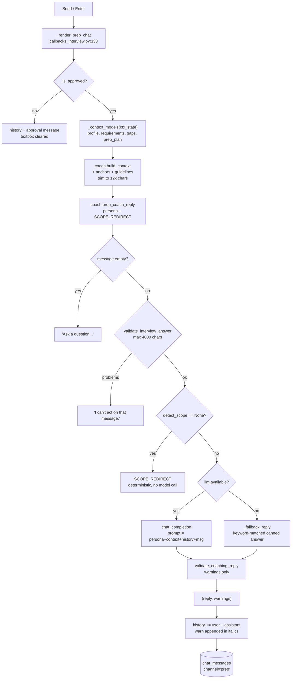

# The Prep coach ("Send"), step by step

One press of **Send** in Tab 2 traced through the codebase: every step names the
file, the exact line range, and the code that runs. Every citation in this document
is checked by
`python tools/verify_doc_refs.py docs/PREP_COACH_WALKTHROUGH.md`.

Written for two readers at once:

- **A reviewer or examiner** who wants to open any file at any cited line and see
  the code the text just described.
- **A presenter** who has to explain the tab out loud. Appendix D is a
  five-slide outline plus likely questions, each answered with a file:line.

Scope: **the preparation chat only.** Its sibling is
[`POST_INTERVIEW_COACH_WALKTHROUGH.md`](POST_INTERVIEW_COACH_WALKTHROUGH.md); both
share `coach.build_context` and `coach._reply`, so read this one first.

---

## Part A. Orientation

### A1. The answer in one paragraph

You press **Send** (or Enter). Gradio calls `_render_prep_chat`
(`careercrew/callbacks_interview.py:333`), a **plain function** returning exactly two
values: the new chat history and an empty textbox. It refuses to run unless the
stored package is `APPROVED`. Then it rebuilds the four typed models from
`ctx_state`, packs them into one bounded context string with
`coach.build_context` (`careercrew/coach.py:30`), and calls
`coach.prep_coach_reply` (`:555`). That function is a thin wrapper around
`coach._reply` (`:615`), which applies **four gates** in order — empty message,
input guardrail, topic scope, LLM-or-fallback — and then runs an output guardrail
whose findings become a warning appended under the reply. The last step appends both
messages to the visible history and writes them to the `chat_messages` table.

The whole tab is **one function, one context string, two return values**.

### A2. The step map

Read this first; every row is a section below with the full code.

| # | What happens | File | Lines |
|--:|--------------|------|-------|
| 1 | Both `Enter` and `Send` are bound to one handler | [`app.py`](../app.py) | 470-481 |
| 2 | The tab's two components | [`app.py`](../app.py) | 243-265 |
| 3 | The approval gate, again | [`callbacks_interview.py`](../careercrew/callbacks_interview.py) | 30-44 |
| 4 | `_render_prep_chat` — the whole turn | [`callbacks_interview.py`](../careercrew/callbacks_interview.py) | 333-361 |
| 5 | `build_context` assembles the bounded prompt body | [`coach.py`](../careercrew/coach.py) | 30-90 |
| 5.1 | The analysis anchors that make scope work | [`coach.py`](../careercrew/coach.py) | 414-462 |
| 5.2 | History is capped, not unbounded | [`coach.py`](../careercrew/coach.py) | 93-101 |
| 6 | `prep_coach_reply` is a persona plus a scope redirect | [`coach.py`](../careercrew/coach.py) | 555-589 |
| 7 | `_reply` — the four gates | [`coach.py`](../careercrew/coach.py) | 615-663 |
| 8 | The scope classifier | [`coach.py`](../careercrew/coach.py) | 502-551 |
| 8.1 | Off-topic words, keyword scopes, and typo tolerance | [`coach.py`](../careercrew/coach.py) | 108-244 |
| 9 | The offline fallback reply | [`coach.py`](../careercrew/coach.py) | 666-694 |
| 10 | The output guardrail | [`guardrails.py`](../careercrew/guardrails.py) | 247-267 |
| 11 | Persistence into `chat_messages` | [`session_store.py`](../careercrew/session_store.py) | 266-273 |

### A3. The whole turn on one diagram

The important structural fact: **there are two different scoping mechanisms.**
`build_context` decides *what the model can see*; `detect_scope` decides *whether the
model is asked at all*. They use the same anchors, so they cannot disagree about
what "this analysis" means.



### A4. How to read the steps

Every step below uses the same six headings:

| Heading | What it tells you |
|---------|-------------------|
| **Runs when** | The trigger, and what state it depends on |
| **The code** | The actual excerpt, with its file and line range on the fence |
| **Line by line** | What each line does, and the names it calls |
| **In -> Out** | What the step consumes and what it produces |
| **Why it is built this way** | The design reason, including the alternative that was rejected |
| **Hands off to** | The next step, so you can follow the chain |

Code blocks are quoted from the working tree, so the line numbers in the fence are
the line numbers in your editor. To re-check any citation in seconds, see
Appendix C.

---

## Part B. The steps

### Step 1. Both `Enter` and `Send` are bound to one handler

**Runs when:** page build time.

**The code**

```startLine:470:481:app.py
        prep_msg.submit(
            _render_prep_chat,
            inputs=[prep_chat, prep_msg, ctx_state],
            outputs=[prep_chat, prep_msg],
            show_progress="hidden",
        )
        prep_send_btn.click(
            _render_prep_chat,
            inputs=[prep_chat, prep_msg, ctx_state],
            outputs=[prep_chat, prep_msg],
            show_progress="hidden",
        )
```

**Line by line**

- **470** — `.submit()` fires on **Enter** inside the textbox.
- **476** — `.click()` fires on the button. Both call the same function with the same
  three inputs and two outputs, so the two paths can never diverge.
- **472, 478** — the inputs are the visible history, the textbox, and the Analyze
  context.
- **473, 479** — the outputs are the history and the textbox. **Nothing else is
  touched:** the reply cannot repaint the Analyze tab or the interview tab.

Note what is **absent** from the inputs: there is no `iv_state`. The prep coach
cannot see the mock interview, by design. That is the whole difference from
[`POST_INTERVIEW_COACH_WALKTHROUGH.md`](POST_INTERVIEW_COACH_WALKTHROUGH.md).

**In -> Out:** live widgets -> two registrations.

**Why it is built this way:** history is passed **in and out** rather than stored in
a `gr.State`. Gradio's `Chatbot` already holds the list, so round-tripping it costs
nothing and avoids a third state variable to keep in sync.

**Hands off to:** `_render_prep_chat`, step 4.

---

### Step 2. The tab's two components

**Runs when:** page build time.

**The code**

```startLine:244:265:app.py
            with gr.Tab("2 · Prep coach"):
                gr.HTML(
                    "<div class='cc-panel-head'><h3>Resume &amp; preparation coach</h3>"
                    "<p class='cc-hint'>Ask about your resume, the job description, or interview "
                    "preparation. Uses your Analyze context when available.</p></div>"
                )
                prep_chat = gr.Chatbot(label="Chat", height=380, show_label=False)
                with gr.Row(equal_height=True):
                    prep_msg = gr.Textbox(
                        label="Your question",
                        placeholder="How should I talk about the AWS gap?",
                        lines=2,
                        scale=4,
                        elem_classes=["cc-field"],
                    )
                    prep_send_btn = gr.Button(
                        "Send",
                        variant="primary",
                        elem_classes=["cc-run"],
                        scale=0,
                        min_width=100,
                    )
```

**Line by line**

- **250** — `gr.Chatbot` with no `type=` argument, so it uses Gradio's default
  **list of dicts** format. That is exactly what `_render_prep_chat` returns.
- **252-258** — a 2-line textbox. `scale=4` against the button's `scale=0` means the
  textbox takes the width and the button stays at `min_width=100`.
- **245-247** — the hint names the three supported topics. The scope guardrail in
  step 8 enforces the same three.

**In -> Out:** component construction only.

**Why it is built this way:** the tab is deliberately minimal. There is no model
picker, no temperature control, no system-prompt editor — the product has one persona
and one scope, and exposing them would invite the user to break the guardrails.

**Hands off to:** step 1.

---

### Step 3. The approval gate, again

**Runs when:** the first line of `_render_prep_chat`.

The function is the same one the interview tab uses:

```startLine:30:44:careercrew/callbacks_interview.py
def _is_approved(ctx_state) -> bool:
    """True when the analyzed package has been approved by a human.

    The mock interview and both coaching chats are gated on approval: they consume
    the reviewed bundle, so they must not run on an unreviewed draft. Returns
    ``False`` when there is no context or no stored package.
    """
    context = _load_context(ctx_state)
    if not context:
        return False
    package_id = context.get("package_id") or ""
    if not package_id:
        return False
    stored = _STORE.get_package(package_id)
    return bool(stored) and stored.get("status") == ReviewStatus.APPROVED.value
```

**Line by line**

- **44** — the status comes from SQLite, not from a UI flag.
- **38-43** — no Analyze context, or no `package_id`, means there is nothing to
  approve yet.

The message the user sees instead of an answer:

```startLine:24:27:careercrew/callbacks_interview.py
_APPROVAL_REQUIRED = (
    "Approve the prep bundle first. The mock interview and coaching chats use the "
    "reviewed package, so open **1 · Analyze match** and press **Approve prep bundle**."
)
```

**In -> Out:** the context blob -> `True`/`False`.

**Why it is built this way:** one gate function, three call sites (both chats and
the interview). Fixing the wording once fixes all three.

**Hands off to:** step 4, or the refusal tuple.

---

### Step 4. `_render_prep_chat` — the whole turn

**Runs when:** **Send** or **Enter**.

**The code**

```startLine:333:361:careercrew/callbacks_interview.py
def _render_prep_chat(history, message: str, ctx_state):
    """Prep coach: resume improvement + preparation chat."""
    history = history or []
    context = _load_context(ctx_state)
    if not _is_approved(ctx_state):
        return history + [{"role": "assistant", "content": _APPROVAL_REQUIRED}], ""
    context_text = coach.build_context() if context else "No analysis yet."
    if context:
        models = _context_models(context)
        context_text = coach.build_context(
            profile=models["profile"],
            requirements=models["requirements"],
            gaps=models["gaps"],
            prep_plan=models["prep_plan"],
        )
    prompt = message.get("text", "") if isinstance(message, dict) else str(message)
    reply, warnings = coach.prep_coach_reply(
        prompt, context_text, history, llm=llm.callable_or_none()
    )
    if warnings:
        reply += "\n\n_" + " ".join(warnings) + "_"
    history = history + [
        {"role": "user", "content": prompt},
        {"role": "assistant", "content": reply},
    ]
    session_id = _context_models(context)["package_id"] if context else "session"
    _STORE.add_chat_message(session_id, "prep", "user", prompt)
    _STORE.add_chat_message(session_id, "prep", "assistant", reply)
    return history, ""
```

**Line by line**

- **336** — `history or []` turns Gradio's `None` on first render into an empty list.
- **338-339** — the gate. The approval message is **appended to the visible thread**
  rather than shown in an alert box, so the user sees it exactly where they tried to
  type.
- **340** — a defensive default for the no-context case. It is immediately overwritten
  when `context` is truthy.
- **341-348** — `_context_models` rebuilds the four typed models, then
  `build_context` assembles the prompt body. **This runs on every single message**,
  which is why no cached prompt can go stale after a revision.
- **349** — the extraction. Gradio 6 sends `{"text": ..., "files": [...]}`; the
  `isinstance` check keeps the function usable from tests that pass a bare string.
- **350-352** — one call to the coach. `llm.callable_or_none()` is `None` without a
  key.
- **353-354** — warnings are appended **inside the assistant message**, in italics,
  separated by a blank line.
- **355-358** — the visible history. Returning a **new** list rather than mutating
  makes the update unambiguous for Gradio.
- **359-361** — two rows in `chat_messages`. If `context` is missing the session id
  is the literal `"session"`. Note the rows are written **after** the reply is
  produced, so a crash inside the coach leaves the transcript untouched.
- **361** — returning `""` clears the textbox.

**In -> Out:** `(history, message_dict, ctx_state)` -> `(new_history, "")`.

**Why it is built this way:** the handler owns *orchestration only*. Every decision
about what the model sees and what it may answer lives in `coach.py`. That is what
lets the two chats share almost all of their code while behaving differently.

**Hands off to:** step 5 for the context, step 6 for the reply.

---

### Step 5. `build_context` assembles the bounded prompt body

**Runs when:** every message.

**The code**

```startLine:30:90:careercrew/coach.py
def build_context(
    *,
    profile=None,
    requirements=None,
    gaps=None,
    prep_plan=None,
    interview=None,
    include_interview: bool = False,
) -> str:
    """Assemble the bounded system context shared by both chat channels.

    ``include_interview`` adds the mock interview transcript, evaluations, and
    score (used by the post-interview coach). The result is trimmed to
    ``MAX_CONTEXT_CHARS`` from the end, keeping the most recent material.
    """
    parts: list[str] = ["# CareerCrew coaching context"]

    anchors = context_anchors(
        profile=profile,
        requirements=requirements,
        gaps=gaps,
        prep_plan=prep_plan,
    )
    if anchors:
        parts.append("## Topics in this analysis\n" + ", ".join(sorted(anchors)))

    if profile is not None:
        parts.append("## Candidate profile (from the resume)\n" + profile.model_dump_json())
    if requirements is not None:
        parts.append(
            "## Job requirements (from the job description)\n" + requirements.model_dump_json()
        )
    if gaps is not None:
        parts.append("## Honest gap report\n" + gaps.model_dump_json())
    if prep_plan is not None:
        parts.append("## Interview preparation plan\n" + prep_plan.model_dump_json())

    if include_interview and interview is not None:
        transcript = "\n".join(
            f"{turn.role.value.upper()}: {turn.text}" for turn in interview.turns
        )
        parts.append(f"## Mock interview transcript\n{transcript}")
        evaluations = "\n".join(
            f"Q{e.question_index + 1} score {e.score}: {e.what_interviewer_wanted} | "
            f"improve: {'; '.join(e.improvements)}"
            for e in interview.evaluations
        )
        parts.append(
            f"## Mock interview evaluations\n{evaluations}\n\n"
            f"## Overall mock interview score: {interview.overall_score}/100\n"
            f"{interview.overall_summary}"
        )

    guidelines = _guidelines()
    if guidelines:
        parts.append("## Coaching guidelines\n" + guidelines)

    context = "\n\n".join(parts)
    if len(context) > MAX_CONTEXT_CHARS:
        context = context[-MAX_CONTEXT_CHARS:]
    return context
```

**Line by line**

- **47** — the header line, so the model can tell where the context starts.
- **49-54** — anchors are computed **first** and emitted as a short "Topics in this
  analysis" line. That line is what `detect_scope` reads back later, so the scope
  classifier and the prompt agree by construction.
- **56-65** — each model is emitted as JSON under its own heading, and each is
  **optional**. A missing model simply omits its section.
- **67-82** — the post-coach extension, skipped entirely for the prep channel because
  `include_interview` stays `False`. The evaluations are flattened to one line per
  question, which keeps the transcript and score readable in a single prompt.
- **84-86** — the coaching guidelines, read from
  `knowledge/interview_guidelines.md` (`careercrew/config.py:24`).
- **88-89** — **the trim.** Over 12 000 characters, the **front** is dropped and the
  tail kept.

Trimming from the front is worth dwelling on. The head of the block is the profile;
the tail is the guidelines. Keeping the tail means the persona's rules survive
truncation, which is the right priority — but it also means a very large profile plus
a very large prep plan can crowd out the profile summary.

**In -> Out:** the four models (plus an optional interview) -> one string of at most
12 000 characters.

**Why it is built this way:** a plain string, not chat messages. The caller decides
how to place it in a prompt, and the same string is reused by both channels.

**Hands off to:** step 5.1 and 5.2 for the two details inside it, then step 6.

---

### Step 5.1. The analysis anchors that make scope work

**Runs when:** inside `build_context`, and again inside `detect_scope` when a
question has no explicit prep keyword.

**The code**

```startLine:414:462:careercrew/coach.py
def context_anchors(*, profile=None, requirements=None, gaps=None, prep_plan=None) -> set[str]:
    """Terms that identify *this* analysis: skills, requirements, gaps, titles.

    Built from the structured models rather than the rendered prompt, so generic
    coaching prose ("give concrete examples", "take time") can never act as a
    relevance anchor.
    """

    def _collect(*values) -> set[str]:
        out: set[str] = set()
        for value in values:
            if not value:
                continue
            items = value if isinstance(value, (list, tuple, set)) else [value]
            for item in items:
                for token in _WORD_RE.findall(_normalize(str(item))):
                    if len(token) < 3 or token.isdigit() or token in _ANCHOR_STOPWORDS:
                        continue
                    out.add(token)
        return out

    anchors: set[str] = set()
    if profile is not None:
        anchors |= _collect(
            getattr(profile, "full_name", None),
            getattr(profile, "summary", None),
            getattr(profile, "skills", None),
            getattr(profile, "education", None),
            [f"{w.title} {w.company}" for w in getattr(profile, "experience", [])],
        )
    if requirements is not None:
        anchors |= _collect(
            getattr(requirements, "required_skills", None),
            getattr(requirements, "keywords", None),
            getattr(requirements, "nice_to_have", None),
            getattr(requirements, "seniority", None),
        )
    if gaps is not None:
        anchors |= _collect(
            [getattr(v, "requirement", None) for v in getattr(gaps, "verdicts", [])]
        )
    if prep_plan is not None:
        anchors |= _collect(
            [getattr(f, "area", None) for f in getattr(prep_plan, "focus_areas", [])],
            getattr(prep_plan, "question_themes", None),
            getattr(prep_plan, "risk_areas", None),
            getattr(prep_plan, "strengths", None),
        )
    return anchors
```

**Line by line**

- **423-434** — `_collect` flattens any mix of strings and lists, tokenises, and
  drops three kinds of noise: tokens under 3 characters, pure digits, and
  `_ANCHOR_STOPWORDS` (`:246-356`).
- **437-442** — the profile contributes name, summary, skills, education, and
  `"title company"` pairs from every role.
- **443-449** — the JD contributes required skills, keywords, nice-to-haves, and
  seniority.
- **450-452** — the gaps contribute every `requirement` string.
- **453-459** — the prep plan contributes focus areas, question themes, risk areas,
  and strengths.

`_ANCHOR_STOPWORDS` is the reason this works. Without it, tokens like `resume`,
`interview`, `requirement`, and `question` — which appear in the context's own
headings — would match **every** question and make scope meaningless. See
`:246-356` for the full list.

**In -> Out:** typed models -> a set of distinctive terms.

**Why it is built this way:** anchors come from the **structured models**, not from
scraped prompt text. If they came from the prompt, the coaching guidelines (which
mention "resume" constantly) would poison the set.

**Hands off to:** step 8, which consumes the same idea via `_context_anchors`.

---

### Step 5.2. History is capped, not unbounded

**Runs when:** inside `_reply`, when building the prompt.

**The code**

```startLine:93:102:careercrew/coach.py
def _history_text(history: list[dict] | None) -> str:
    if not history:
        return "(no previous messages)"
    lines: list[str] = []
    for message in history[-MAX_HISTORY_TURNS:]:
        role = str(message.get("role", "user")).upper()
        content = str(message.get("content", "")).strip()
        if content:
            lines.append(f"{role}: {content}")
    return "\n".join(lines) or "(no previous messages)"
```

**Line by line**

- **97** — `history[-MAX_HISTORY_TURNS:]` keeps the **last 12 entries** (`:20`).
  Since each turn appends two entries, that is roughly six exchanges.
- **98-101** — role is uppercased (`USER` / `ASSISTANT`) and blank messages are
  skipped.
- **101** — an all-blank history still yields a readable placeholder rather than an
  empty section.

Two caps in total, and they bound different things:

| Cap | Constant | Bounds |
|-----|----------|--------|
| Context characters | `MAX_CONTEXT_CHARS = 12_000` (`:19`) | what the model *knows* |
| History turns | `MAX_HISTORY_TURNS = 12` (`:20`) | what the model *remembers of the chat* |

The visible chat in the browser is **not** capped — the user keeps the whole thread.
Only the prompt is trimmed.

**In -> Out:** the full visible history -> at most 12 lines of text.

**Why it is built this way:** the transcript grows without bound while the token
budget does not. Capping at the prompt boundary keeps the UI honest and the request
cost flat.

**Hands off to:** step 7.

---

### Step 6. `prep_coach_reply` is a persona plus a scope redirect

**Runs when:** step 4 calls it.

**The code**

```startLine:555:589:careercrew/coach.py
def prep_coach_reply(
    message: str,
    context: str,
    history: list[dict] | None = None,
    *,
    llm=None,
) -> tuple[str, list[str]]:
    """Reply on the resume-improvement / preparation channel.

    The channel is scoped to three topics: the candidate's resume, the job
    description, and interview preparation. Out-of-scope questions get a
    deterministic redirect instead of an answer.

    Returns ``(reply, warnings)``. Never raises.
    """
    return _reply(
        message,
        context,
        history,
        persona=(
            "You are the CareerCrew preparation coach. You help with exactly three "
            "topics: (1) improving the candidate's resume, (2) clarifying this job "
            "description, and (3) preparing for this interview — including learning "
            "the technologies and skills this role requires. Stay on this analysis: "
            "the candidate's resume, this job description, and preparation for this "
            "role. If a question has nothing to do with them (weather, recipes, sport, "
            "shopping, general trivia), politely redirect to those three topics in one "
            "short sentence. When a request plausibly relates to preparing for this "
            "role, answer it helpfully instead of asking them to rephrase. "
            "Use only the context provided. Be specific and honest; "
            "never invent experience."
        ),
        scope_redirect=SCOPE_REDIRECT,
        llm=llm,
    )
```

**Line by line**

- **570** — the whole function body is **one** delegation. There is no logic here.
- **574-585** — the persona text. Three topics, an instruction to redirect on
  anything else, and an explicit "answer helpfully rather than asking them to
  rephrase" — the last clause is there because the alternative produced annoying
  clarification loops.
- **587** — `scope_redirect=SCOPE_REDIRECT` is what turns on the deterministic scope
  gate in step 8. **The post-interview coach omits this argument**, and that single
  difference is why the two channels behave differently.

**In -> Out:** `(message, context, history, llm)` -> `(reply, warnings)`.

**Why it is built this way:** the two channels differ by exactly two arguments. If
each had its own `_reply`, every guardrail fix would need to be made twice.

**Hands off to:** step 7.

---

### Step 7. `_reply` — the four gates

**Runs when:** either channel calls it.

**The code**

```startLine:615:663:careercrew/coach.py
def _reply(
    message: str,
    context: str,
    history: list[dict] | None,
    *,
    persona: str,
    scope_redirect: str | None = None,
    llm=None,
) -> tuple[str, list[str]]:
    message = (message or "").strip()
    if not message:
        return "Ask a question and I'll help using your resume, the role, and your results.", []

    # Input guardrail: the message is untrusted; reject oversized or injected input.
    problems = guardrails.validate_interview_answer(message, max_chars=4000)
    if problems:
        return (
            "I can't act on that message. " + "; ".join(problems) + ". "
            "Ask a normal question about your resume, the role, or your results.",
            [],
        )

    # Scope guardrail (prep channel only): stay on the resume, the job
    # description, or interview preparation for this role; redirect anything else.
    if scope_redirect is not None and detect_scope(message, context) is None:
        return scope_redirect, []

    answer = ""
    if llm is not None:
        try:
            prompt = (
                f"{persona}\n\n{context}\n\n"
                f"## Conversation so far\n{_history_text(history)}\n\n"
                f"## Candidate question\n{message}\n\nAnswer:"
            )
            answer = (llm(prompt) or "").strip()
        except Exception as exc:  # noqa: BLE001 - fall back, never crash
            logger.warning("coach LLM failed: %s", exc)
            answer = ""

    warnings: list[str] = []
    if not answer:
        answer = _fallback_reply(message, context)
        warnings.append("Coach used the offline fallback reply.")

    problems = guardrails.validate_coaching_reply(answer, context_text=context)
    if problems:
        warnings.extend(problems)
    return answer, warnings
```

**Line by line**

- **625-627** — gate 1: empty message. A nudge, no warnings.
- **629-634** — gate 2: the **input** guardrail, reusing `validate_interview_answer`
  with a tighter 4000-character cap. Oversized or injection-pattern input is refused
  before any model call.
- **638-640** — gate 3: scope. **Only active when `scope_redirect` is not `None`**,
  which is the prep channel. Returns the fixed redirect string with **no** warnings
  and **no** model call.
- **642-653** — gate 4: the model. The prompt is a single string with four labelled
  sections: persona, context, history, question. `Answer:` at the end primes the
  continuation.
- **652** — any exception becomes `answer = ""`, which the next block catches.
- **656-658** — **the empty-string fallback.** Note the condition is `if not answer`,
  not `if llm is None`. That means a model that returns an empty string, or a call
  that raised, lands in the same place as no key at all.
- **660-662** — the **output** guardrail. Its findings are **appended to warnings**,
  never used to block. Chat stays usable.

The asymmetry between gates 2 and 5 is deliberate: bad **input** is refused, but a
suspect **output** is shown with a caveat. Blocking output would leave the user
staring at a chat that silently swallows replies.

**In -> Out:** message, context, history, persona -> `(reply, warnings)`.

**Why it is built this way:** four gates in a fixed order, cheapest and most
restrictive first. The scope gate sits **before** the model call specifically so that
an off-topic question costs zero tokens.

**Hands off to:** step 8 (gate 3), step 9 (fallback), step 10 (output guardrail).

---

### Step 8. The scope classifier

**Runs when:** gate 3 in `_reply`, prep channel only.

**The code**

```startLine:502:552:careercrew/coach.py
def detect_scope(message: str, context: str | None = None) -> str | None:
    """Classify a prep-chat question into one of the three supported scopes.

    Returns ``"resume"``, ``"job_description"``, ``"interview_prep"``, or
    ``None`` when the question is not about this analysis.

    Relevance is anchored to **the analysis on screen**: when ``context`` is
    given, a question must reference something from it (a required skill, a
    technology, a role title, or a gap) to be in scope. This keeps the coach on
    the candidate's resume, this job description, and preparation for this role,
    while still answering phrasing that uses no preparation keyword such as
    "what I have to do in the first step for learn Kubernetes?" — because
    Kubernetes is named in this analysis.

    A recognized off-topic topic is always rejected, and so is a question that
    shares nothing with this analysis. Deterministic: no LLM call.
    """
    text = _normalize(message)
    if not text:
        return None
    tokens = _WORD_RE.findall(text)
    if _is_off_topic(tokens):
        return None

    for scope, keywords in SCOPE_KEYWORDS.items():
        for keyword in keywords:
            if " " in keyword:
                if keyword in text:
                    return scope
            elif any(_token_matches(token, keyword) for token in tokens):
                return scope

    # No explicit prep keyword. Accept generic "how do I learn X" phrasing only
    # when X is something this analysis actually talks about.
    anchors = _context_anchors(context) if context else set()
    mentions_generic = any(
        (keyword in text) if " " in keyword else any(_token_matches(t, keyword) for t in tokens)
        for keyword in GENERIC_PREP_WORDS
    )
    if mentions_generic:
        if not anchors or _anchored_to_context(message, anchors):
            return "interview_prep"
        return None

    # A question that names this role's skills/technologies is about preparation
    # for it, even when worded without any prep keyword.
    if anchors and _anchored_to_context(message, anchors):
        return "interview_prep"

    # Otherwise the question shares nothing with this analysis: redirect it.
    return None
```

**Line by line**

- **519-525** — normalise (lowercase, strip accents, collapse whitespace) and hard-reject
  any recognised off-topic word. This runs **first**, so "what's the weather" is
  rejected even if it also says "interview".
- **527-532** — a direct keyword hit on any of the three scopes wins immediately.
  Multi-word keywords are matched as substrings; single words match whole tokens
  with plural/typo tolerance.
- **536-543** — no scope keyword, but generic learning phrasing ("how do I learn",
  "roadmap", "first step"). Accept it **only** if it is anchored to this analysis.
- **544-548** — no generic phrasing either, but the question names something from
  this analysis (a required skill, a technology, a gap). Treat it as preparation.
- **551** — otherwise `None`, which becomes the deterministic redirect.

The three keyword tables:

```startLine:108:170:careercrew/coach.py
SCOPE_KEYWORDS: dict[str, tuple[str, ...]] = {
    "resume": (
        "resume",
        "cv",
        "bullet",
        "rewrite",
        "experience",
        "skill",
        "background",
        "job title",
        "employment",
        "internship",
        "career",
    ),
    "job_description": (
        "job description",
        "jd",
        "posting",
        "requirement",
        "role",
        "responsibilities",
        "qualification",
        "mean by",
        "company",
    ),
    "interview_prep": (
        "interview",
        "prep",
        "prepare",
        "preparation",
        "study",
        "readiness",
        "practice",
        "mock",
        "question",
        "nervous",
        "tips",
        "advice",
        "star",
        "behavioral",
        "tell me about",
        "walk through",
        "gap",
        "weakness",
        "strength",
        "technical",
        "coding",
        "whiteboard",
        "rehearse",
        "get ready",
        "brush up",
        "focus",
        "prioritize",
        "priority",
        "spend my time",
    ),
}
```

The typo tolerance, which is what keeps "preperation" from being redirected:

```startLine:373:412:careercrew/coach.py
def _within_one_typo(token: str, keyword: str) -> bool:
    """True when ``token`` is ``keyword`` with at most one edit.

    Counts a single substitution, insertion, deletion, or adjacent transposition,
    which covers the common slips ("preperation", "intreview") without matching
    words that merely share a stem ("technical" vs "technically").
    """
    if len(keyword) < _FUZZY_MIN_KEYWORD_CHARS or abs(len(token) - len(keyword)) > 1:
        return False
    if token == keyword:
        return True
    if len(token) == len(keyword):
        diffs = [i for i in range(len(token)) if token[i] != keyword[i]]
        if len(diffs) == 1:
            return True
        if len(diffs) == 2:
            i, j = diffs
            return j == i + 1 and token[i] == keyword[j] and token[j] == keyword[i]
        return False
    # One insertion or deletion: align the shorter token against the longer one.
    short, long = (token, keyword) if len(token) < len(keyword) else (keyword, token)
    i = 0
    while i < len(short) and short[i] == long[i]:
        i += 1
    return short[i:] == long[i + 1 :]


def _token_matches(token: str, keyword: str) -> bool:
    """Exact token match, plural/stem variant, or a single typo."""
    if token == keyword:
        return True
    for suffix in ("ing", "es", "ed", "s"):
        if len(keyword) > len(suffix) + 3 and keyword.endswith(suffix):
            if token == keyword[: -len(suffix)]:
                return True
        if len(token) > len(suffix) + 3 and token.endswith(suffix):
            if token[: -len(suffix)] == keyword:
                return True
    return _within_one_typo(token, keyword)
```

**Line by line**

- **380** — the guard: keywords under 7 characters (`_FUZZY_MIN_KEYWORD_CHARS`, `:363`)
  get **no** typo tolerance, and a length gap over 1 is impossible to cover with one
  edit.
- **384-391** — same length: one substitution, or one adjacent transposition.
- **392-396** — different length: align, skip the first mismatch, and require the
  remainders to be equal.
- **400-411** — `_token_matches` adds stemming for `ing`/`es`/`ed`/`s` before falling
  back to the typo rule.

**In -> Out:** a message and a context -> a scope name or `None`.

**Why it is built this way:** the design is explicitly **fail-open on ambiguity**.
The comment at `:165-168` states the trade: bouncing a real preparation question
costs the candidate far more than answering a stray one gracefully. Only a
recognised off-topic domain, or a question with nothing in common with the analysis,
is redirected.

**Hands off to:** step 7, which either returns the redirect or proceeds to the model.

---

### Step 8.1. Off-topic words, generic phrasing, and the redirect

**Runs when:** inside `detect_scope`.

The scope gate is deterministic only because it has three literal tables. The three
literal tables:

```startLine:220:244:careercrew/coach.py
SCOPE_REDIRECT = (
    "I can help with three things: your resume, the job description, "
    "or interview preparation. Could you ask about one of those?"
)

# Generic "how do I learn this" phrasing. On its own it says nothing about the
# role, so it only counts when the question also names something from *this*
# analysis (a skill, technology, or requirement) or a prep topic.
GENERIC_PREP_WORDS: tuple[str, ...] = (
    "learn",
    "learning",
    "first step",
    "get started",
    "where do i start",
    "roadmap",
    "fundamentals",
    "basics",
    "course",
    "tutorial",
    "study",
    "guide",
    "resources",
)
```

`OFF_TOPIC_WORDS` (`:171-218`) is the hard-reject list: weather, jokes, recipes,
sport, lottery, crypto, medical symptoms, politics, and so on. It is checked first
and cannot be overridden by a keyword hit.

The fallback when no key is configured is not a redirect — it is a real answer:

```startLine:666:695:careercrew/coach.py
def _fallback_reply(message: str, context: str) -> str:
    """A deterministic, honest reply when no LLM is available."""
    lower = message.lower()
    if any(word in lower for word in ("gap", "weak", "missing", "lack", "struggle")):
        return (
            "Use the gap report to separate what you genuinely cover from what you "
            "don't. For each uncovered requirement, prepare an honest answer: name a "
            "related skill you do have, then describe the concrete way you'd close "
            "the gap. Never claim experience your resume doesn't support. "
            "(Add an API key for a tailored answer using your own materials.)"
        )
    if any(word in lower for word in ("score", "performance", "how did i", "feedback", "review")):
        return (
            "Look at the per-question evaluations: they list what the interviewer was "
            "listening for and what to improve. Prioritize the lowest-scoring answers "
            "and rework them with the action-result structure (situation, your action, "
            "the measurable outcome). (Add an API key for a tailored review.)"
        )
    if any(word in lower for word in ("resume", "bullet", "rewrite", "improve")):
        return (
            "Rewrite each bullet as action + result, and only use facts already in your "
            "resume. Start with the bullets tied to the highest-priority gaps in your "
            "prep plan. (Add an API key for specific rewrites.)"
        )
    return (
        "Here's what I can say from your materials: focus your practice on the "
        "highest-priority gaps in your prep plan, keep every answer anchored to a real "
        "example from your resume, and end each answer with a measurable outcome. "
        "(Add an API key for a fully tailored answer.)"
    )
```

**Line by line**

- **669** — three keyword buckets, checked in order: gaps, then performance, then
  resume work.
- **690-694** — a general fallback that names the candidate's own materials.
- Every branch ends with "(Add an API key...)" so the limitation is stated, not
  hidden.

**In -> Out:** the question -> a canned but grounded reply.

**Why it is built this way:** the offline path must not be a dead end. Each bucket
gives advice that is genuinely true given the context — no invented experience, no
fake specifics.

**Hands off to:** back to step 7, then step 9.

---

### Step 9. The output guardrail

**Runs when:** after a reply exists, on every path except gates 1-3.

**The code**

```startLine:247:268:careercrew/guardrails.py
def validate_coaching_reply(reply: str, *, context_text: str = "") -> list[str]:
    """Check a coaching chat reply for honesty and safety.

    Returns problem strings. The reply must be non-empty, must not leak PII, and
    must not invite the candidate to fabricate experience. We do not hard-block
    the reply (chat must stay usable) - callers surface problems as warnings.
    """
    problems: list[str] = []
    text = (reply or "").strip()
    if not text:
        problems.append("the coaching reply is empty")
        return problems
    if EMAIL_RE.search(text) or PHONE_RE.search(text):
        problems.append("the coaching reply appears to contain personal contact details")
    if re.search(
        r"\b(lie|fabricate|make up (?:an? )?(?:employer|title|degree|date)|"
        r"pretend you (?:have|worked))\b",
        text,
        re.IGNORECASE,
    ):
        problems.append("the coaching reply may suggest misrepresenting experience")
    return problems
```

**Line by line**

- **257-259** — an empty reply is a problem (though `_reply` never passes one).
- **260-261** — PII leakage: an email or phone number in the reply.
- **262-266** — fabrication phrasing: `lie`, `fabricate`, `make up a title/degree/date`,
  `pretend you have/worked`.
- **267** — problems are returned, **not** raised.

The warnings then land under the reply, in italics, from step 4:

```startLine:352:353:careercrew/callbacks_interview.py
    if warnings:
        reply += "\n\n_" + " ".join(warnings) + "_"
```

**In -> Out:** a reply -> a list of problem strings.

**Why it is built this way:** soft enforcement. The docstring says it plainly: chat
must stay usable. A hard block on the word "lie" would be trivial to trigger and
would look like a bug to the user.

**Hands off to:** step 4, which renders both.

---

### Step 10. Persistence into `chat_messages`

**Runs when:** the very end of `_render_prep_chat`.

**The code**

```startLine:266:273:careercrew/session_store.py
    def add_chat_message(self, session_id: str, channel: str, role: str, content: str) -> None:
        """Append one chat turn for a channel ('prep' or 'post')."""
        with self._connect() as conn:
            conn.execute(
                "INSERT INTO chat_messages (session_id, channel, role, content, created_at) "
                "VALUES (?, ?, ?, ?, ?)",
                (session_id, channel, role, content, _now()),
            )
```

and the table it writes:

```startLine:65:72:careercrew/session_store.py
CREATE TABLE IF NOT EXISTS chat_messages (
    id          INTEGER PRIMARY KEY AUTOINCREMENT,
    session_id  TEXT NOT NULL,
    channel     TEXT NOT NULL DEFAULT 'prep',
    role        TEXT NOT NULL DEFAULT 'user',
    content     TEXT NOT NULL DEFAULT '',
    created_at  TEXT NOT NULL
);
```

**Line by line**

- **270-272** — append-only insert. Two calls per turn, so the table grows by 2.
- **66** — an autoincrement `id`, so ordering is by `id`, not by `created_at`
  (two inserts in the same microsecond are possible).
- **68** — `channel` distinguishes `prep` from `post`.

**The important limitation:** nothing in the app ever **reads** this table back. The
visible thread lives in Gradio's `history` argument. So an audit trail exists, but a
page refresh does not restore the chat.

**In -> Out:** a message -> one row.

**Why it is built this way:** the chat is session-scoped UX; the rows are the record.
Persisting history *and* restoring it would need a `demo.load` handler that does not
exist.

**Hands off to:** the browser.

---

## Appendix A. The offline path (no `OPENAI_API_KEY`)

1. `llm.callable_or_none()` returns `None` (`careercrew/llm.py:98`).
2. `build_context` still assembles the full context — the models are local, not
   remote.
3. `detect_scope` still runs. The redirect path needs no model at all.
4. `_reply` skips the `try` block, so `answer` stays `""`.
5. `_fallback_reply` produces a bucket-matched answer.
6. A warning is added: *"Coach used the offline fallback reply."*
7. `validate_coaching_reply` still runs.

| Behaviour | With key | Without key |
|-----------|----------|-------------|
| Scope redirect | deterministic | deterministic (identical) |
| Input guardrail | runs | runs (identical) |
| Answer | model, grounded in context | keyword bucket, still grounded |
| Warning under reply | only if something is off | always, "used the offline fallback reply" |
| Context assembly | identical | identical |

The scope gate being model-free means the offline experience is **not** degraded on
the one dimension users notice most: off-topic questions still get the same polite
redirect.

---

## Appendix B. What the model actually receives

One prompt string, four labelled blocks, in this exact order:

| Block | Source | Line |
|-------|--------|------|
| Persona | `prep_coach_reply` argument | `careercrew/coach.py:574-585` |
| Context | `build_context` return value, max 12 000 chars | `careercrew/coach.py:88-89` |
| Conversation so far | last 12 history entries | `careercrew/coach.py:97` |
| Candidate question | the trimmed message | `careercrew/coach.py:650` |

And the context itself, in order: header, `## Topics in this analysis`, candidate
profile, job requirements, gap report, prep plan, coaching guidelines.

Two things are **not** in the prompt for this channel: the mock interview transcript
(that is `include_interview=False`) and the full visible history (only the last 12
entries).

---

## Appendix C. Re-verify any citation in 30 seconds

```powershell
python tools/verify_doc_refs.py docs/PREP_COACH_WALKTHROUGH.md
```

Print one cited range:

```powershell
python -c "import pathlib; ls=pathlib.Path('careercrew/coach.py').read_text(encoding='utf-8').splitlines(); [print('%4d| %s' % (i+1, ls[i])) for i in range(501, 552)]"
```

Find a call site:

```powershell
rg -n "prep_coach_reply|detect_scope|build_context|add_chat_message" careercrew app.py
```

---

## Appendix D. Presentation cheat sheet

### Five slides, mapped to the steps

| Slide | Title | Steps | The one thing to say |
|------:|-------|-------|----------------------|
| 1 | Two inputs, two outputs | 1-2 | Same handler for Enter and Send; the reply cannot repaint other tabs |
| 2 | Context rebuilt every message | 4-5 | No cached prompt, so a revision is picked up on the very next question |
| 3 | Two caps, two jobs | 5.2 | 12 000 characters for what it knows, 12 turns for what it remembers |
| 4 | Scope before tokens | 7-8 | Off-topic questions are rejected deterministically, costing zero API calls |
| 5 | Soft output guardrail | 9-10 | Bad input is refused; suspect output is shown with a caveat |

### Questions an examiner is likely to ask

| Question | Answer, with the place to look |
|----------|-------------------------------|
| Where does Enter enter Python? | `prep_msg.submit(...)` at `app.py:470-475`; handler at `careercrew/callbacks_interview.py:333` |
| Why not a generator? | One model call, two outputs. Generators exist for streaming, which this tab does not do |
| Is the chat gated on approval? | Yes: `_is_approved` at `careercrew/callbacks_interview.py:338`, gate defined at `:30-44` |
| What context does the model get? | `careercrew/coach.py:30-90` — profile, requirements, gaps, prep plan, guidelines, capped at 12 000 chars |
| Does the prep coach see the mock interview? | No. `include_interview` is `False` at `careercrew/callbacks_interview.py:341-347`; the post coach passes `True` |
| Where is the scope rule? | `detect_scope` (`careercrew/coach.py:502-551`), enabled by the `scope_redirect` argument at `:587` |
| Why is the prep coach scoped but the post coach not? | The post coach's answer space is naturally bounded by the session; the prep coach could otherwise answer anything |
| How are typos handled? | `_within_one_typo` (`careercrew/coach.py:373-397`), one edit or one transposition, only for keywords of 7+ characters |
| What if the model calls fail? | `answer = ""` at `careercrew/coach.py:652`, then `_fallback_reply` at `:657` |
| Is the fallback honest? | Yes — each bucket gives advice grounded in the context, with no invented facts (`careercrew/coach.py:666-694`) |
| Are warnings blocking? | No. They are appended in italics to the reply at `careercrew/callbacks_interview.py:353-354` |
| Is chat history restored after refresh? | No. Rows persist in `chat_messages`, but nothing reads them back |
| Why cap history at 12 turns? | Token budget. The visible thread is unbounded; only the prompt is trimmed (`careercrew/coach.py:97`) |
| Can a user override the persona or scope? | No. Neither is exposed in the UI (`app.py:243-265`) |

---

## Appendix E. Rough edges worth knowing

| Observation | Where | Effect |
|-------------|-------|--------|
| Context is rebuilt from JSON on every message | `careercrew/callbacks_interview.py:341-348` | Correct after a revision, but wastes a few milliseconds per send |
| `build_context` trims from the front | `careercrew/coach.py:88-89` | A very large profile plus prep plan can push the profile summary out of the prompt while keeping the guidelines |
| `chat_messages` is write-only | `careercrew/session_store.py:266-273` | No history restore, so a refresh loses the visible thread |
| Fallback triggers on empty string, not on no-key | `careercrew/coach.py:656` | A model that returns `""` silently becomes the canned reply, with a warning |
| Session id is the literal `"session"` without context | `careercrew/callbacks_interview.py:359` | Rows from different users can share that id in the table |

---

## Related documents

- [`POST_INTERVIEW_COACH_WALKTHROUGH.md`](POST_INTERVIEW_COACH_WALKTHROUGH.md) —
  the sibling channel, with the interview in context
- [`MOCK_INTERVIEW_WALKTHROUGH.md`](MOCK_INTERVIEW_WALKTHROUGH.md) — the session the
  post coach reads
- [`ANALYZE_BUTTON_WALKTHROUGH.md`](ANALYZE_BUTTON_WALKTHROUGH.md) — where
  `ctx_state` comes from
- [`CODE_PATH_COACH.md`](CODE_PATH_COACH.md) — diagram-first companion, both
  channels
- [`CODE_PATH_HITL.md`](CODE_PATH_HITL.md) — why approval gates this tab
- [`code-walkthrough/coach.md`](code-walkthrough/coach.md) — per-function notes
