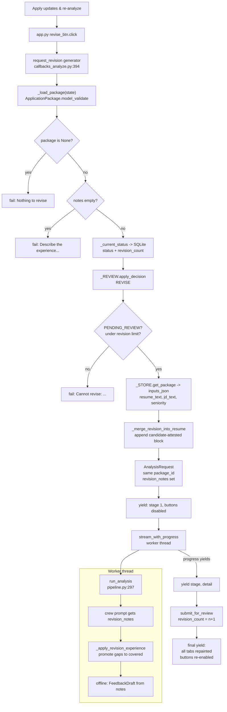

# The "Apply updates & re-analyze" button, step by step

One press of **Apply updates & re-analyze** in the Analyze tab's decision dock traced
through the codebase: every step names the file, the exact line range, and the code
that runs. Every citation in this document is checked by
`python tools/verify_doc_refs.py docs/REVISION_BUTTON_WALKTHROUGH.md`.

Written for two readers at once:

- **A reviewer or examiner** who wants to open any file at any cited line and see
  the code the text just described.
- **A presenter** who has to explain the click out loud. Appendix D is a
  six-slide outline plus likely questions, each answered with a file:line.

Scope: **the revision click only.** The first Analyze click is in
[`ANALYZE_BUTTON_WALKTHROUGH.md`](ANALYZE_BUTTON_WALKTHROUGH.md); approval and
rejection are in [`CODE_PATH_HITL.md`](CODE_PATH_HITL.md).

---

## Part A. Orientation

### A1. The answer in one paragraph

You type your missing experience into the dock and press the button. Gradio calls
`request_revision` (`careercrew/callbacks_analyze.py:394`), a **generator** like
`analyze`. It rebuilds the package from `state`, checks the notes are non-empty,
and asks `PackageReviewService.apply_decision` for a `REVISE` decision
(`careercrew/review.py:84`), which enforces two rules: the package must be
`PENDING_REVIEW`, and the revision count must not exceed the limit. It then **reads
the original resume and JD back out of SQLite** — the UI no longer has them —
appends the notes to the resume as a candidate-attested block
(`careercrew/callbacks_analyze.py:367`), and runs the **same** `stream_with_progress`
pipeline as the first Analyze. Inside the pipeline, `_apply_revision_experience`
(`careercrew/pipeline.py:125`) additionally folds the notes into the profile and
promotes matching gap verdicts to `covered`, so the revision works even offline. The
bundle is saved again, `PENDING_REVIEW`, with an incremented revision count, and one
final `yield` repaints every result tab.

The whole click is **one generator reusing the entire Analyze pipeline**, with notes
injected at two places.

### A2. The step map

| # | What happens | File | Lines |
|--:|--------------|------|-------|
| 1 | The button is bound to a generator | [`app.py`](../app.py) | 507-512 |
| 2 | The dock: one textbox shared by three buttons | [`app.py`](../app.py) | 208-223 |
| 3 | `request_revision` starts and defines its error exit | [`callbacks_analyze.py`](../careercrew/callbacks_analyze.py) | 394-423 |
| 4 | The two cheap rejection gates | [`callbacks_analyze.py`](../careercrew/callbacks_analyze.py) | 422-431 |
| 5 | `apply_decision` with `REVISE` | [`review.py`](../careercrew/review.py) | 119-140 |
| 6 | The state machine and its allowed transitions | [`review.py`](../careercrew/review.py) | 28-43 |
| 7 | The original inputs are read back from SQLite | [`callbacks_analyze.py`](../careercrew/callbacks_analyze.py) | 450-468 |
| 7.1 | `get_package` returns the parsed inputs | [`session_store.py`](../careercrew/session_store.py) | 192-208 |
| 8 | The notes are merged into the resume text | [`callbacks_analyze.py`](../careercrew/callbacks_analyze.py) | 367-391 |
| 9 | The request is rebuilt with `revision_notes` | [`callbacks_analyze.py`](../careercrew/callbacks_analyze.py) | 470-478 |
| 10 | Progress is painted and the pipeline runs again | [`callbacks_analyze.py`](../careercrew/callbacks_analyze.py) | 480-515 |
| 11 | `revision_notes` inside the pipeline, part 1: the prompt | [`pipeline.py`](../careercrew/pipeline.py) | 248-259 |
| 12 | Inside the pipeline, part 2: deterministic gap promotion | [`pipeline.py`](../careercrew/pipeline.py) | 125-190 |
| 13 | Inside the pipeline, part 3: the offline feedback fallback | [`pipeline.py`](../careercrew/pipeline.py) | 416-434 |
| 14 | Re-submission and the final yield | [`callbacks_analyze.py`](../careercrew/callbacks_analyze.py) | 517-556 |

### A3. The whole click on one diagram

The important structural fact: **the browser cannot supply the inputs.** The resume
and JD were uploaded on the first Analyze click; by revision time only `state` (the
package dict) and the textbox are in the UI. Everything else is re-read from SQLite.



### A4. How to read the steps

Every step below uses the same six headings:

| Heading | What it tells you |
|---------|-------------------|
| **Runs when** | The trigger, and which thread you are on |
| **The code** | The actual excerpt, with its file and line range on the fence |
| **Line by line** | What each line does, and the names it calls |
| **In -> Out** | What the step consumes and what it produces |
| **Why it is built this way** | The design reason, including the alternative that was rejected |
| **Hands off to** | The next step, so you can follow the chain |

Code blocks are quoted from the working tree, so the line numbers in the fence are
the line numbers in your editor. To re-check any citation in seconds, see
Appendix C.

---

## Part B. The steps

### Step 1. The button is bound to a generator

**Runs when:** page build time.

**The code**

```startLine:507:512:app.py
        revise_btn.click(
            request_revision,
            inputs=[state, feedback],
            outputs=analyze_outputs,
            show_progress="hidden",
        )
```

**Line by line**

- **508** — `request_revision`. It is a generator, so Gradio streams each `yield`.
- **509** — **two inputs only**: the package dict and the textbox. No file widgets, no
  resume text, no JD text. That is the constraint the whole flow works around.
- **510** — `analyze_outputs`, the same 14 outputs the Analyze button writes. The
  revision repaints exactly the same surface, including `context`, which is what keeps
  the coach and interview tabs in sync.
- **511** — `show_progress="hidden"`, same reason as Analyze.

For contrast, the first Analyze click takes four inputs:

```startLine:397:402:app.py
        run_btn.click(
            analyze,
            inputs=[resume_file, resume_text, jd_file, jd_text],
            outputs=analyze_outputs,
            show_progress="hidden",
        )
```

**In -> Out:** live widgets -> one registration.

**Why it is built this way:** reusing `analyze_outputs` means a revision cannot leave
the page half-updated. If the button had its own output list, a field added to Analyze
would silently stop being refreshed on revision.

**Hands off to:** step 3.

---

### Step 2. The dock: one textbox shared by three buttons

**Runs when:** page build time.

**The code**

```startLine:204:225:app.py
                        gr.HTML(
                            "<div class='cc-choice-label'>"
                            "<span class='cc-choice-n'>B</span>"
                            "<div><strong>Add missing experience</strong> — e.g. the JD wants "
                            "React but your resume doesn’t list it. Type the update, then press "
                            "the button. <em>Analyze runs again automatically</em> and refreshes "
                            "Match and Prep.</div></div>"
                        )
                        feedback = gr.Textbox(
                            label="Your experience update",
                            placeholder=(
                                "e.g. I have 5+ years of React experience building production SPAs."
                            ),
                            lines=3,
                            interactive=False,
                            elem_classes=["cc-field"],
                        )
                        revise_btn = gr.Button(
                            "Apply updates & re-analyze",
                            interactive=False,
                            elem_classes=["cc-revise"],
                        )
```

**Line by line**

- **206-211** — the label sets the expectation explicitly: *Analyze runs again
  automatically*.
- **212-219** — `feedback`, the only input the user supplies. It starts
  `interactive=False`.
- **220-223** — the button, also disabled until Analyze succeeds.
- **216-218** — the placeholder is the canonical example: a specific, dated,
  technology-scoped claim.

The same `feedback` widget is an output of `analyze` (`app.py:374`) and of
`request_revision` (`callbacks_analyze.py:492`), which is why it is cleared after a
successful run and pre-filled while one is in flight.

**In -> Out:** component construction only.

**Why it is built this way:** one textbox for the dock rather than one per button.
Approve and Reject also read `feedback` (as `reviewer_feedback`), so a reject with a
reason and a revision with notes use the same field.

**Hands off to:** step 1.

---

### Step 3. `request_revision` starts and defines its error exit

**Runs when:** the button is pressed.

**The code**

```startLine:394:423:careercrew/callbacks_analyze.py
def request_revision(state, feedback) -> Iterator[tuple]:
    """Merge candidate experience updates, re-analyze, and refresh every result tab.

    ``Request changes`` is how the candidate adds missing experience (e.g. React
    years not on the resume). Notes are folded into the resume context and the
    full Analyze pipeline runs again so gaps, prep, and answers update.
    """
    view = _empty_outputs()
    package = _load_package(state)

    def fail(message: str) -> tuple:
        return view.apply(
            error=_alert_html(message, kind="error"),
            status="Revision could not finish — see the message above.",
            stages=_stages_html(-1),
            approve=gr.update(interactive=bool(package)),
            reject=gr.update(interactive=bool(package)),
            revise=gr.update(interactive=bool(package)),
            package=state,
            notes=gr.update(interactive=bool(package)),
            run_button=gr.update(interactive=True),
            clear_button=gr.update(interactive=True),
            review_guide=_review_guide_html(
                "ready" if package else "idle",
                package_id=package.package_id if package else "",
            ),
        )

    if package is None:
        yield fail("Nothing to revise — run Analyze first.")
```

**Line by line**

- **394** — returns `Iterator[tuple]`, so the progress tracker can animate.
- **402-403** — `_empty_outputs()` builds the reset view; `_load_package(state)`
  validates the state dict into a typed model (`:258-264`), returning `None` on
  anything unexpected.
- **405-420** — the nested `fail()`. **Four things are deliberately preserved** on
  failure, unlike `analyze`'s version:
  - **409-411** — the three decision buttons are re-enabled **only if a package
    exists**. A failed revision should not cost the user their ability to approve or
    reject the previous bundle.
  - **412** — `package=state` hands the state back **unchanged**. Without this, a
    failed revision would wipe `gr.State` and leave the page permanently unusable.
  - **413** — the notes box is re-enabled but **not cleared**, so the user does not
    retype their experience.
  - **416-419** — the dock guide is rebuilt in the `ready` state, not `idle`.
- **422-423** — the first gate.

**In -> Out:** `(state, feedback)` -> the reset view and a validated package or
`None`.

**Why it is built this way:** the `fail()` here is *recoverable*, where `analyze`'s
is terminal. That asymmetry is the whole point: a failed first analysis is a dead end
because there is nothing to go back to; a failed revision must return the user to a
still-usable bundle.

**Hands off to:** step 4.

---

### Step 4. The two cheap rejection gates

**Runs when:** immediately after the state loads.

**The code**

```startLine:422:432:careercrew/callbacks_analyze.py
    if package is None:
        yield fail("Nothing to revise — run Analyze first.")
        return

    notes = (feedback or "").strip()
    if not notes:
        yield fail(
            "Describe the experience or corrections to apply "
            "(e.g. “I have 5+ years of React experience”)."
        )
        return
```

**Line by line**

- **422-424** — no package: `gr.State` is empty, which happens after a browser refresh
  or if Analyze never ran. The message names the fix.
- **426** — the notes are trimmed. Whitespace-only counts as empty.
- **427-431** — an empty revision is refused **before** any state transition. This
  ordering matters: the revision count is not incremented for a request that could
  never work.

**In -> Out:** the raw textbox -> a trimmed notes string, or an exit.

**Why it is built this way:** a revision consumes one of only two allowed revisions
(`CAREERCREW_MAX_REVISIONS`, default 2). Spending one on an empty request would be
unforgivable, so the check is done in the UI **and** again in the service
(`review.py:119-120`).

**Hands off to:** step 5.

---

### Step 5. `apply_decision` with `REVISE`

**Runs when:** the notes are non-empty.

**The code**

```startLine:434:448:careercrew/callbacks_analyze.py
    status_now, revisions = _current_status(package)
    try:
        outcome = _REVIEW.apply_decision(
            package,
            ReviewDecision(
                package_id=package.package_id,
                decision=ReviewAction.REVISE,
                reviewer_feedback=notes,
            ),
            status_now,
            revisions,
        )
    except ReviewError as exc:
        yield fail(f"Cannot revise: {exc}")
        return
```

**Line by line**

- **432** — `_current_status` reads `status` and `revision_count` **from SQLite**
  (`:266-271`), not from the state dict. The two can disagree, and the database wins.
- **434-444** — one call with four arguments: the package, a decision object, the
  current status, and the current count.
- **445-447** — `ReviewError` is the only expected exception. It becomes a message,
  not a traceback.

Inside the service:

```startLine:120:140:careercrew/review.py
        # REVISE
        if not decision.reviewer_feedback.strip():
            raise ReviewError("a revision request requires reviewer feedback")
        next_count = revision_count + 1
        if next_count > self._max_revisions:
            raise ReviewError(
                f"revision limit reached ({self._max_revisions}); "
                "approve, reject, or start a new analysis."
            )
        _check_transition(current_status, ReviewStatus.DRAFT)
        self._store.record_decision(decision)
        self._store.update_status(package.package_id, ReviewStatus.DRAFT, next_count)
        return ReviewOutcome(
            status=ReviewStatus.DRAFT,
            message=(
                f"Revision {next_count} requested; merging candidate experience "
                "updates and re-analyzing."
            ),
            revision_count=next_count,
            needs_revision=True,
        )
```

**Line by line, for the service**

- **120-121** — the same empty-notes rule, enforced again where it cannot be bypassed.
- **122-127** — **the limit.** `revision_count + 1 > max_revisions` raises. With the
  default of 2, the third revision request is refused.
- **128** — the transition check: the package must be `PENDING_REVIEW` and is moved to
  `DRAFT`.
- **129** — the decision is appended to the `decisions` table (audit trail).
- **130** — the status and the new count are written to `packages`.
- **131-139** — the outcome carries the incremented count, which the final status
  message will display.

**In -> Out:** package + notes -> a `ReviewOutcome` with `revision_count = n + 1`.

**Why it is built this way:** two layers enforce the same rules because they protect
different things. The UI layer gives a good message; the service layer guarantees the
database is never left in an inconsistent state regardless of caller.

**Hands off to:** step 6 for the state machine, step 7 for the inputs.

---

### Step 6. The state machine and its allowed transitions

**Runs when:** inside `_check_transition`, called by `apply_decision`.

**The code**

```startLine:26:36:careercrew/review.py
#: Valid transitions from each status.
_ALLOWED: dict[ReviewStatus, set[ReviewStatus]] = {
    ReviewStatus.DRAFT: {ReviewStatus.PENDING_REVIEW},
    ReviewStatus.PENDING_REVIEW: {
        ReviewStatus.APPROVED,
        ReviewStatus.REJECTED,
        ReviewStatus.DRAFT,  # a requested revision returns to a fresh draft
    },
    ReviewStatus.APPROVED: set(),
    ReviewStatus.REJECTED: set(),
}
```

**Line by line**

- **31-37** — `PENDING_REVIEW` is the only state that can go anywhere, and `DRAFT` is
  reachable from it as the revision target.
- **38-39** — `APPROVED` and `REJECTED` have empty sets, so they are **terminal**.

```startLine:41:43:careercrew/review.py
def _check_transition(current: ReviewStatus, target: ReviewStatus) -> None:
    if target not in _ALLOWED[current]:
        raise ReviewError(f"invalid transition: {current.value} -> {target.value}")
```

So pressing the revision button twice in a row behaves like this:

| Attempt | Stored status | Result |
|---------|---------------|--------|
| 1st | `PENDING_REVIEW` -> `DRAFT` | accepted, count 1 |
| 2nd (after the re-run puts it back to `PENDING_REVIEW`) | `PENDING_REVIEW` -> `DRAFT` | accepted, count 2 |
| 3rd | `PENDING_REVIEW` -> `DRAFT` | **refused**, limit reached |
| After approve | `APPROVED` | **refused**, invalid transition |

Note what `apply_decision` requires at its own top: `if current_status is not
ReviewStatus.PENDING_REVIEW: raise ReviewError(...)` (`review.py:96-97`). So a package
sitting in `DRAFT` — mid-revision — cannot be revised again until the re-run completes
and `submit_for_review` sets it back to `PENDING_REVIEW`.

**In -> Out:** current and target status -> nothing, or `ReviewError`.

**Why it is built this way:** a declarative table rather than a chain of `if`s. Adding
a state means editing one line, and the diagram in `CODE_PATH_HITL.md` maps one-to-one
onto this dict.

**Hands off to:** step 7.

---

### Step 7. The original inputs are read back from SQLite

**Runs when:** the decision was accepted.

**The code**

```startLine:450:468:careercrew/callbacks_analyze.py
    stored = _STORE.get_package(package.package_id) or {}
    saved = stored.get("inputs") or {}
    resume_path = saved.get("resume_path") or None
    resume_text = saved.get("resume_text") or None
    jd_path = saved.get("jd_path") or None
    jd_text = saved.get("jd_text") or None
    if not resume_path and not resume_text:
        yield fail(
            "Saved resume inputs are missing for this prep bundle. "
            "Update the resume/JD fields and press Analyze match again."
        )
        return
    if not jd_path and not jd_text:
        yield fail(
            "Saved job-description inputs are missing for this prep bundle. "
            "Update the resume/JD fields and press Analyze match again."
        )
        return
```

**Line by line**

- **450** — `get_package` returns the row **plus** two parsed fields; `or {}` guards a
  missing row.
- **451** — `inputs` is the dict that `analyze` saved at the end of the first run
  (`callbacks_analyze.py:216-223`).
- **452-455** — the four saved inputs. `or None` normalises `""` to `None` so the
  checks below are clean.
- **456-462** — no resume at all: refuse and tell the user to re-run Analyze.
- **463-468** — no JD at all: same.

`get_package` is where the JSON becomes usable:

```startLine:192:208:careercrew/session_store.py
    def get_package(self, package_id: str) -> dict | None:
        """Return a package row (with parsed package) or None."""
        with self._connect() as conn:
            row = conn.execute(
                "SELECT * FROM packages WHERE package_id = ?", (package_id,)
            ).fetchone()
        if row is None:
            return None
        import json

        data = dict(row)
        data["package"] = ApplicationPackage.model_validate_json(data["package_json"])
        try:
            data["inputs"] = json.loads(data.get("inputs_json") or "{}")
        except (TypeError, ValueError):
            data["inputs"] = {}
        return data
```

**Line by line, for `get_package`**

- **194-197** — a primary-key lookup.
- **201** — the package is **validated** on the way out, so a schema change surfaces
  here rather than deep in the pipeline.
- **203-207** — `inputs_json` is parsed defensively; corrupt JSON yields `{}`, which
  the caller's checks then catch.

**In -> Out:** a package id -> the saved resume/JD paths and texts.

**Why it is built this way:** the browser genuinely does not have this data any more,
and asking the user to re-upload would defeat the feature. Persisting the inputs with
the output is what makes revision possible at all.

**Hands off to:** step 8.

---

### Step 8. The notes are merged into the resume text

**Runs when:** both inputs exist.

**The code**

```startLine:366:391:careercrew/callbacks_analyze.py
def _merge_revision_into_resume(
    resume_path: str | None, resume_text: str | None, notes: str
) -> str:
    """Fold candidate-attested Request-changes notes into the resume text.

    Agents then re-extract the profile and re-score gaps so new experience
    (e.g. React years) updates the match report, prep plan, and rewrites.
    """
    base = (resume_text or "").strip()
    if not base and resume_path:
        try:
            from careercrew.document_tools import read_resume

            base = (read_resume(resume_path) or "").strip()
        except Exception:  # noqa: BLE001 - fall back to notes-only addendum
            logger.warning("could not re-read resume %s for revision", resume_path, exc_info=True)
            base = ""
    block = (
        "\n\n---\n"
        "CANDIDATE-ATTESTED UPDATE (from Request changes):\n"
        "Treat the following as real experience the candidate confirms they have, "
        "even if it was missing from the original resume. Use it when scoring "
        "coverage, writing bullets, and planning interview prep.\n"
        f"{notes.strip()}\n"
    )
    return f"{base}{block}".strip() if base else notes.strip()
```

**Line by line**

- **374** — if the user **pasted** the resume, that text is already the base.
- **375-383** — if they **uploaded a file**, the file is re-read from `uploads/` with
  `document_tools.read_resume`. Failure is logged and falls through to an empty base
  rather than aborting the revision.
- **384-390** — the appended block. Three sentences of instruction plus the notes, all
  in plain text.
- **391** — if there is no base at all, the notes alone become the "resume", which is
  the honest minimum.

The wording "**Treat the following as real experience the candidate confirms they
have**" is doing specific work. It is the difference between asking the model to
invent and asking it to accept an attestation. The prompt is not authorizing
fabrication; it is recording that the candidate has stated a fact.

**In -> Out:** saved resume text (or path) plus notes -> one merged text string.

**Why it is built this way:** appending rather than replacing means the original
resume content is still there for the profile extractor. The `---` separator is
deliberate: it reads as an addendum to a document, which is how a human would annotate
a resume.

**Hands off to:** step 9.

---

### Step 9. The request is rebuilt with `revision_notes`

**Runs when:** the merged text exists.

**The code**

```startLine:469:479:careercrew/callbacks_analyze.py
    # Fold notes into resume text so profile → gaps → prep all see the new experience.
    updated_resume = _merge_revision_into_resume(resume_path, resume_text, notes)
    request = AnalysisRequest(
        package_id=package.package_id,
        resume_path=None,
        resume_text=updated_resume,
        jd_path=jd_path,
        jd_text=jd_text,
        seniority=saved.get("seniority") or "",
        revision_notes=notes,
    )
```

**Line by line**

- **471** — the merge from step 8.
- **472** — **the same `package_id`.** This is not a new bundle; it is revision N of
  the existing one. The database row is upserted, not inserted.
- **474** — `resume_path=None` even though a file exists. The merged text already
  contains the file's contents, so passing both would make the pipeline read the
  resume twice.
- **475** — the merged text, which is what the agents will read.
- **476-477** — the JD is passed through unchanged. Revisions only add experience;
  they never change the role.
- **478** — `revision_notes=notes` — **the second injection point.** The merged resume
  already contains the notes as text; this field is the structured copy that the
  pipeline uses for deterministic gap promotion.

So the notes enter the run **twice**, on purpose:

| Injection | Where | Who consumes it |
|-----------|-------|-----------------|
| Appended to resume text | `callbacks_analyze.py:384-390` | the profile extractor and gap analyst agents |
| `revision_notes` field | `callbacks_analyze.py:478` | `_apply_revision_experience` and the crew prompt |

The first is for the LLM path, where the agents re-read the text. The second is for
the deterministic path, where no agent may run at all.

**In -> Out:** saved inputs plus notes -> a complete `AnalysisRequest`.

**Why it is built this way:** two channels for one fact, because the two execution
paths see different things. Without the text merge the crew would never see the new
experience; without the field the offline path would never mark gaps as covered.

**Hands off to:** step 10.

---

### Step 10. Progress is painted and the pipeline runs again

**Runs when:** the request is ready.

**The code**

```startLine:481:515:careercrew/callbacks_analyze.py
    yield view.apply(
        error="",
        status=(
            f"**Revision {outcome.revision_count}…** updating your experience from the "
            "notes and re-analyzing the match."
        ),
        stages=_stages_html(1, "Merging your experience updates…"),
        approve=gr.update(interactive=False),
        reject=gr.update(interactive=False),
        revise=gr.update(interactive=False),
        package=state,
        notes=gr.update(value=notes, interactive=False),
        review_guide=_review_guide_html(
            "working",
            package_id=package.package_id,
            detail="Analyze is running again with your experience updates…",
        ),
        run_button=gr.update(interactive=False),
        clear_button=gr.update(interactive=False),
    )

    stages_run = stream_with_progress(request, reading_detail="Re-reading your resume…")
    try:
        while True:
            try:
                target, detail = next(stages_run)
            except StopIteration as finished:
                result = finished.value
                break
            yield view.apply(stages=_stages_html(target, detail), status=detail)
    except Exception as exc:  # noqa: BLE001
        logger.exception("revision re-run failed")
        yield fail(str(exc) or "Revision re-run failed unexpectedly.")
        return
```

**Line by line**

- **483-485** — the status names the revision number, so the user can see which
  attempt this is.
- **486** — the tracker starts at step 1 with a revision-specific label.
- **487-489** — all three decision buttons disabled. You cannot approve a bundle while
  it is being rebuilt.
- **491** — `package=state` — the state is held, not replaced, during the run.
- **492** — **the notes stay visible but read-only.** Unlike `analyze`, which clears
  the box, a revision keeps the text on screen so the user can see what is being
  applied. The final yield is what clears it.
- **493-497** — the dock switches to a `"working"` guide.
- **498-499** — run and clear are disabled, same as Analyze.
- **501** — `stream_with_progress`, the **same runner as Analyze**, with a different
  reading label.
- **503-508** — the polling loop, identical to Analyze's: `next()` until
  `StopIteration`, then read the return value.
- **509** — one yield per stage change, updating only the tracker and the status.
- **510-513** — any exception in the runner becomes a `fail()`, so the page is never
  left disabled.

**In -> Out:** the request -> a stream of progress tuples, then the `PipelineResult`
via `StopIteration.value`.

**Why it is built this way:** reusing `stream_with_progress` means the revision gets
the worker thread, the stage mapping, and the progress heuristics for free. The only
difference is one label.

**Hands off to:** step 11, 12, and 13 — the three places inside the pipeline that
react to `revision_notes`.

---

### Step 11. Inside the pipeline, part 1: the crew prompt

**Runs when:** the pipeline reaches the crew on the worker thread.

**The code**

```startLine:250:259:careercrew/pipeline.py
        resume_text=request.resume_text,
        jd_path=request.jd_path if not request.jd_text else None,
        jd_text=request.jd_text,
        seniority=(
            request.seniority
            or "the seniority / years of experience signaled in the job description"
        ),
        revision_notes=(request.revision_notes or "").strip()
        or "(none — produce the initial package)",
    )
```

**Line by line**

- **248** — the merged resume text becomes the crew input.
- **249, 251** — the `if not ... else None` pattern ensures each document has exactly
  one source: a text blob or a path, never both.
- **252-255** — seniority, with a descriptive fallback so the prompt never reads
  "seniority: ".
- **257-258** — `revision_notes`, with `"(none — produce the initial package)"` on the
  first run. That literal makes the **same crew prompt** serve both Analyze and
  revision, which is why one `build_crew` covers both.

**In -> Out:** the request -> the crew's `inputs` dict.

**Why it is built this way:** one prompt template with an explicit "none" sentinel
beats two templates. The agents can be told "the candidate added this" only when it
is true.

**Hands off to:** step 12.

---

### Step 12. Inside the pipeline, part 2: deterministic gap promotion

**Runs when:** after the crew (or after the fallback) produced a profile and gaps.

**The code**

```startLine:126:159:careercrew/pipeline.py
def _apply_revision_experience(
    profile: CandidateProfile | None,
    gaps: GapReport | None,
    requirements: JobRequirements | None,
    request: AnalysisRequest,
) -> tuple[CandidateProfile, GapReport, JobRequirements]:
    """Fold Request-changes notes into profile/gaps when the crew did not.

    Used so offline / fallback runs still treat candidate-attested experience
    (e.g. React years) as covering matching JD requirements.
    """
    profile = profile or CandidateProfile()
    gaps = gaps or GapReport()
    requirements = requirements or JobRequirements()
    notes = (request.revision_notes or "").strip()
    if not notes:
        return profile, gaps, requirements

    already = any(
        "candidate-attested" in (role.company or "").lower()
        or notes[:80] in " ".join(role.achievements)
        for role in profile.experience
    )
    if not already:
        profile.experience.append(
            WorkExperience(
                company="Candidate-attested update",
                title="Additional experience (Request changes)",
                achievements=[notes],
            )
        )

    notes_l = notes.lower()
    # Promote out-of-scope / missing requirements that the notes clearly cover.
```

**Line by line**

- **145-147** — **idempotency.** Before appending, it checks whether a
  `Candidate-attested` role already exists, or whether the first 80 characters of the
  notes already appear in some role's achievements. That is what stops revision 2 from
  duplicating revision 1's experience.
- **148-155** — the synthetic role. Company is `"Candidate-attested update"`, title is
  `"Additional experience (Request changes)"`, and the notes become the achievement.
- **157+** — the gap promotion: any `out_of_scope` verdict whose requirement tokens
  appear in the notes is rewritten to `covered`, with the notes as the supporting
  fact.

**In -> Out:** profile, gaps, requirements, request -> the same three, enriched.

**Why it is built this way:** this is the offline safety net. Without an API key the
crew never runs, so nothing would re-score the gaps, and the user would revise and see
no change. This function makes the revision *visible* with no model at all. The
docstring says it plainly: "when the crew did not".

**Hands off to:** step 13.

---

### Step 13. Inside the pipeline, part 3: the offline feedback fallback

**Runs when:** a revision ran offline and the crew produced no `FeedbackDraft`.

**The code**

```startLine:418:434:careercrew/pipeline.py
    if (request.revision_notes or "").strip():
        profile, gaps, requirements = _apply_revision_experience(
            profile, gaps, requirements, request
        )
        if feedback is None:
            feedback = FeedbackDraft(
                rewritten_bullets=[
                    RewrittenBullet(
                        text=f"Highlight attested experience: {(request.revision_notes or '')[:180]}",
                        cited_fact=(request.revision_notes or "")[:240],
                    )
                ],
                talking_points=[
                    f"Be ready to discuss: {(request.revision_notes or '')[:160]}",
                ],
            )
        warnings.append("Candidate-attested Request changes updates were applied to experience.")
```

**Line by line**

- **416-421** — the call from step 12, run on **every** revision regardless of path.
- **422** — `if feedback is None` — only when the crew produced nothing, i.e. the
  offline path.
- **424-427** — one rewritten bullet built **from the notes themselves**. `cited_fact`
  is the same notes text, which is what makes it pass `validate_citations`
  (`guardrails.py:130-152`): the citation is traceable to the profile, because
  `_apply_revision_experience` just put it there.
- **430-432** — one talking point.
- **434** — a warning, so the limited mode is disclosed.

**In -> Out:** the request -> a `FeedbackDraft` that cannot be fabricated, plus a
warning.

**Why it is built this way:** the citation rule is strict — a bullet with no
traceable cited fact fails closed. Rather than weaken the rule for revisions, the
fallback cites the candidate's own attestation, which is a real fact in the profile.

**Hands off to:** step 14.

---

### Step 14. Re-submission and the final yield

**Runs when:** the pipeline returned.

**The code**

```startLine:516:555:careercrew/callbacks_analyze.py
    try:
        _REVIEW.submit_for_review(
            {
                "resume_path": request.resume_path,
                "resume_text": request.resume_text,
                "jd_path": request.jd_path,
                "jd_text": request.jd_text,
                "seniority": request.seniority,
            },
            result.package,
            result.trace,
            revision_count=outcome.revision_count,
        )

        mode = " (limited mode)" if result.used_fallback else ""
        status = (
            f"**Revision {outcome.revision_count} is ready{mode}.** "
            f"Your experience updates were merged and the match / prep / answers "
            f"were rebuilt — `{result.package.package_id}`. Review the updated tabs, "
            f"then approve, add more experience, or reject."
        )
        yield view.apply(
            error="",
            status=status,
            stages=_stages_html(_FINAL, "Experience updated — review the new match report."),
            match_report=_insight_html(result),
            prep_plan=_prep_html(result.prep_plan),
            approve=gr.update(interactive=True),
            reject=gr.update(interactive=True),
            revise=gr.update(interactive=True),
            package=result.package.model_dump(),
            notes=gr.update(value="", interactive=True),
            context=_serialize_result(result),
            review_guide=_review_guide_html("ready", package_id=result.package.package_id),
            run_button=gr.update(interactive=True),
            clear_button=gr.update(interactive=True),
        )
    except Exception as exc:  # noqa: BLE001
        logger.exception("request_revision crashed")
        yield fail(f"Unexpected error: {exc}")
```

**Line by line**

- **518-527** — `submit_for_review` again, with the **merged** resume text as the new
  saved `resume_text`. This matters: revision 2 builds on revision 1's text, so
  experience compounds instead of being lost. `revision_count=outcome.revision_count`
  persists the incremented count, and the status goes back to `PENDING_REVIEW`.
- **528** — the limited-mode marker, same as Analyze.
- **529-534** — the status names the revision number and tells the user what is now
  possible (approve, add more, or reject).
- **538-539** — `_FINAL` marks all six stages complete with a revision-specific label.
- **540-541** — the match report and prep plan are repainted from the **new** result.
- **542-544** — the three buttons are re-enabled.
- **545** — the new package dict replaces the old one in `state`.
- **546** — **the notes box is cleared and re-enabled here**, after the run, not before.
- **547** — `context` is reserialized, which is what updates the coach and interview
  tabs to the new analysis without re-running them.
- **548** — the dock returns to `ready`.
- **549-550** — run and clear re-enabled.
- **552-555** — a crash in this final block still routes through `fail()`, so the page
  cannot be left with disabled buttons.

**In -> Out:** the `PipelineResult` -> the final 14-output tuple.

**Why it is built this way:** one final yield, exactly like Analyze. The user never
sees a state where the new match report is painted but the buttons are still disabled,
or where `context` still points at the previous revision.

**Hands off to:** the human, again. The bundle is `PENDING_REVIEW` with a higher
revision count.

---

## Appendix A. The revision budget

`CAREERCREW_MAX_REVISIONS`, default **2** (`careercrew/config.py:78`).

| Revision | `revision_count` | Status after | Allowed? |
|---------:|------------------|--------------|----------|
| initial Analyze | 0 | `PENDING_REVIEW` | — |
| 1st | 1 | `DRAFT` then `PENDING_REVIEW` | yes |
| 2nd | 2 | `DRAFT` then `PENDING_REVIEW` | yes |
| 3rd | 3 > 2 | unchanged | **no**, `ReviewError` |

The limit is checked **in the service** (`careercrew/review.py:122-127`), so raising it
is an environment change, not a code change. The user-facing message on refusal is
"Cannot revise: revision limit reached (2); approve, reject, or start a new analysis."
(`careercrew/callbacks_analyze.py:446-447`).

---

## Appendix B. The offline revision path

The most interesting case, because the notes must produce a visible change with no
model involved.

1. `_merge_revision_into_resume` appends the notes to the saved resume text.
2. `stream_with_progress` runs `run_analysis`; `settings.has_llm` is `False`, so the
   crew block is skipped and `used_fallback` becomes `True`.
3. `profile`, `gaps`, `requirements` are empty defaults at this point.
4. `_apply_revision_experience` (`careercrew/pipeline.py:125`) appends a
   `Candidate-attested update` role and promotes matching `out_of_scope` verdicts to
   `covered`.
5. `feedback is None`, so a `FeedbackDraft` is built from the notes with the notes as
   its own `cited_fact` (`:422-433`).
6. `build_fallback_plan` builds the prep plan from the now-updated gaps.
7. The status shows "**(limited mode)**".

| What the user sees | With key | Without key |
|---|---|---|
| Match report | re-scored by the gap analyst | verdicts promoted by token matching |
| Rewritten bullets | agent-written, citation-checked | one bullet built from the notes |
| Prep plan | agent-written | rebuilt from the promoted gaps |
| Status suffix | none | `(limited mode)` |
| Notes preserved as resume input | yes | yes |

The revision is **not** a no-op offline. That is the point of steps 12 and 13.

---

## Appendix C. Re-verify any citation in 30 seconds

```powershell
python tools/verify_doc_refs.py docs/REVISION_BUTTON_WALKTHROUGH.md
```

Print one cited range:

```powershell
python -c "import pathlib; ls=pathlib.Path('careercrew/callbacks_analyze.py').read_text(encoding='utf-8').splitlines(); [print('%4d| %s' % (i+1, ls[i])) for i in range(393, 480)]"
```

Find a call site:

```powershell
rg -n "request_revision|apply_decision|revision_notes|_apply_revision_experience|_merge_revision_into_resume" careercrew app.py
```

---

## Appendix D. Presentation cheat sheet

### Six slides, mapped to the steps

| Slide | Title | Steps | The one thing to say |
|------:|-------|-------|----------------------|
| 1 | Two inputs, fourteen outputs | 1-2 | The button only has the package dict and a textbox; everything else is recovered |
| 2 | Recoverable failure | 3 | Unlike Analyze, a failed revision hands the state back untouched |
| 3 | Two layers, one rule | 4-6 | Empty notes and the limit are rejected in the UI and again in the service |
| 4 | The inputs come from SQLite | 7-7.1 | Uploads were saved with the output, which is what makes revision possible |
| 5 | Notes injected twice | 8-9, 11-13 | Once as resume text for the agents, once as a field for the deterministic path |
| 6 | Same pipeline, higher count | 10, 14 | The revision reuses `stream_with_progress` and resubmits as `PENDING_REVIEW` |

### Questions an examiner is likely to ask

| Question | Answer, with the place to look |
|----------|-------------------------------|
| Where does the click enter Python? | `revise_btn.click(...)` at `app.py:507-512`; handler at `careercrew/callbacks_analyze.py:394` |
| Why only two inputs? | The files were consumed by the first Analyze; the handler re-reads them from SQLite (`careercrew/callbacks_analyze.py:450`) |
| Where were the inputs saved? | `analyze` calls `submit_for_review` with an `inputs` dict (`careercrew/callbacks_analyze.py:216-223`), stored as `inputs_json` |
| What stops a revision without notes? | Two checks: `careercrew/callbacks_analyze.py:426` and `careercrew/review.py:120-121` |
| How many revisions are allowed? | `CAREERCREW_MAX_REVISIONS`, default 2 (`careercrew/config.py:78`), enforced at `careercrew/review.py:122-127` |
| What status must the package be in? | `PENDING_REVIEW` (`careercrew/review.py:96-97`); the revision moves it to `DRAFT` |
| Can you revise an approved package? | No. `APPROVED` has no outgoing transitions (`careercrew/review.py:38-39`) |
| How do the notes reach the agents? | Appended to the resume text at `careercrew/callbacks_analyze.py:384-390`, then passed as `resume_text` at `:475` |
| What is `revision_notes` for, then? | The deterministic path: it feeds `_apply_revision_experience` (`careercrew/pipeline.py:125-190`) and the crew prompt (`:257-258`) |
| Does a revision re-score the gaps offline? | Yes, by token matching: `out_of_scope` verdicts become `covered` (`careercrew/pipeline.py:157-179`) |
| Why can a failed revision not lose the package? | `fail()` passes `package=state` back unchanged (`careercrew/callbacks_analyze.py:412`) |
| Does the same bundle id survive? | Yes — `package_id=package.package_id` at `:473`, so the row is upserted |
| What gets cleared, and when? | The notes box, only in the final success yield (`:546`), not while running |
| Which tabs update? | All of them: the 14 outputs include `context`, which the coach and interview tabs read |
| Is anything sent anywhere? | No. The pipeline is local plus the model API; nothing is submitted to an employer |

---

## Appendix E. Rough edges worth knowing

| Observation | Where | Effect |
|-------------|-------|--------|
| Notes are injected as resume text **and** as a field | `careercrew/callbacks_analyze.py:475, 478` | Deliberate, but the same words reach the model twice on the crew path; a reader may not expect the duplication |
| Revision 2 re-reads the **merged** text | `careercrew/callbacks_analyze.py:520` saves `request.resume_text` | Attested experience compounds correctly, but the stored "resume" is no longer the user's original file |
| `_apply_revision_experience` mutates `requirements` too | `careercrew/pipeline.py:419` | Its return signature includes `requirements`, though the promotion logic described in the docstring is about gaps |
| A revision cannot change the JD | `careercrew/callbacks_analyze.py:476-477` | By design, but it means a JD typo requires a fresh Analyze |
| Token matching for gap promotion is crude | `careercrew/pipeline.py:163-179` | Any requirement token appearing in the notes promotes the verdict, so "I don't know React" would promote a React gap |

---

## Related documents

- [`ANALYZE_BUTTON_WALKTHROUGH.md`](ANALYZE_BUTTON_WALKTHROUGH.md) — the first click,
  whose outputs this button reuses
- [`CODE_PATH_HITL.md`](CODE_PATH_HITL.md) — the full approve / revise / reject state
  machine
- [`CODE_PATH_ANALYZE.md`](CODE_PATH_ANALYZE.md) — the pipeline in diagram form
- [`PREP_COACH_WALKTHROUGH.md`](PREP_COACH_WALKTHROUGH.md) — the chat that reads the
  refreshed `context`
- [`MOCK_INTERVIEW_WALKTHROUGH.md`](MOCK_INTERVIEW_WALKTHROUGH.md) — the interview that
  reads the refreshed `context`
- [`code-walkthrough/pipeline.md`](code-walkthrough/pipeline.md) — per-function notes
