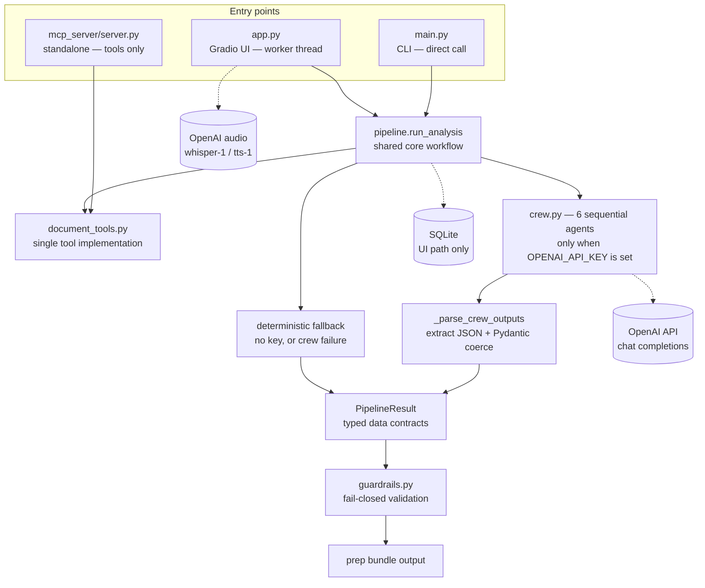

# CareerCrew — Architecture Overview

**Status:** In progress
**Assessed commit:** `ee1f2fc6` (dev; same code on main)

This document is the wiring view: entry points, the shared core, data contracts, and external dependencies. For the end-to-end numbered flow see `ARCHITECTURE.md`; for the module catalog see `component-catalog.md`; for a traced request see `request-lifecycle.md`.

## 1. Entry points and the shared core

| Entry point | Invokes the shared workflow? | Notes |
|---|---|---|
| `main.py` (CLI) | Yes — calls `run_analysis(request)` directly | Prints `ScreeningPrep` + `InterviewPrepPlan` JSON; no persistence |
| `app.py` (Gradio UI) | Yes — submits `run_analysis` to a worker thread with progress callbacks | Full interactive flow: HITL review, interview, coaching, SQLite persistence |
| `mcp_server/server.py` (standalone) | No — exposes the tools only | `read_resume` / `read_job_description` / `query_answer_bank` over stdio; no analysis |

Two of the three entry points converge on `pipeline.run_analysis`, which is the single shared workflow: input guardrails → normalize → crew or fallback → output guardrails → `PipelineResult`.

## 2. Data contracts

**Between agents:** CrewAI runs the six tasks sequentially; each task sees previous outputs through CrewAI's task context. Each task's `expected_output` (in `config/tasks.yaml`) describes the JSON shape the agent should produce.

**Enforcement is two-layered** (answers the key Phase 2 question):
1. *Requested by prompt* — task descriptions ask for structured JSON.
2. *Enforced at runtime* — `_parse_crew_outputs` (`pipeline.py:275`) extracts JSON from each raw task output (`extract_json`) and coerces it into Pydantic models (`_coerce_model`: `CandidateProfile`, `JobRequirements`, `GapReport`, `FeedbackDraft`, `InterviewPrepPlan`, `ScreeningPrep`). A coercion failure raises inside the crew `try` block, which is caught and degrades to the deterministic fallback with a warning (`pipeline.py:385`).

**Between pipeline stages:** everything downstream of parsing is typed — `PipelineResult` carries `package`, `profile`, `requirements`, `gaps`, `feedback`, `prep_plan`, `trace`, and `warnings`.

**To persistence:** Pydantic models are written to SQLite tables (`packages`, `decisions`, `interview_sessions`, `interview_turns`, `chat_messages`) via `session_store.py`. UI path only; the CLI does not persist.

## 3. External dependencies and failure modes

| Dependency | Used by | If unavailable or failing |
|---|---|---|
| OpenAI chat API | crew agents, interview evaluation, coach replies | No key → deterministic fallbacks (banner in UI); key + failure → warning + fallback path |
| OpenAI audio API (whisper-1, tts-1) | `audio.py` | Explicit text fallback; UI states voice is unavailable |
| CrewAI | `crew.py` | Exceptions → caught → fallback with warning; never crashes the run |
| MCP stdio subprocess | `mcp_client.MCPToolClient` | Timeout/error → fallback catches → empty package + warning |
| Filesystem (`uploads/`) | `document_tools`, `main.py`, `app.py` | Dir created automatically; unreadable files → `ValueError` / `JobDescriptionError` with guidance |
| SQLite (`careercrew.db`) | `session_store.py` (UI path) | Failure mode not traced — open question |
| `pypdf` / `python-docx` | resume/JD parsing | Parse failure → `ValueError("Could not read the resume")` or `JobDescriptionError` |
| `python-dotenv` / env vars | `config.py` | Missing vars → documented defaults; real env vars override `.env` |

## 4. Open questions

- [ ] SQLite failure modes: what happens on a locked/corrupt database?
- [ ] CrewAI-level retries/timeouts: which are configured, if any?
- [ ] MCP subprocess lifecycle: who restarts it if it dies mid-run?
- [ ] `_coerce_model` behavior on partially valid output: default, partial, or raise? (code-traced as raise-via-try; confirm)
