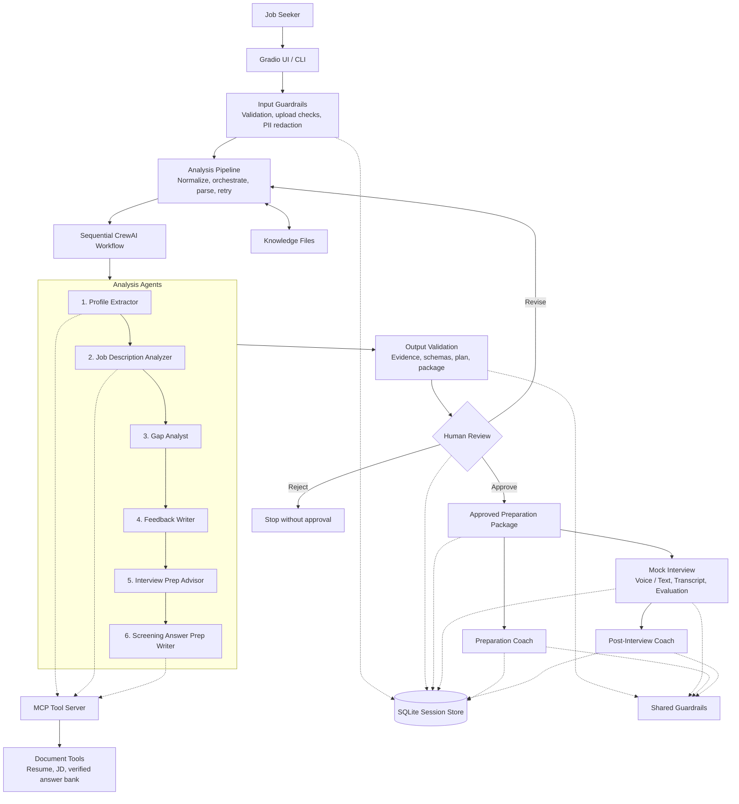

## 10. Conceptual System Architecture

The diagram below is a **logical draft**, not a verified deployment diagram. 

### Architecture verification checklist

- [ ] Confirm the actual UI entry points and supported input methods.
- [ ] Confirm the exact agent/task sequence and data contracts.
- [ ] Confirm whether MCP tools and deterministic fallbacks are both implemented.
- [ ] Confirm how output validation, retries, and package completeness are enforced.
- [ ] Confirm whether human approval/revision/rejection exists in the UI or is only a proposed interaction.
- [ ] Confirm which workflows use SQLite or other persistence and what is stored.
- [ ] Confirm the actual mock-interview, voice/text, and coaching paths.
- [ ] Update the diagram to distinguish in-process modules from external services.
