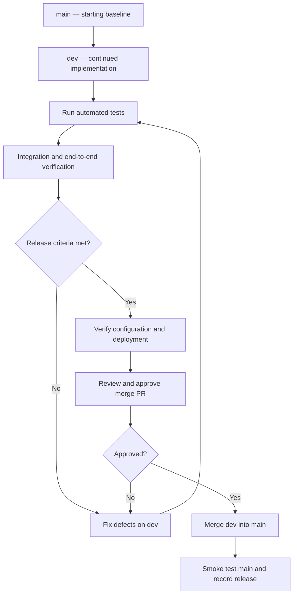

# CareerCrew — Product Draft v0.1

## 1. Recommended Next Steps

1. Inspect the current `dev` implementation and classify each requirement as **Implemented**, **Partially implemented**, **Missing**, or **Not verified**.
2. Verify the agent/task contracts, orchestration sequence, input/output schemas, and guardrails against code.
3. Create a requirements-to-tests traceability matrix.
4. Run existing tests and add tests for critical success and failure paths.
5. Revise the architecture diagram to show only verified components and real control/data flows.
6. Separate current behavior from planned behavior in the documentation.
7. Merge `dev` into `main` only after the agreed release gates pass.

## 2. Open Questions for Review

Answered 2026-10-16 against `dev` at `61d7506`; remaining open items are marked.

- **Which input methods and file types are actually supported today?** Resume: `.pdf`, `.docx`, or `.txt` upload, or pasted text (exactly one source). JD: file upload or pasted text. (`careercrew/document_tools.py`, `careercrew/guardrails.py`)
- **Is job-description URL ingestion implemented and tested?** No. Pasted URLs are rejected with a clear error (`_looks_like_url` in `careercrew/document_tools.py`).
- **Which agent roles are active in the current pipeline, and what are their exact output schemas?** Five agents, sequential, `allow_delegation: false` (`config/agents.yaml`, `careercrew/crew.py`): Profile Extractor, JD Analyzer, Gap Analyst, Feedback Writer, Interview Prep Advisor. Output schemas live in `careercrew/models.py` (Pydantic contracts). The prep bundle is `ApplicationPackage`.
- **What output validation is enforced programmatically versus described in prompts?** Programmatic: `validate_citations`, `validate_package`, `validate_prep_plan` (plus interview/coaching validators) in `careercrew/guardrails.py`, covered by `tests/test_guardrails.py` (23 tests).
- **What human-review actions are available in the current UI?** Approve prep bundle, Request changes, Reject — all wired to the `PackageReviewService` state machine in `app.py`.
- **Which artifacts are persisted, where, and for how long?** SQLite via `careercrew/session_store.py` (`CAREERCREW_DB_PATH`, default `careercrew.db`): preparation packages, review history, interview sessions and turns, chat messages. Retention/deletion policy: **open**.
- **Which mock-interview and coaching paths are fully functional?** Voice mock interview (`careercrew/interview.py` + `audio.py`) with explicit text fallback; prep coach and post-interview coach (`careercrew/coach.py`).
- **What are the current test results and known failure modes?** 123 passed, 0 failed (2026-10-21). Known environment quirk: sandbox proxy variables break `httpx` at import during `test_app_smoke.py` collection; unset them to run. See `testing-and-release.md`.
- **What measurable success thresholds should be adopted after establishing a baseline?** **Open** — needs a team decision (see `product-overview.md` goals G-01..G-06).

---

**Draft status reminder:** This document is a proposed product and engineering baseline. Do not treat a feature, guardrail, quality attribute, or architecture connection as implemented until it is confirmed in the repository and supported by appropriate tests or other verification evidence.
