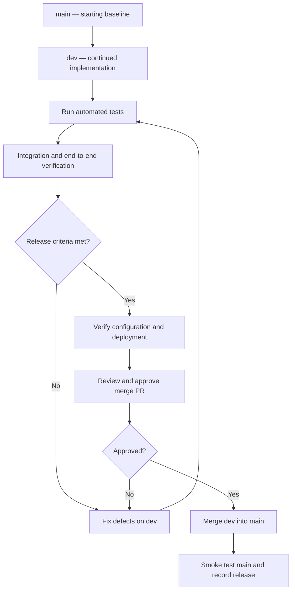

# CareerCrew — Product Draft v0.1

## 1. Recommended Next Steps

1. Inspect the current `dev` implementation and classify each requirement as **Implemented**, **Partially implemented**, **Missing**, or **Not verified**.
2. Verify the agent/task contracts, orchestration sequence, input/output schemas, and guardrails against code.
3. Create a requirements-to-tests traceability matrix.
4. Run existing tests and add tests for critical success and failure paths.
5. Revise the architecture diagram to show only verified components and real control/data flows.
6. Separate current behavior from planned behavior in the documentation.
7. Merge `dev` into `main` only after the agreed release gates pass.

## 2. Open Questions for Review

- Which input methods and file types are actually supported today?
- Is job-description URL ingestion implemented and tested?
- Which agent roles are active in the current pipeline, and what are their exact output schemas?
- What output validation is enforced programmatically versus described in prompts?
- What human-review actions are available in the current UI?
- Which artifacts are persisted, where, and for how long?
- Which mock-interview and coaching paths are fully functional?
- What are the current test results and known failure modes?
- What measurable success thresholds should be adopted after establishing a baseline?

---

**Draft status reminder:** This document is a proposed product and engineering baseline. Do not treat a feature, guardrail, quality attribute, or architecture connection as implemented until it is confirmed in the repository and supported by appropriate tests or other verification evidence.
