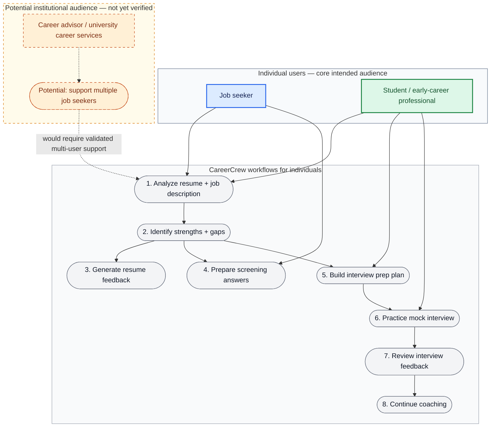
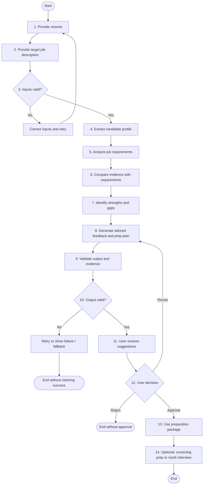
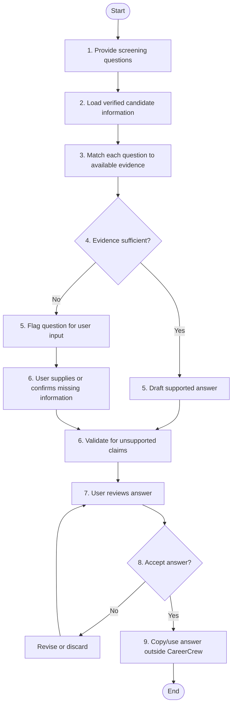
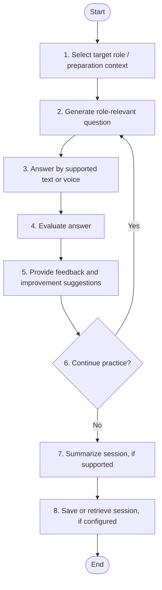
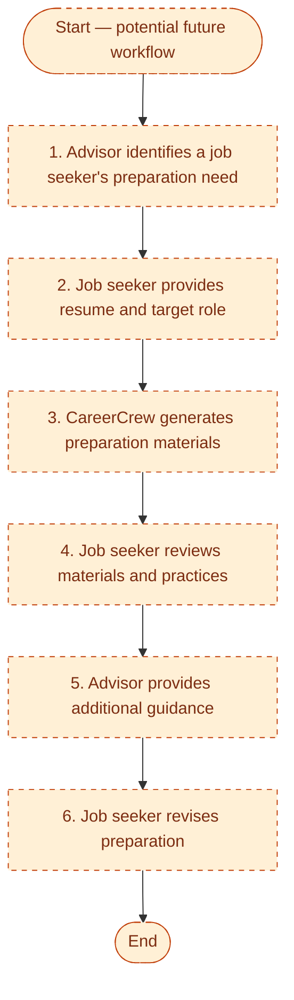
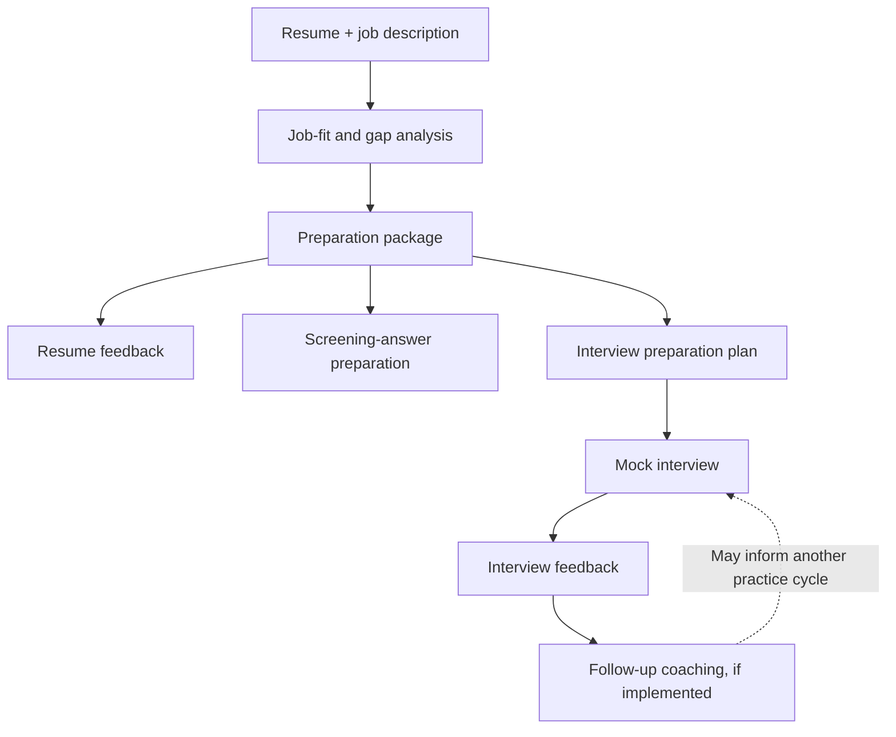
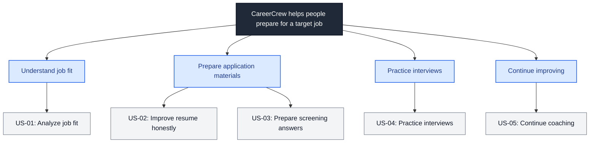

## 3. Use Cases

These diagrams present the intended use cases at a glance. They are **product-level drafts**; confirm which actions are implemented in `dev` before treating them as verified functionality.

### 3.1 Use-case overview by user group

**How to read this diagram**
- **Blue:** job seekers.
- **Green:** students and early-career professionals.
- **Grey:** individual CareerCrew workflows that these users can access; the arrows indicate example entry points, not exclusive permissions.
- **Orange dashed:** the potential career-advisor/institutional use case, which is not confirmed as implemented.

> **Audience note:** The job seeker and student/early-career workflows align with the individual-preparation concept. Career advisors and university career services are a potential institutional audience; multi-user or advisor-specific functionality needs validation before it is presented as an existing feature.

### 3.2 UC-01 — Prepare for a target job

**Actor:** Job seeker  
**Outcome:** A reviewed preparation package grounded in the user's supplied experience, when the workflow succeeds.  
**Boundary:** CareerCrew prepares the user; it does not submit an application.

### 3.3 UC-02 — Prepare employer screening answers

**Actor:** Job seeker  
**Outcome:** Screening-answer drafts the user can review and use.  
**Guardrail:** Never invent personal facts or submit answers to an employer.

### 3.4 UC-03 — Practice for an interview

**Actor:** Job seeker or student/early-career professional  
**Outcome:** Practice and actionable feedback where the relevant interview workflow is implemented.  
**Implementation check:** Confirm voice support, evaluation format, session summaries, and persistence in `dev`.

### 3.5 UC-04 — Career advisor supports job seekers (potential use case)

**Actor:** Career advisor or university career-services staff  
**Status:** This diagram captures a possible future workflow, **not a claim that advisor accounts, multi-user management, or advisor dashboards currently exist**. Validate this audience and its needs before adding it to the implemented feature set.

### 3.6 Use-case relationships at a glance

### Use-case verification checklist

- [ ] Confirm resume and job-description input methods and file formats.
- [ ] Confirm the actual analysis steps and output schemas.
- [ ] Confirm whether users can approve, revise, or reject suggestions in the current UI.
- [ ] Confirm screening-answer preparation and its evidence guardrails.
- [ ] Confirm text and voice mock-interview paths and evaluation outputs.
- [ ] Confirm coaching and session-history persistence.
- [ ] Treat advisor/multi-user support as future scope unless code proves otherwise.

## 4. User Stories and Acceptance Criteria

The user stories below are grouped by the user outcome. Each story uses the familiar format **As a [user], I want [capability], so that [benefit]**. Acceptance criteria describe how the story can be verified; they are proposed until checked against the implementation.

### User story map

### US-01 — Analyze job fit

<box>
**As a** job seeker, **I want** to compare my resume with a job description, **so that** I can understand my strengths and gaps for the role.

**Acceptance criteria**
- [ ] The system produces a structured candidate profile and job-requirements representation when inputs are valid.
- [ ] Each assessed requirement has a clear coverage classification and supporting evidence, where supported.
- [ ] Missing experience is not presented as established candidate experience.
- [ ] Invalid or incomplete inputs produce an actionable error or recovery path.
</box>

### US-02 — Improve my resume honestly

<box>
**As a** job seeker or early-career professional, **I want** tailored resume feedback and talking points, **so that** I can present relevant experience clearly without misrepresenting it.

**Acceptance criteria**
- [ ] Suggestions are tailored to the target job description.
- [ ] Factual suggestions can be traced to information supplied by the user.
- [ ] Unsupported claims are excluded or explicitly flagged.
- [ ] The user can review, revise, or reject suggestions.
</box>

### US-03 — Prepare screening answers

<box>
**As a** job seeker, **I want** help preparing answers to employer screening questions, **so that** I can respond consistently using verified information about myself.

**Acceptance criteria**
- [ ] Supported answers are drafted from a verified answer bank or other user-provided evidence.
- [ ] Questions that require unknown personal facts are flagged for user input.
- [ ] The system does not invent work authorization, notice period, location, salary, or other personal facts.
- [ ] CareerCrew does not submit the answers to the employer.
</box>

### US-04 — Practice interviews

<box>
**As a** job seeker or student/early-career professional, **I want** to practice role-specific interview questions and receive feedback, **so that** I can improve my answers before an interview.

**Acceptance criteria**
- [ ] Questions are relevant to the target role and available preparation context.
- [ ] Each answer receives actionable feedback where the evaluation workflow supports it.
- [ ] The session provides an understandable summary or evaluation when supported.
- [ ] If voice is unavailable, a supported text path remains usable where implemented.
</box>

### US-05 — Continue coaching over time

<box>
**As a** job seeker, **I want** coaching to use relevant preparation and practice history, **so that** follow-up advice builds on prior work.

**Acceptance criteria**
- [ ] Relevant prior context is available to the coaching workflow where implemented.
- [ ] The system distinguishes supplied evidence from uncertainty.
- [ ] Stored sessions can be retrieved after restart if persistence is part of the configured implementation.
- [ ] Persistence failures are surfaced rather than represented as successful saves.
</box>

### Optional institutional story — Support multiple job seekers

This is a **potential future story**, not a confirmed current capability.

**As a** career advisor or university career-services staff member, **I want** to help multiple job seekers organize their preparation, **so that** I can support them consistently.

Possible acceptance criteria to validate with intended users:
- [ ] The advisor can access only the job-seeker information they are authorized to see.
- [ ] Each job seeker's preparation materials and sessions remain separated.
- [ ] The advisor can review progress without silently changing or submitting materials on the job seeker's behalf.
- [ ] Privacy, consent, access control, and retention rules are defined before implementation.

